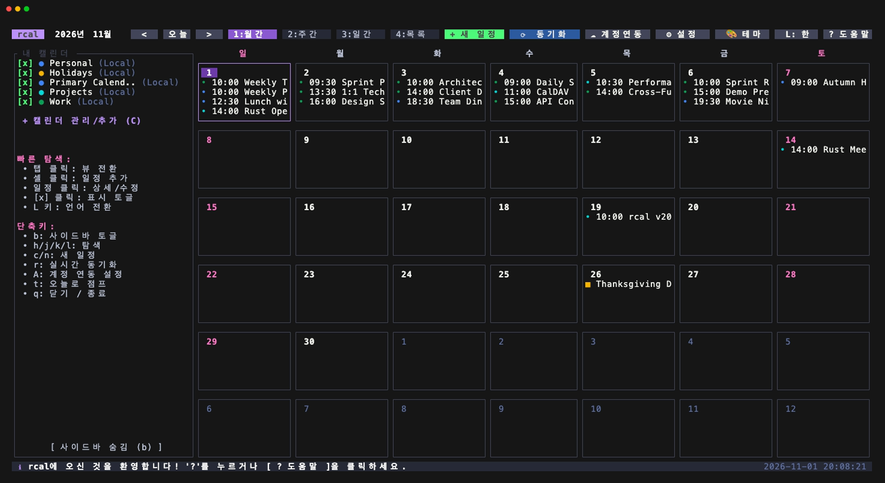
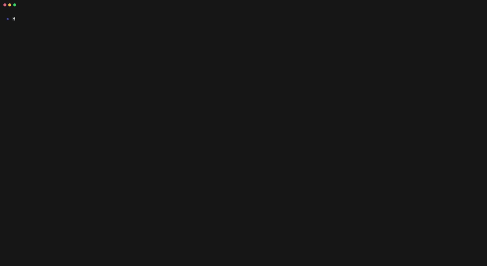
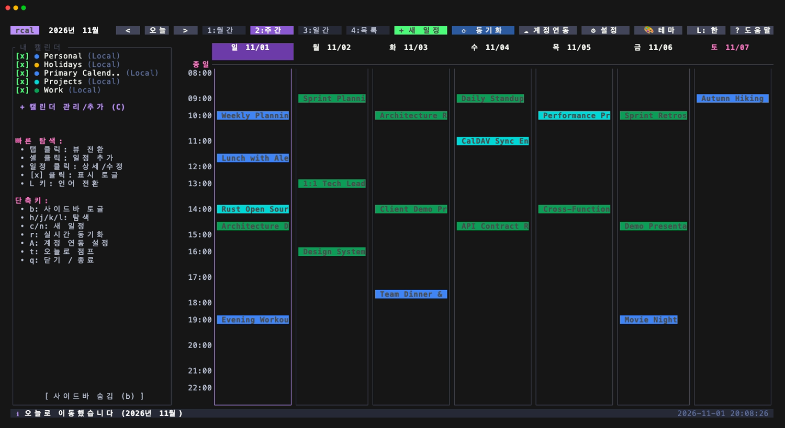
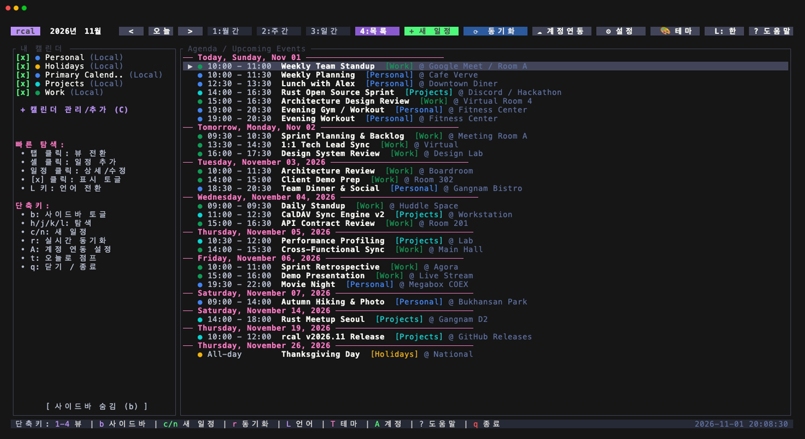
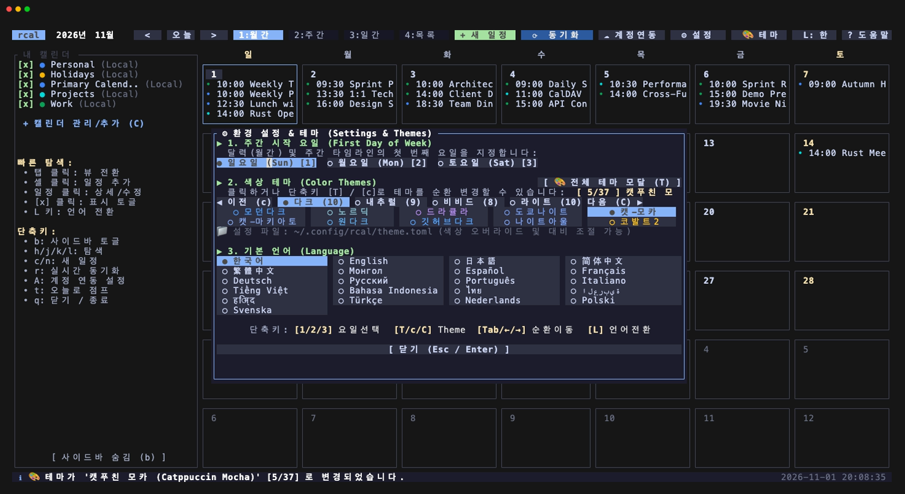
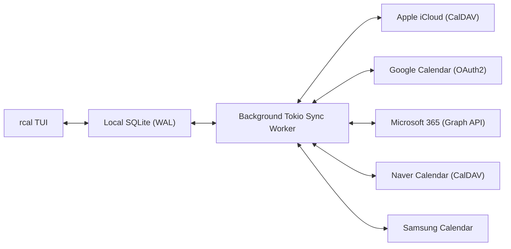
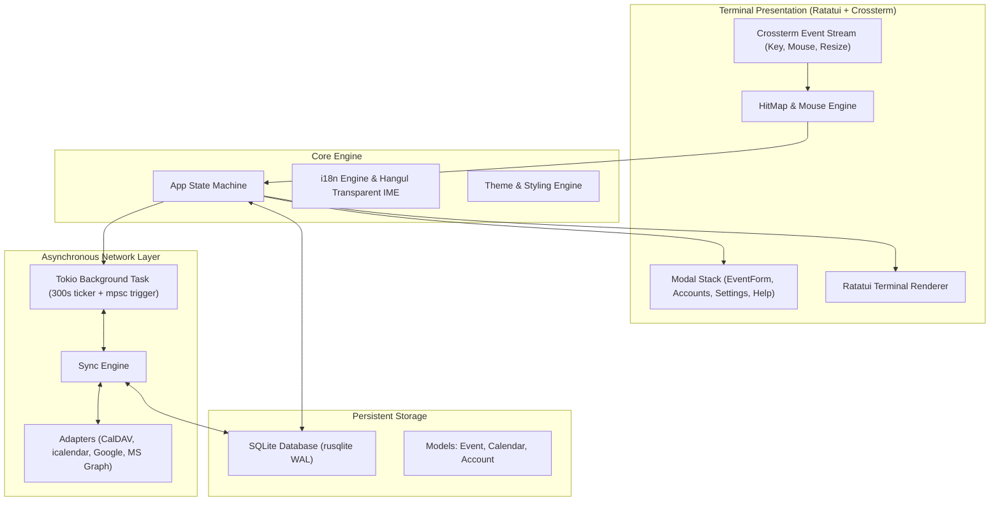

<div align="center">

```
  ██████╗  ██████╗ █████╗ ██╗     
  ██╔══██╗██╔════╝██╔══██╗██║     
  ██████╔╝██║     ███████║██║     
  ██╔══██╗██║     ██╔══██║██║     
  ██║  ██║╚██████╗██║  ██║███████╗
  ╚═╝  ╚═╝ ╚═════╝╚═╝  ╚═╝╚══════╝
```

### **Fast, Modern, Mouse-interactive Terminal Calendar in Rust with Multi-Cloud Sync**

[](https://github.com/eeyees/rcal/actions/workflows/ci.yml)
[](https://www.rust-lang.org)
[](LICENSE)
[](https://github.com/eeyees/rcal)
[](https://github.com/ratatui/ratatui)
[](https://www.sqlite.org)
[](https://tokio.rs)

<p align="center">
  
</p>

<p align="center">
  🌐 <strong>Languages / 다국어 / 语言 / 言語 / Idiomas:</strong><br>
  <strong>English</strong> •
  <a href="./docs/locales/README.ko.md">한국어</a> •
  <a href="./docs/locales/README.zh-CN.md">简体中文</a> •
  <a href="./docs/locales/README.zh-TW.md">繁體中文</a> •
  <a href="./docs/locales/README.ja.md">日本語</a> •
  <a href="./docs/locales/README.es.md">Español</a> •
  <a href="./docs/locales/README.fr.md">Français</a> •
  <a href="./docs/locales/README.de.md">Deutsch</a> •
  <a href="./docs/locales/README.pt-BR.md">Português</a> •
  <a href="./docs/locales/README.ru.md">Русский</a> •
  <a href="./docs/locales/README.it.md">Italiano</a> •<br>
  <a href="./docs/locales/README.id.md">Bahasa Indonesia</a> •
  <a href="./docs/locales/README.vi.md">Tiếng Việt</a> •
  <a href="./docs/locales/README.tr.md">Türkçe</a> •
  <a href="./docs/locales/README.pl.md">Polski</a> •
  <a href="./docs/locales/README.nl.md">Nederlands</a> •
  <a href="./docs/locales/README.ar.md">العربية</a> •
  <a href="./docs/locales/README.hi.md">हिन्दी</a> •
  <a href="./docs/locales/README.bn.md">বাংলা</a> •
  <a href="./docs/locales/README.sv.md">Svenska</a> •
  <a href="./docs/locales/README.uk.md">Українська</a> •
  <a href="./docs/locales/README.th.md">ภาษาไทย</a>
</p>

<p align="center">
  <a href="#-key-features">Key Features</a> •
  <a href="#-ui-views--showcase">UI Views & Showcase</a> •
  <a href="#-keyboard--mouse-controls">Controls</a> •
  <a href="#-multi-cloud--caldav-sync">Cloud Sync</a> •
  <a href="#-themes--customization">Themes</a> •
  <a href="#-installation">Installation</a> •
  <a href="#-architecture">Architecture</a>
</p>

---

</div>

`rcal` is a lightweight, responsive TUI calendar designed for developers, terminal enthusiasts, and power users who want the visual clarity and ease-of-use of Google Calendar directly in their terminal with **zero lag**, **100% mouse interactivity**, and **seamless multi-cloud synchronization**.

---

## ✨ Key Features

- ⚡ **Zero-Lag Offline-First Architecture**: Instant sub-millisecond startup backed by an embedded SQLite database running in WAL (*Write-Ahead Logging*) mode.
- 🖱️ **Full Mouse Interactivity**:
  - Click view tabs (`[ 1:Month ]`, `[ 2:Week ]`, `[ 3:Day ]`, `[ 4:Agenda ]`) or header buttons (`[ < ]`, `[ Today ]`, `[ > ]`, `[ ⟳ Sync ]`).
  - Click any day cell in Month view to select; double-click to drill down into Day view.
  - Click any hour slot in Week or Day view to quickly draft an event.
  - Click event blocks to open interactive details and edit modal.
  - Mouse wheel scrolling across days and calendar timelines.
- 📅 **4 Familiar, High-Density Views**:
  - **Month View**: 7-column calendar layout with event badges, today highlights, and date indicators.
  - **Week View**: Sunday–Saturday (or Monday/Saturday start) timeline with hourly slots and colored event rectangles.
  - **Day View**: High-precision single-day schedule with intelligent side-by-side positioning for concurrent/overlapping events.
  - **Agenda View**: Chronological upcoming event stream grouped by date.
- ☁️ **Multi-Cloud & CalDAV Sync Engine**:
  - **Apple iCloud**: Native two-way CalDAV synchronization.
  - **Naver Calendar**: CalDAV sync integration with auto-discovery.
  - **Google Calendar**: Google API OAuth2 adapter.
  - **Microsoft 365 / Outlook**: Microsoft Graph API OAuth2 engine.
  - **Samsung Calendar**: Cloud adapter integration.
  - **Background Worker**: Dedicated Tokio background task syncing silently every 5 minutes or on-demand without freezing the UI.
- ⌨️ **Vim Navigation & Transparent Korean IME Handling**:
  - Classic `h` / `j` / `k` / `l` navigation, tab switching, and modal controls.
  - **Transparent IME Translation**: Use Vim shortcuts seamlessly even when typing with Korean (`ㅗ/ㅓ/ㅏ/ㅣ`) input mode active without annoying terminal beeps or missed keystrokes.
- 🌐 **Native Multi-Language (i18n) Support**:
  - Automatic system locale detection (`LANG` / `LC_ALL`).
  - Runtime 1-key language toggle between **한국어 (Korean)** and **English** with `L` or mouse click.
  - Localized dates, day names, modals, forms, and status notifications.
- 🎨 **Rich Themes & Customization**:
  - 37 Curated color palettes: **Modern Dark**, **Nord**, **Dracula**, **Tokyo Night**, **Catppuccin**, **Gruvbox**, **One Dark**, **GitHub Dark/Light**, **Kanagawa**, **Everforest**, **Rose Pine**, and more across 4 categories (Dark, Nature, Vibrant, Light).
  - Configurable `theme.toml` for fine-tuning any color, high-contrast boost, and custom themes.
  - Configurable week start day: **Sunday**, **Monday**, or **Saturday**.
  - Custom calendar creation with color tags (`Personal`, `Work`, `Holidays`, etc.).

---

## 🖥️ UI Views & Showcase

### 🎬 Interactive Live Demo

<p align="center">
  
</p>

### 📸 High-Resolution Screenshot Gallery

| 📅 **Month View (Hero)** | ⏱️ **Week View (Hourly Schedule)** |
| :---: | :---: |
| [](./assets/screenshot.png) | [](./assets/week_view.png) |
| *7-column monthly overview with calendar color badges, quick sidebar navigation & status line* | *Hourly timeline with intelligent side-by-side positioning for concurrent/overlapping events* |
| 📋 **Agenda View (Chronological)** | 🎨 **Themes & Settings Modal (Catppuccin)** |
| [](./assets/agenda_view.png) | [](./assets/theme_modal.png) |
| *Upcoming agenda stream grouped by date with category badges and location indicators* | *Instant theme cycler across 37 palettes, week start day picker, and runtime language selector* |

<details>
<summary><b>🔍 Click to view ASCII Terminal Text Preview</b></summary>

```
┌── rcal v2026.11.01.1 ─────────────────────────────────────────────── [ L: 한/EN ] [ ? Help ] [ ⚙ Settings ] ──┐
│ [ 1:Month ] [ 2:Week ] [ 3:Day ] [ 4:Agenda ]    [ < ] [ Today ] [ > ]  2026-11-01 (Sun)   [ ⟳ Sync ]  │
├────────────────────┬───────────────────────────────────────────────────────────────────────────────────┤
│ Calendars          │                             November 2026                                         │
│ [x] ■ Personal     │  Sun         Mon         Tue         Wed         Thu         Fri         Sat      │
│ [x] ■ Work         │ ┌───────────┬───────────┬───────────┬───────────┬───────────┬───────────┬───────────┐ │
│ [x] ■ Holidays     │ │ 1  TODAY  │ 2         │ 3         │ 4         │ 5         │ 6         │ 7         │ │
│                    │ │■ 10:00 AM │■ 09:00 AM │           │■ 14:00 PM │           │■ 19:00 PM │           │ │
│ Accounts           │ │  Sprint   │  Standup  │           │  Design   │           │  Dinner   │           │ │
│ • iCloud (Syncing) │ ├───────────┼───────────┼───────────┼───────────┼───────────┼───────────┼───────────┤ │
│ • Google (Active)  │ │ 8         │ 9         │ 10        │ 11        │ 12        │ 13        │ 14        │ │
│                    │ │           │           │           │           │           │           │           │ │
├────────────────────┴───────────────────────────────────────────────────────────────────────────────────┤
│ [c] New Event  [m/w/d/a] Switch View  [h/j/k/l] Navigate  [/] Search  [a] Accounts  [s] Settings  [q] Quit │
└────────────────────────────────────────────────────────────────────────────────────────────────────────┘
```

</details>

---

## ⌨️ Keyboard & Mouse Controls

### 🧭 Navigation & Views

| Keybinding | Mouse Action | Description |
| :--- | :--- | :--- |
| `h` / `j` / `k` / `l` or Arrows | Click date cell / time slot | Move focus Left / Down / Up / Right |
| `1` or `m` | Click `[ 1:Month ]` tab | Switch to **Month View** |
| `2` or `w` | Click `[ 2:Week ]` tab | Switch to **Week View** |
| `3` or `d` | Click `[ 3:Day ]` tab | Switch to **Day View** |
| `4` or `a` | Click `[ 4:Agenda ]` tab | Switch to **Agenda View** |
| `t` | Click `[ Today ]` button | Jump cursor to Today |
| `[` / `]` | Click `[ < ]` / `[ > ]` buttons | Previous / Next period (Month / Week / Day) |
| Scroll Up / Down | Mouse Wheel | Scroll timeline or cycle through dates |
| Double-Click | Double-Click on day cell | Drill down directly from Month view into Day view |

### 📝 Events & Modal Management

| Keybinding | Mouse Action | Description |
| :--- | :--- | :--- |
| `c` or `n` | Click `[ + New ]` / empty slot | Create new event form modal |
| `Enter` | Click on event box | Open selected event details modal |
| `e` | Click `[ Edit ]` button | Edit event |
| `x` or `Delete` | Click `[ Delete ]` button | Delete selected event |
| `Tab` / `Shift+Tab` | Click form field / button | Cycle between input fields and buttons |
| `Esc` or `q` | Click `[ Close ]` / outside backdrop | Close active modal |

### ⚙️ System & Customization

| Keybinding | Mouse Action | Description |
| :--- | :--- | :--- |
| `T` | Click `[ 🎨 테마 ]` in header | Open Theme Selection Modal (37 palettes with color swatches & categories) |
| `L` | Click `[ L: 한/EN/日 ]` | Cycle language (Korean ↔ English ↔ Japanese) |
| `s` | Click `[ ⚙ Settings ]` | Open Settings Modal (Week start day, themes, language) |
| `a` | Click Accounts in sidebar | Open Cloud Accounts Manager Modal |
| `b` | Click sidebar toggle | Toggle sidebar visibility |
| `r` | Click `[ ⟳ Sync ]` | Trigger immediate background cloud sync |
| `?` | Click `[ ? Help ]` | Toggle keyboard shortcuts cheat sheet |
| `Ctrl+C` / `q` | - | Quit `rcal` safely |

---

## ☁️ Multi-Cloud & CalDAV Sync

`rcal` includes built-in sync adapters designed to keep your terminal schedule in sync with all your devices.



### Supported Providers

- **Apple iCloud**: Connect with your Apple ID and an App-Specific Password via CalDAV.
- **Naver Calendar**: Connect using Naver CalDAV (`https://caldav.calendar.naver.com:443/caldav/`) and 2-step verification app password.
- **Google Calendar**: Secure token exchange via Google Cloud OAuth2 credentials.
- **Microsoft 365 / Outlook**: Enterprise and personal Outlook calendar sync via Microsoft Graph REST endpoints.
- **Samsung Calendar**: Samsung Cloud account integration.

To configure your accounts, press `a` inside `rcal` or select the **Accounts** menu in the sidebar.

---

## 🎨 Themes & Customization

Cycle themes quickly anytime by pressing **`T`** (`Shift+T`), or press **`s`** to open the **Settings Modal** to click and select from **37 rich color palettes**:

### 37 Curated Color Palettes (4 Categories)

#### 1. 🌙 Dark Modern & Classic (10 Themes)
- **Modern Dark**: Clean minimalist default terminal aesthetic
- **Nord**: Arctic snow storm & frost cyan (`#88C0D0`)
- **Dracula**: High-contrast violet (`#BD93F9`) & neon pink
- **Tokyo Night**: Vibrant midnight blue cyberpunk (`#7AA2F7`)
- **Catppuccin Mocha**: Cozy deep dark pastel base (`#1E1E2E`)
- **Catppuccin Macchiato**: Medium-contrast dusky pastel (`#24273A`)
- **One Dark**: Atom / VS Code iconic editor palette (`#282C34`)
- **GitHub Dark**: Official GitHub dark mode contrast (`#161B22`)
- **Night Owl**: Sarah Drasner's deeply tuned midnight theme (`#011627`)
- **Cobalt2**: Wes Bos's punchy cobalt blue & bright yellow (`#19354E`)

#### 2. 🌲 Nature, Earthy & Atmospheric (9 Themes)
- **Forest**: Organic sage green & earthy matcha tones
- **Everforest Dark**: Calming natural woodland green (`#2D353B`)
- **Kanagawa**: Inspired by Japanese woodblock print sumi-e ink (`#1F1F28`)
- **Rose Pine**: Soho dusky dark with muted rose & pine (`#191724`)
- **Rose Pine Moon**: Cooler Soho midnight dusk (`#232136`)
- **Material Palenight**: Deep indigo material elegance (`#292D3E`)
- **Gruvbox Dark**: Warm retro groove brown & gold (`#282828`)
- **Ayu Dark**: Minimalist charcoal slate with glowing orange (`#0F1419`)
- **Catppuccin Frappé**: Soothing twilight pastel (`#303446`)

#### 3. 🌆 Vibrant, Cyberpunk & Retro (8 Themes)
- **Sunset**: Electric cyberpunk purple & warm amber
- **Monokai**: Classic vibrant gold, green & coral red
- **Cyberpunk Neon**: Pitch black with high-voltage cyan & hot pink
- **Synthwave '84**: Radical 80s neon gradient glow (`#262335`)
- **Matrix**: Phosphor green CRT terminal hacker vibe
- **Ayu Mirage**: Balanced mid-tone twilight slate blue (`#1F2430`)
- **Tokyo Night Storm**: Lighter atmospheric blue storm (`#24283B`)
- **Solarized Dark**: Low-contrast precision dark teal (`#002B36`)

#### 4. ☀️ Clean Light Themes (10 Themes)
- **Solarized Light**: Classic warm parchment reading contrast (`#FDF6E3`)
- **Catppuccin Latte**: Crisp, clean light pastel (`#EFF1F5`)
- **Tokyo Night Light**: Soft morning light Japanese aesthetic
- **Gruvbox Light**: Retro warm groove parchment (`#FBF1C7`)
- **One Light**: Atom clean day mode (`#FAFAFA`)
- **GitHub Light**: Official GitHub crisp white day mode (`#FFFFFF`)
- **Rose Pine Dawn**: Vintage newspaper & dusty rose light (`#FAF4ED`)
- **Everforest Light**: Gentle morning paper warm green (`#FDF6E3`)
- **Light Owl**: High-legibility day reading theme (`#F0F0F0`)
- **Ayu Light**: Bright warm sand paper theme (`#FAFAFA`)

---

### ⚙️ Theme Configuration File (`theme.toml`)

`rcal` automatically generates and manages a configuration file located at:
- **macOS / Linux**: `~/.config/rcal/theme.toml`
- **Windows**: `%APPDATA%\rcal\theme.toml`

#### 1. Visibility & Contrast Adjustments
If certain text, borders, or dates are hard to read on your specific terminal emulator or monitor, toggle visibility options:

```toml
[options]
# Force solid opaque background (avoids contrast loss on transparent terminal windows)
force_opaque_bg = false

# High-contrast mode: sharpens borders and boosts text brightness
high_contrast = false

# Boost muted text: brightens secondary dates, shortcut hints, and dimmed hours
boost_muted_text = false
```

#### 2. Per-Theme Color Overrides
You can fine-tune any color in any theme using Hex (`#RRGGBB`) or RGB (`rgb(r, g, b)`):

```toml
[themes.tokyo_night]
border = "#7aa2f7"
text_muted = "#9aa5ce"
today_bg = "#3d59a1"

[themes.github_light]
text_normal = "#1f2328"
border = "#d0d7de"
```

#### 3. Custom User Themes
You can also define your own custom theme and select it inside `rcal`:

```toml
[[custom_themes]]
id = "my_custom"
name = "My Custom Studio"
is_light = false
panel_bg = "#1e1e2e"
border = "#45475a"
border_focused = "#89b4fa"
primary = "#89b4fa"
secondary = "#a6e3a1"
accent = "#f9e2af"
danger = "#f38ba8"
text_normal = "#cdd6f4"
text_muted = "#a6adc8"
text_dim = "#6c7086"
text_highlight = "#ffffff"
today_bg = "#313244"
selected_bg = "#45475a"
tab_active_bg = "#89b4fa"
tab_inactive_bg = "#181825"
button_bg = "#313244"
button_fg = "#cdd6f4"
```

### Week Start Preference
Choose whether your week starts on **Sunday**, **Monday**, or **Saturday** based on your cultural or regional workflow.

---

## 🏗️ Architecture



---

## 🚀 Installation

### Prerequisites

- [Rust 1.80+](https://www.rust-lang.org/tools/install) (`cargo` & `rustup`)

### Build from Source

```bash
# Clone the repository
git clone https://github.com/eeyees/rcal.git
cd rcal

# Build optimized release binary
cargo build --release

# Run rcal
./target/release/rcal
```

### Install Globally via Cargo

```bash
cargo install --path .
rcal
```

### Data Storage Location

- **macOS**: `~/Library/Application Support/rcal/rcal.db`
- **Linux**: `~/.local/share/rcal/rcal.db`
- **Windows**: `%LOCALAPPDATA%\rcal\rcal.db`

---

## 🗺️ Development Roadmap

- [x] **Phase 1: Local TUI MVP**
  - Month, Week, Day (with overlap detection), and Agenda views
  - 100% Mouse hit-testing engine
  - Embedded SQLite WAL database persistence
  - Event CRUD modal with full validation
- [x] **Phase 2: CalDAV Synchronization**
  - Apple iCloud two-way sync
  - Naver Calendar two-way sync
  - Background Tokio sync worker & auto-interval ticker
  - Account configuration UI
- [x] **Phase 3: Multi-Cloud Adapters & Polishing**
  - Google Calendar OAuth2 engine
  - Microsoft 365 Graph API adapter
  - Samsung Calendar adapter
  - Transparent Korean IME navigation mapping
  - Multiple color themes and week start day settings
- [ ] **Phase 4: Ecosystem & Extensibility**
  - [ ] Model Context Protocol (MCP) server support for AI agents
  - [ ] WebCal / iCalendar (`.ics`) local HTTP subscription server
  - [ ] Recurrence rules (RFC 5545 RRULE support)
  - [ ] Natural language event entry (e.g., `rcal add "Lunch tomorrow at 12pm"`)
  - [ ] Native OS notifications for upcoming events

---

## 🤝 Contributing

Contributions, issues, and feature requests are welcome!  
Feel free to check out the [issues page](https://github.com/eeyees/rcal/issues).

1. Fork the Project
2. Create your Feature Branch (`git checkout -b feat/AmazingFeature`)
3. Commit your Changes (`git commit -m 'feat: Add some AmazingFeature'`)
4. Push to the Branch (`git push origin feat/AmazingFeature`)
5. Open a Pull Request

---

## 📜 License

Distributed under the **MIT License**. See `LICENSE` for more information.
