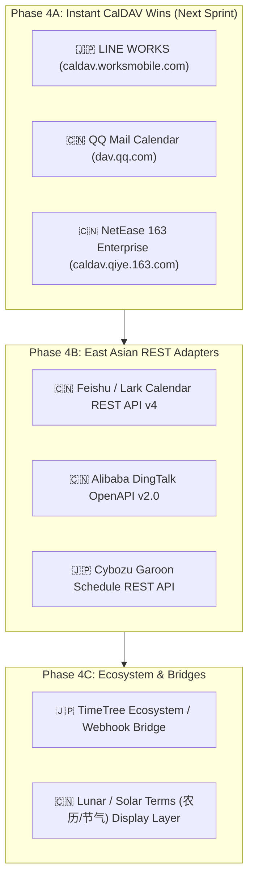

# East Asian Cloud Calendar Integration Plan (Japan & China)

This document provides a comprehensive market analysis, protocol compatibility study, and actionable implementation roadmap for integrating the most widely used calendar services in **Japan (🇯🇵)** and **China (🇨🇳)** into `rcal`.

---

## 1. Executive Summary

| Country | Calendar Provider | Dominant User Base | Primary Protocol | Integration Feasibility in `rcal` | Priority |
| :---: | :--- | :--- | :--- | :---: | :---: |
| 🇯🇵 Japan | **LINE WORKS** | Enterprise, SMB, Retail & On-site | **CalDAV** (RFC 4791) & REST API | **Immediate (Native CalDAV)** | **P1 (High)** |
| 🇯🇵 Japan | **Cybozu Garoon / Office** | Enterprise & Public Sector #1 | REST API / iCal (`.ics`) | Medium (REST adapter required) | **P2 (Mid)** |
| 🇯🇵 Japan | **TimeTree** | Couples, Families, Groups (70M users) | Closed (Legacy REST retired) | Low (Awaiting API reopening / iCal bridge) | **P3 (Eval)** |
| 🇯🇵 Japan | **Yahoo! JAPAN / LINE** | Consumer portal users | Mobile OS bridge (CalDAV ended 2021) | Low (API closed) | **P3 (Eval)** |
| 🇨🇳 China | **Tencent QQ Mail Calendar (QQ邮箱)** | Consumer & personal (#1 mail) | **CalDAV** (RFC 4791) | **Immediate (Native CalDAV)** | **P1 (High)** |
| 🇨🇳 China | **ByteDance Feishu / Lark (飞书)** | Tech, IT, Startups, Global Enterprises | **Open Platform REST API v4** | High (Robust modern REST client) | **P1 (High)** |
| 🇨🇳 China | **Alibaba DingTalk (钉钉)** | Enterprise #1 (Hundreds of millions MAU) | DingTalk OpenAPI v2.0 | Medium (Enterprise App credentials) | **P2 (Mid)** |
| 🇨🇳 China | **NetEase 163 Enterprise Mail (网易)** | Business & Enterprise mail | **CalDAV** (RFC 4791) | **Immediate (Native CalDAV)** | **P2 (Mid)** |
| 🇨🇳 China | **Tencent WeCom (企业微信)** | Enterprise & WeChat ecosystem CRM | WeCom Open API | Medium (Corpid / Secret API) | **P2 (Mid)** |

---

## 2. Japan (🇯🇵) Calendar Analysis & Integration Tasks

### 2.1 LINE WORKS (ラインワークス) — **Priority: P1**
- **Overview**: Operated by WORKS MOBILE (NAVER affiliate), LINE WORKS is the **#1 business messaging and groupware platform in Japan**, extensively used across SMBs, logistics, retail, and enterprises.
- **Protocol & Endpoint**:
  - **CalDAV Server**: `https://caldav.worksmobile.com` (Port `443`)
  - **Authentication**: LINE WORKS ID (`username@domain.com`) + External App Password generated from user settings.
  - **Compatibility**: 100% compatible with RFC 4791. Can plug directly into `rcal`'s existing `CalDavClient`.
- **Tasks**:
  - [ ] Add `ProviderType::LineWorks` preset into `src/model/mod.rs` and account modal preset list.
  - [ ] Pre-populate endpoint `https://caldav.worksmobile.com/` in account manager.
  - [ ] Support localized error messages and help guide for generating app passwords in LINE WORKS admin/user portal.

### 2.2 Cybozu Garoon & Office (サイボウズ ガルーン / オフィス) — **Priority: P2**
- **Overview**: Cybozu is the traditional and undisputed enterprise groupware market leader in Japanese corporate offices and government organizations.
- **Protocol & Endpoint**:
  - **Garoon REST API**: Cybozu Developer Network provides schedule REST APIs for reading/creating/updating events.
  - **iCal Subscription**: Garoon provides private `.ics` export/subscription URLs.
- **Tasks**:
  - [ ] Implement `src/sync/cybozu.rs` REST API client with OAuth2 or password-based token authentication.
  - [ ] Provide one-click iCalendar URL subscription fallback (`webcal://` or `https://`).

### 2.3 TimeTree (タイムツリー) — **Priority: P3**
- **Overview**: Over 70 million cumulative users worldwide; the #1 shared calendar app for Japanese families, couples, and small teams.
- **Status & Technical Challenges**:
  - TimeTree officially deprecated and closed its public developer platform (Connect App / Personal Access Token API) in recent years.
  - Does not offer open CalDAV server endpoints.
- **Tasks**:
  - [ ] Monitor TimeTree Developer relations for future API or Webhook relaunch.
  - [ ] Support importing/exporting shared `.ics` calendars if community bridge tools or URL feeds become available.

---

## 3. China (🇨🇳) Calendar Analysis & Integration Tasks

### 3.1 Tencent QQ Mail Calendar (QQ邮箱 日历) — **Priority: P1**
- **Overview**: Tencent QQ Mail is China's largest consumer webmail and calendar provider, bundled with QQ and WeChat identity.
- **Protocol & Endpoint**:
  - **CalDAV Server**: `https://dav.qq.com` (Port `443`, SSL)
  - **Authentication**: Full QQ email address (`user@qq.com`) + 16-character dedicated CalDAV authorization code (授权码) obtained from QQ Mail account security settings.
  - **Compatibility**: Standard CalDAV (RFC 4791) auto-discovery supported. Directly usable with `rcal`'s `CalDavClient`.
- **Tasks**:
  - [ ] Add `ProviderType::QqMail` preset into `src/model/mod.rs` and `AccountModalState`.
  - [ ] Pre-populate endpoint `https://dav.qq.com` with port 443.
  - [ ] Add Chinese i18n instructions informing users to generate a 16-character authorization code (`授权码`) instead of their regular password.

### 3.2 ByteDance Feishu / Lark (飞书 日历) — **Priority: P1**
- **Overview**: ByteDance's modern workplace collaboration suite. Dominates China's tech companies, internet giants, gaming studios, and global teams.
- **Protocol & Endpoint**:
  - **Feishu Open Platform REST API v4**:
    - Endpoint: `https://open.feishu.cn/open-apis/calendar/v4/calendars` (China) / `https://open.larksuite.com/open-apis/calendar/v4/calendars` (Global Lark)
    - Full two-way CRUD for calendar list, primary calendar events, attendees, meeting rooms, and recurrence rules.
    - Authentication: User Access Token (OAuth2) or Tenant Access Token.
- **Tasks**:
  - [ ] Create `src/sync/feishu.rs` implementing `FeishuCalendarClient`.
  - [ ] Add Feishu / Lark app credential configuration (App ID + App Secret).
  - [ ] Support event sync and attendee status parsing.

### 3.3 Alibaba DingTalk (钉钉 日历) — **Priority: P2**
- **Overview**: China's #1 enterprise collaboration platform with hundreds of millions of users across manufacturing, education, and enterprise.
- **Protocol & Endpoint**:
  - **DingTalk OpenAPI v2.0**: Schedule API (`/v1.0/calendar/users/{userId}/calendars/{calendarId}/events`).
- **Tasks**:
  - [ ] Create `src/sync/dingtalk.rs` REST adapter.
  - [ ] Integrate DingTalk OAuth2 user authorization flow.

### 3.4 NetEase 163 Enterprise Mail (网易企业邮箱 日历) — **Priority: P2**
- **Overview**: One of China's most trusted corporate email and schedule solutions.
- **Protocol & Endpoint**:
  - **CalDAV Server**: `https://caldav.qiye.163.com` or `https://caldavhz.qiye.163.com`.
  - **Authentication**: Corporate email account + client authorization password.
- **Tasks**:
  - [ ] Provide 163 Enterprise Mail preset in account modal.

---

## 4. Implementation Phasing & Roadmap

### Phase 4A: Instant CalDAV Wins
Because `rcal` already possesses a production-grade RFC 4791 CalDAV synchronization engine with auto-discovery, **LINE WORKS**, **QQ Mail**, and **163 Enterprise Mail** can be delivered with minimal new code by creating presets in the account modal and handling service-specific URL discovery.

### Phase 4B: East Asian REST Adapters
Develop native HTTP REST clients for Feishu / Lark, DingTalk, and Cybozu Garoon following the existing patterns established in `src/sync/google.rs` and `src/sync/microsoft.rs`.
