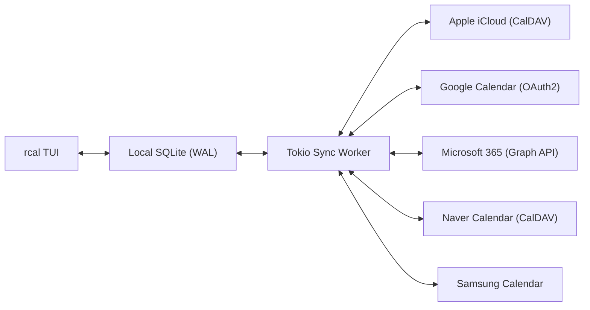
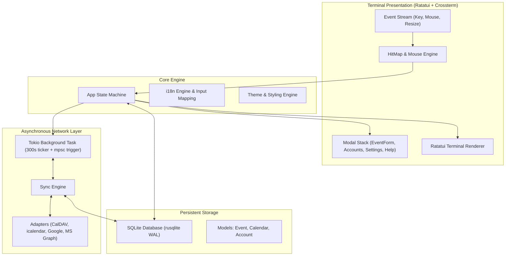

<div align="center">

```
  ██████╗  ██████╗ █████╗ ██╗     
  ██╔══██╗██╔════╝██╔══██╗██║     
  ██████╔╝██║     ███████║██║     
  ██╔══██╗██║     ██╔══██║██║     
  ██║  ██║╚██████╗██║  ██║███████╗
  ╚═╝  ╚═╝ ╚═════╝╚═╝  ╚═╝╚══════╝
```

### **تقويم طرفية Rust سريع وحديث وتفاعلي بالفأرة مع مزامنة سحابية متعددة**

[](https://www.rust-lang.org)
[](../../LICENSE)
[](https://github.com/eeyees/rcal)
[](https://github.com/ratatui/ratatui)
[](https://www.sqlite.org)
[](https://tokio.rs)

<p align="center">
  🌐 <strong>Languages / 다국어 / 语言 / 言語 / Idiomas:</strong><br>
  <a href="../../README.md">English</a> •
  <a href="README.ko.md">한국어</a> •
  <a href="README.zh-CN.md">简体中文</a> •
  <a href="README.zh-TW.md">繁體中文</a> •
  <a href="README.ja.md">日本語</a> •
  <a href="README.es.md">Español</a> •
  <a href="README.fr.md">Français</a> •
  <a href="README.de.md">Deutsch</a> •
  <a href="README.pt-BR.md">Português</a> •
  <a href="README.ru.md">Русский</a> •
  <a href="README.it.md">Italiano</a> •<br>
  <a href="README.id.md">Bahasa Indonesia</a> •
  <a href="README.vi.md">Tiếng Việt</a> •
  <a href="README.tr.md">Türkçe</a> •
  <a href="README.pl.md">Polski</a> •
  <a href="README.nl.md">Nederlands</a> •
  <strong>العربية</strong> •
  <a href="README.hi.md">हिन्दी</a> •
  <a href="README.bn.md">বাংলা</a> •
  <a href="README.sv.md">Svenska</a> •
  <a href="README.uk.md">Українська</a> •
  <a href="README.th.md">ภาษาไทย</a>
</p>

<p align="center">
  <a href="#-key-features">المميزات</a> •
  <a href="#-ui-views">العروض</a> •
  <a href="#-controls">التحكم</a> •
  <a href="#-cloud-sync">المزامنة</a> •
  <a href="#-themes">السمات</a> •
  <a href="#-installation">التثبيت</a> •
  <a href="#-architecture">البنية</a>
</p>

---

</div>

`rcal` هو تطبيق تقويم TUI خفيف وعالي الاستجابة، صُمم للمطورين ومستخدمي الطرفية ليمنحهم السهولة البصرية لتقويم Google مباشرة داخل الطرفية وبدون أي بطء، مع **استجابة فورية**، **وتحكم كامل بالفأرة بنسبة 100%**، **ومزامنة ثنائية موثوقة مع السحابة**.

---

## <a id="-key-features"></a>✨ المميزات الرئيسية

- ⚡ **بنية دون تأخير وتعمل دون اتصال**: إقلاع فوري في أقل من مللي ثانية بفضل قاعدة بيانات SQLite مدمجة بنمط WAL.
- 🖱️ **تحكم كامل بالفأرة**: النقر على ألسنة العرض وأزرار التنقل، والنقر المزدوج على اليوم للتفاصيل، والنقر على الفترات الزمنية لإنشاء الأحداث، وتمرير عجلة الفأرة.
- 📅 **4 عروض تقويم غنية ومألوفة**: عرض الشهر، والأسبوع، واليوم (مع ترتيب ذكي للأحداث المتزامنة جنباً إلى جنب)، وعرض جدول المواعيد المرتب زمنياً.
- ☁️ **محرك المزامنة السحابية المتعددة وCalDAV**: دعم Apple iCloud وNaver وGoogle Calendar (OAuth2) وMicrosoft 365 Graph API وSamsung Calendar عبر مهمة خلفية في Tokio.
- ⌨️ **اختصارات Vim وتنقل سلس**: مفاتيح `h/j/k/l` والتنقل الفوري والطباعة بدون مقاطعة.
- 🌐 **دعم أصيل لتعدد اللغات (i18n)**: اكتشاف لغة النظام تلقائياً والتبديل السريع بزر واحد.
- 🎨 **7 سمات ألوان وتخصيص واسع**: Modern Dark, Nord, Dracula, Forest, Sunset, Monokai, Solarized وخيار تحديد اليوم الأول للأسبوع.

---

## <a id="-ui-views"></a>🖥️ العروض

```
┌── rcal v2026.11.01.1 ─────────────────────────────────────────────── [ L: 한/EN ] [ ? Help ] [ ⚙ Settings ] ──┐
│ [ 1:Month ] [ 2:Week ] [ 3:Day ] [ 4:Agenda ]    [ < ] [ Today ] [ > ]  2026-11-01 (Sun)   [ ⟳ Sync ]  │
├────────────────────┬───────────────────────────────────────────────────────────────────────────────────┤
│ Calendars          │                             November 2026                                         │
│ [x] ■ Personal     │  Sun         Mon         Tue         Wed         Thu         Fri         Sat      │
│ [x] ■ Work         │ ┌───────────┬───────────┬───────────┬───────────┬───────────┬───────────┬───────────┐ │
│ [x] ■ Holidays     │ │ 1  TODAY  │ 2         │ 3         │ 4         │ 5         │ 6         │ 7         │ │
│                    │ │■ 10:00 AM │■ 09:00 AM │           │■ 14:00 PM │           │■ 19:00 PM │           │ │
│ Accounts           │ │  Sprint   │  Standup  │           │  Design   │           │  Dinner   │           │ │
│ • iCloud (Syncing) │ ├───────────┼───────────┼───────────┼───────────┼───────────┼───────────┼───────────┤ │
│ • Google (Active)  │ │ 8         │ 9         │ 10        │ 11        │ 12        │ 13        │ 14        │ │
│                    │ │           │           │           │           │           │           │           │ │
├────────────────────┴───────────────────────────────────────────────────────────────────────────────────┤
│ [c] New Event  [m/w/d/a] Switch View  [h/j/k/l] Navigate  [/] Search  [a] Accounts  [s] Settings  [q] Quit │
└────────────────────────────────────────────────────────────────────────────────────────────────────────┘
```

---

## <a id="-controls"></a>⌨️ دليل التحكم بلوحة المفاتيح والفأرة

### 🧭 التحكم 1: Navigation

| الاختصار | حركة الفأرة | الوصف |
| :--- | :--- | :--- |
| `h` / `j` / `k` / `l` أو الأسهم | النقر على الخلية / الوقت | تحريك المؤشر يسار / أسفل / أعلى / يمين |
| `1` أو `m` | النقر على تبويب `[ 1:Month ]` | التبديل إلى **عرض الشهر** |
| `2` أو `w` | النقر على تبويب `[ 2:Week ]` | التبديل إلى **عرض الأسبوع** |
| `3` أو `d` | النقر على تبويب `[ 3:Day ]` | التبديل إلى **عرض اليوم** |
| `4` أو `a` | النقر على تبويب `[ 4:Agenda ]` | التبديل إلى **عرض جدول المواعيد** |
| `t` | النقر على زر `[ Today ]` | الانتقال إلى اليوم |
| `[` / `]` | النقر على `[ < ]` / `[ > ]` | الفترة السابقة / التالية |
| عجلة الفأرة | تدوير العجلة | تمرير الخط الزمني أو تبديل الأيام |
| النقر المزدوج | النقر المزدوج على خلية التاريخ | الانتقال المباشر لتفاصيل اليوم من عرض الشهر |

### 📝 التحكم 2: Events & Modals

| الاختصار | حركة الفأرة | الوصف |
| :--- | :--- | :--- |
| `c` أو `n` | النقر على `[ + New ]` أو فترة فارغة | فتح استمارة إنشاء حدث جديد |
| `Enter` | النقر على كتلة الحدث | عرض تفاصيل الحدث |
| `e` | النقر على زر `[ Edit ]` | تعديل الحدث |
| `x` أو `Delete` | النقر على زر `[ Delete ]` | حذف الحدث المحدد |
| `Tab` / `Shift+Tab` | النقر على الحقول / الأزرار | تبديل التركيز بين حقول النموذج |
| `Esc` أو `q` | النقر على `[ Close ]` أو الخارج | إغلاق النافذة النشطة |

### ⚙️ التحكم 3: System & Settings

| الاختصار | حركة الفأرة | الوصف |
| :--- | :--- | :--- |
| `L` | النقر على `[ L: 한/EN ]` | تبديل لغة الواجهة |
| `s` | النقر على `[ ⚙ Settings ]` | فتح إعدادات النظام |
| `a` | النقر على الحسابات في الشريط الجانبي | فتح إدارة الحسابات السحابية |
| `b` | النقر على زر الشريط الجانبي | إظهار / إخفاء الشريط الجانبي |
| `r` | النقر على `[ ⟳ Sync ]` | بدء المزامنة السحابية فوراً |
| `?` | النقر على `[ ? Help ]` | عرض دليل الاختصارات |
| `Ctrl+C` / `q` | - | الخروج بأمان من `rcal` |

---

## <a id="-cloud-sync"></a>☁️ المزامنة السحابية المتعددة وCalDAV

يوفر `rcal` توافقية عالية مع أبرز مزودي الخدمات السحابية:



### Supported Providers

- **Apple iCloud**: مزامنة CalDAV باستخدام معرف Apple وكلمة مرور التطبيق الخاصة.
- **Naver Calendar**: اكتشاف ومزامنة تلقائية عبر CalDAV.
- **Google Calendar**: ربط عبر واجهة Google Calendar API مع OAuth2 آمن.
- **Microsoft 365 / Outlook**: اتصال سحابي عبر واجهة Microsoft Graph REST API.
- **Samsung Calendar**: تكامل سحابة Samsung.

---

## <a id="-themes"></a>🎨 السمات اللونية والتخصيص

اضغط `s` لفتح **نافذة الإعدادات** واختيار المظهر المفضل لديك:

### Built-in Color Palettes
- 🌙 **Modern Dark**: مظهر داكن عصري ونقي
- ❄️ **Nord**: درجات الأزرق والرمادي القطبية الهادئة
- 🧛 **Dracula**: مظهر داكن مميز عالي التباين
- 🌲 **Forest**: درجات خضراء مريحة مستوحاة من الطبيعة
- 🌆 **Sunset**: درجات بنفسجية وبرتقالية نابضة بالحياة
- 🎨 **Monokai**: التباين الكلاسيكي لمحرري الأكواد
- ☀️ **Solarized**: مظهر داكن منخفض التباين مريح للعين

### بداية الأسبوع
حدد ما إذا كان أسبوعك يبدأ يوم **الأحد** أو **الاثنين** أو **السبت**.

---

## <a id="-architecture"></a>🏗️ البنية



---

## <a id="-installation"></a>🚀 التثبيت والتشغيل

### البناء من المصدر

```bash
# Clone the repository
git clone https://github.com/eeyees/rcal.git
cd rcal

# Build release
cargo build --release

# Run
./target/release/rcal
```

### التثبيت العام عبر Cargo

```bash
cargo install --path .
rcal
```

### مكان حفظ قاعدة البيانات محلياً

- **macOS**: `~/Library/Application Support/rcal/rcal.db`
- **Linux**: `~/.local/share/rcal/rcal.db`
- **Windows**: `%LOCALAPPDATA%\rcal\rcal.db`

---

## 🗺️ 🗺️ خارطة الطريق والتطوير

- [x] **المرحلة 1**: نسخة TUI أولية بـ 4 عروض، ومحرك الفأرة، وتخزين SQLite WAL، وإدارة الأحداث.
- [x] **المرحلة 2**: محرك CalDAV (Apple iCloud وNaver)، ومهمة خلفية في Tokio، وواجهة الحسابات.
- [x] **المرحلة 3**: Google Calendar وMS Graph وSamsung، و7 سمات، وتخصيص بداية الأسبوع.
- [ ] **المرحلة 4**: المنظومة والبروتوكولات المفتوحة:
    - [ ] خادم بروتوكول MCP (Model Context Protocol) لعملاء الذكاء الاصطناعي
    - [ ] خادم اشتراك عبر HTTP بصيغة WebCal / iCalendar (`.ics`)
    - [ ] دعم الأحداث المتكررة (RFC 5545 RRULE)
    - [ ] إضافة الأحداث باللغة الطبيعية
    - [ ] إشعارات النظام على سطح المكتب

---

## 📜 📜 الترخيص

مرخص بموجب **رخصة MIT**. راجع ملف [`LICENSE`](../../LICENSE) لمزيد من التفاصيل.
