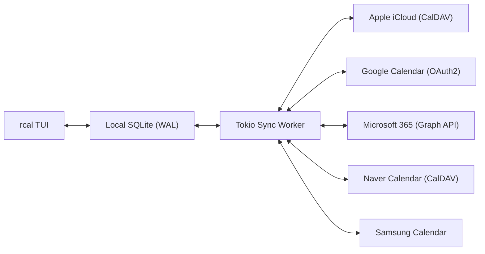
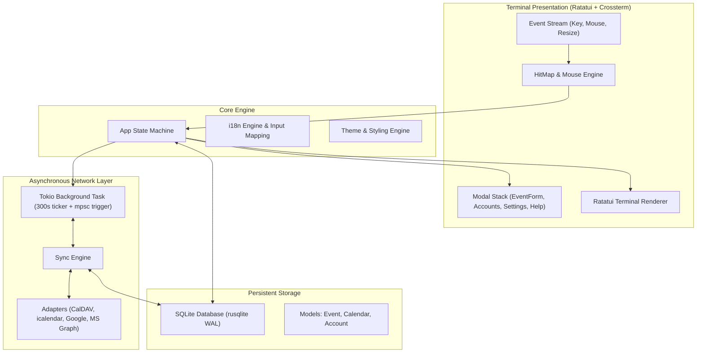

<div align="center">

```
  ██████╗  ██████╗ █████╗ ██╗     
  ██╔══██╗██╔════╝██╔══██╗██║     
  ██████╔╝██║     ███████║██║     
  ██╔══██╗██║     ██╔══██║██║     
  ██║  ██║╚██████╗██║  ██║███████╗
  ╚═╝  ╚═╝ ╚═════╝╚═╝  ╚═╝╚══════╝
```

### **মাল্টি-ক্লাউড সিঙ্ক সহ দ্রুত, আধুনিক ও মাউস-ইন্টারেক্টিভ রাস্ট টার্মিনাল ক্যালেন্ডার**

[](https://www.rust-lang.org)
[](../../LICENSE)
[](https://github.com/eeyees/rcal)
[](https://github.com/ratatui/ratatui)
[](https://www.sqlite.org)
[](https://tokio.rs)

<p align="center">
  🌐 <strong>Languages / 다국어 / 语言 / 言語 / Idiomas:</strong><br>
  <a href="../../README.md">English</a> •
  <a href="README.ko.md">한국어</a> •
  <a href="README.zh-CN.md">简体中文</a> •
  <a href="README.zh-TW.md">繁體中文</a> •
  <a href="README.ja.md">日本語</a> •
  <a href="README.es.md">Español</a> •
  <a href="README.fr.md">Français</a> •
  <a href="README.de.md">Deutsch</a> •
  <a href="README.pt-BR.md">Português</a> •
  <a href="README.ru.md">Русский</a> •
  <a href="README.it.md">Italiano</a> •<br>
  <a href="README.id.md">Bahasa Indonesia</a> •
  <a href="README.vi.md">Tiếng Việt</a> •
  <a href="README.tr.md">Türkçe</a> •
  <a href="README.pl.md">Polski</a> •
  <a href="README.nl.md">Nederlands</a> •
  <a href="README.ar.md">العربية</a> •
  <a href="README.hi.md">हिन्दी</a> •
  <strong>বাংলা</strong> •
  <a href="README.sv.md">Svenska</a> •
  <a href="README.uk.md">Українська</a> •
  <a href="README.th.md">ภาษาไทย</a>
</p>

<p align="center">
  <a href="#-key-features">মূল বৈশিষ্ট্য</a> •
  <a href="#-ui-views">ইউআই দৃশ্য</a> •
  <a href="#-controls">নিয়ন্ত্রণ</a> •
  <a href="#-cloud-sync">ক্লাউড সিঙ্ক</a> •
  <a href="#-themes">থিম</a> •
  <a href="#-installation">ইনস্টলেশন</a> •
  <a href="#-architecture">আর্কিটেকচার</a>
</p>

---

</div>

`rcal` হল একটি দ্রুত এবং হালকা TUI ক্যালেন্ডার, যা ডেভেলপার ও টার্মিনাল ব্যবহারকারীদের জন্য নির্মিত। এটি গুগল ক্যালেন্ডারের মতই স্বাচ্ছন্দ্যময় অভিজ্ঞতা প্রদান করে কোনো ল্যাগ ছাড়াই, সম্পূর্ণ মাউস সুবিধা এবং শক্তিশালী ক্লাউড সিঙ্ক সহ।

---

## <a id="-key-features"></a>✨ মূল বৈশিষ্ট্যসমূহ

- ⚡ **জিরো-ল্যাগ অফলাইন আর্কিটেকচার**: SQLite WAL মোড ব্যবহারের মাধ্যমে মিলিসেকেন্ডের মধ্যে দ্রুত চালু ও অফলাইন ব্যবহার।
- 🖱️ **সম্পূর্ণ মাউস ইন্টারঅ্যাকশন**: ভিউ পরিবর্তন, বাটনে ক্লিক, দ্বিগুণ ক্লিকে দিনের বিস্তারিত দেখা এবং টাইমলাইন স্ক্রোলিং।
- 📅 **৪টি পরিচিত ক্যালেন্ডার ভিউ**: মাসিক ভিউ, সাপ্তাহিক ভিউ, দৈনিক ভিউ (একই সময়ের ইভেন্ট পাশাপাশি প্রদর্শন) এবং এজেন্ডা ভিউ।
- ☁️ **মাল্টি-ক্লাউড ও CalDAV সিঙ্ক**: Apple iCloud, Naver, Google Calendar, Microsoft 365 এবং Samsung Calendar-এর সাথে ব্যাকগ্রাউন্ডে স্বয়ংক্রিয় সিঙ্ক।
- ⌨️ **Vim শর্টকাট ও সহজ নেভিগেশন**: পরিচিত `h/j/k/l` কিবোর্ড শর্টকাট এবং দ্রুত ভিউ পরিবর্তন।
- 🌐 **বহুভাষিক সমর্থন (i18n)**: স্বয়ংক্রিয় ভাষা শনাক্তকরণ এবং ১-ক্লিকে ভাষা পরিবর্তনের সুবিধা।
- 🎨 **আকর্ষণীয় থিম ও কাস্টমাইজেশন**: ৭টি কালার প্যালেট এবং সপ্তাহের শুরুর দিন নির্ধারণের সুযোগ।

---

## <a id="-ui-views"></a>🖥️ ইউআই দৃশ্য

```
┌── rcal v2026.11.01.1 ─────────────────────────────────────────────── [ L: 한/EN ] [ ? Help ] [ ⚙ Settings ] ──┐
│ [ 1:Month ] [ 2:Week ] [ 3:Day ] [ 4:Agenda ]    [ < ] [ Today ] [ > ]  2026-11-01 (Sun)   [ ⟳ Sync ]  │
├────────────────────┬───────────────────────────────────────────────────────────────────────────────────┤
│ Calendars          │                             November 2026                                         │
│ [x] ■ Personal     │  Sun         Mon         Tue         Wed         Thu         Fri         Sat      │
│ [x] ■ Work         │ ┌───────────┬───────────┬───────────┬───────────┬───────────┬───────────┬───────────┐ │
│ [x] ■ Holidays     │ │ 1  TODAY  │ 2         │ 3         │ 4         │ 5         │ 6         │ 7         │ │
│                    │ │■ 10:00 AM │■ 09:00 AM │           │■ 14:00 PM │           │■ 19:00 PM │           │ │
│ Accounts           │ │  Sprint   │  Standup  │           │  Design   │           │  Dinner   │           │ │
│ • iCloud (Syncing) │ ├───────────┼───────────┼───────────┼───────────┼───────────┼───────────┼───────────┤ │
│ • Google (Active)  │ │ 8         │ 9         │ 10        │ 11        │ 12        │ 13        │ 14        │ │
│                    │ │           │           │           │           │           │           │           │ │
├────────────────────┴───────────────────────────────────────────────────────────────────────────────────┤
│ [c] New Event  [m/w/d/a] Switch View  [h/j/k/l] Navigate  [/] Search  [a] Accounts  [s] Settings  [q] Quit │
└────────────────────────────────────────────────────────────────────────────────────────────────────────┘
```

---

## <a id="-controls"></a>⌨️ কিবোর্ড ও মাউস নিয়ন্ত্রণ নির্দেশিকা

### 🧭 নিয়ন্ত্রণ 1: Navigation

| শর্টকাট | মাউস অ্যাকশন | বিবরণ |
| :--- | :--- | :--- |
| `h` / `j` / `k` / `l` বা তীর চিহ্ন | তারিখ বা সময়ের স্লটে ক্লিক | কার্সার বাম / নিচে / উপরে / ডানে সরান |
| `1` বা `m` | `[ 1:Month ]` ট্যাবে ক্লিক | **মাসিক ভিউ**-এ যান |
| `2` یا `w` | `[ 2:Week ]` ট্যাবে ক্লিক | **সাপ্তাহিক ভিউ**-এ যান |
| `3` বা `d` | `[ 3:Day ]` ট্যাবে ক্লিক | **দৈনিক ভিউ**-এ যান |
| `4` বা `a` | `[ 4:Agenda ]` ট্যাবে ক্লিক | **এজেন্ডা ভিউ**-এ যান |
| `t` | `[ Today ]` বাটনে ক্লিক | আজকের তারিখে যান |
| `[` / `]` | `[ < ]` / `[ > ]` বাটনে ক্লিক | পূর্ববর্তী বা পরবর্তী সময়কালে যান |
| মাউস স্ক্রোল | স্ক্রোল হুইল ঘুরান | টাইমলাইন স্ক্রোল বা তারিখ পরিবর্তন |
| ডাবল ক্লিক | তারিখের ঘরে ডাবল ক্লিক | সরাসরি দিনের বিস্তারিত ভিউ খুলুন |

### 📝 নিয়ন্ত্রণ 2: Events & Modals

| শর্টকাট | মাউস অ্যাকশন | বিবরণ |
| :--- | :--- | :--- |
| `c` বা `n` | `[ + New ]` বা ফাঁকা স্লটে ক্লিক | নতুন ইভেন্ট ফর্ম খুলুন |
| `Enter` | ইভেন্ট বক্সে ক্লিক | ইভেন্টের বিস্তারিত দেখুন |
| `e` | `[ Edit ]` বাটনে ক্লিক | ইভেন্ট সম্পাদনা করুন |
| `x` বা `Delete` | `[ Delete ]` বাটনে ক্লিক | ইভেন্ট মুছে ফেলুন |
| `Tab` / `Shift+Tab` | ইনপুট বক্সে ক্লিক | ফিল্ড পরিবর্তন করুন |
| `Esc` বা `q` | `[ Close ]` বা বাইরে ক্লিক | পপআপ বন্ধ করুন |

### ⚙️ নিয়ন্ত্রণ 3: System & Settings

| শর্টকাট | মাউস অ্যাকশন | বিবরণ |
| :--- | :--- | :--- |
| `L` | `[ L: 한/EN ]` বাটনে ক্লিক | ভাষা পরিবর্তন করুন |
| `s` | `[ ⚙ Settings ]` বাটনে ক্লিক | সেটিংস খুলুন |
| `a` | সাইডবারে Accounts-এ ক্লিক | ক্লাউড অ্যাকাউন্ট ম্যানেজার |
| `b` | সাইডবার বাটনে ক্লিক | সাইডবার দেখান / লুকান |
| `r` | `[ ⟳ Sync ]` বাটনে ক্লিক | এখনই ক্লাউড সিঙ্ক শুরু করুন |
| `?` | `[ ? Help ]` বাটনে ক্লিক | সাহায্য ও শর্টকাট দেখুন |
| `Ctrl+C` / `q` | - | সফটওয়্যার বন্ধ করুন |

---

## <a id="-cloud-sync"></a>☁️ মাল্টি-ক্লাউড ও CalDAV সিঙ্ক্রোনাইজেশন

`rcal` শীর্ষস্থানীয় ক্লাউড ক্যালেন্ডারগুলোর সাথে নির্ভরযোগ্য সংযোগ সমর্থন করে:



### Supported Providers

- **Apple iCloud**: CalDAV প্রোটোকল ও অ্যাপ পাসওয়ার্ডের মাধ্যমে সিঙ্ক।
- **Naver Calendar**: স্বয়ংক্রিয় CalDAV সিঙ্ক।
- **Google Calendar**: OAuth2 মাধ্যমে Google Calendar API সংযুক্তি।
- **Microsoft 365 / Outlook**: Microsoft Graph REST API ইন্টিগ্রেশন।
- **Samsung Calendar**: স্যামসাং ক্লাউড ক্যালেন্ডার সিঙ্ক।

---

## <a id="-themes"></a>🎨 থিম ও পারসোনালাইজেশন

`s` চেপে **সেটিংস**-এ প্রবেশ করুন এবং নিজের পছন্দমতো রঙ নির্বাচন করুন:

### Built-in Color Palettes
- 🌙 **Modern Dark**: আদর্শ পরিচ্ছন্ন ডার্ক থিম
- ❄️ **Nord**: শান্ত ও আরামদায়ক ব্লু-গ্রে থিম
- 🧛 **Dracula**: জনপ্রিয় হাই-কন্ট্রাস্ট ডার্ক থিম
- 🌲 **Forest**: চোখের জন্য আরামদায়ক সবুজ থিম
- 🌆 **Sunset**: প্রাণবন্ত সাইবারপাঙ্ক পার্পল-অরেঞ্জ থিম
- 🎨 **Monokai**: কোড এডিটর স্টাইল থিম
- ☀️ **Solarized**: স্বল্প কন্ট্রাস্টের আরামদায়ক থিম

### সপ্তাহের শুরুর দিন
আপনার কাজের সুবিধার্থে সপ্তাহের শুরুর দিন **রবিবার**, **সোমবার** বা **শনিবার** বেছে নিন।

---

## <a id="-architecture"></a>🏗️ আর্কিটেকচার



---

## <a id="-installation"></a>🚀 ইনস্টলেশন ও ব্যবহার

### সোর্স কোড থেকে বিল্ড

```bash
# Clone the repository
git clone https://github.com/eeyees/rcal.git
cd rcal

# Build release
cargo build --release

# Run
./target/release/rcal
```

### Cargo দিয়ে ইনস্টল করুন

```bash
cargo install --path .
rcal
```

### ডাটাবেজ ফাইল লোকেশন

- **macOS**: `~/Library/Application Support/rcal/rcal.db`
- **Linux**: `~/.local/share/rcal/rcal.db`
- **Windows**: `%LOCALAPPDATA%\rcal\rcal.db`

---

## 🗺️ 🗺️ ডেভেলপমেন্ট রোডম্যাপ

- [x] **পর্ব ১**: লোকাল TUI MVP, ৪টি ভিউ, মাউস ইঞ্জিন, SQLite WAL।
- [x] **পর্ব ২**: CalDAV সিঙ্ক (Apple iCloud & Naver), Tokio ব্যাকগ্রাউন্ড সিঙ্ক।
- [x] **পর্ব ৩**: Google, MS Graph, Samsung, ৭টি থিম, সপ্তাহের শুরুর দিন।
- [ ] **পর্ব ৪**: ভবিষ্যতের সংযোজন:
    - [ ] AI এজেন্টের জন্য MCP (Model Context Protocol) সার্ভার
    - [ ] WebCal / iCalendar (`.ics`) HTTP সার্ভার
    - [ ] পুনরাবৃত্ত ইভেন্ট রুলস (RFC 5545 RRULE)
    - [ ] স্বাভাবিক ভাষায় ইভেন্ট যোগ করা
    - [ ] ডেস্কটপ নোটিফিকেশন

---

## 📜 📜 লাইসেন্স

**MIT লাইসেন্স**-এর অধীনে প্রকাশিত। বিস্তারিত জানতে [`LICENSE`](../../LICENSE) ফাইল দেখুন।
