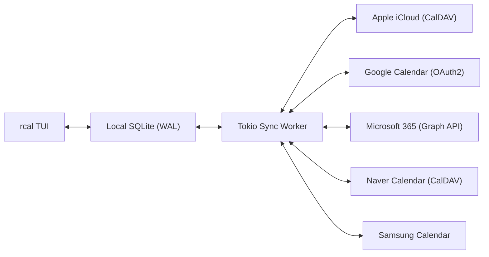
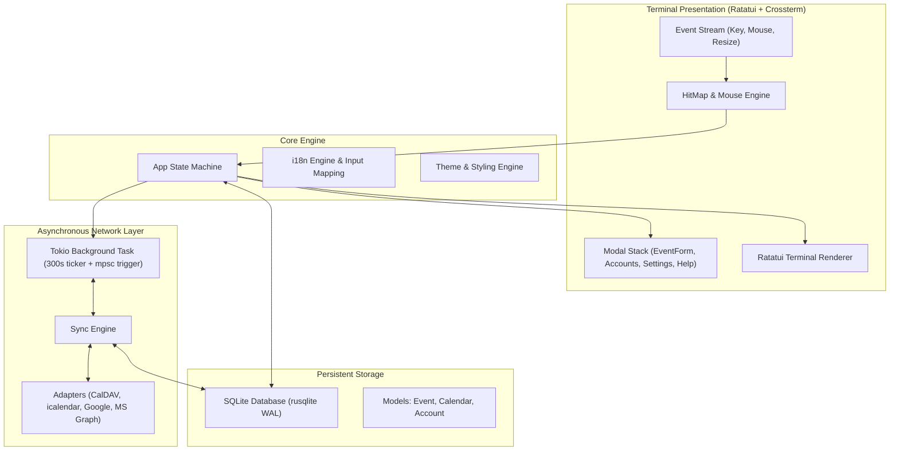

<div align="center">

```
  ██████╗  ██████╗ █████╗ ██╗     
  ██╔══██╗██╔════╝██╔══██╗██║     
  ██████╔╝██║     ███████║██║     
  ██╔══██╗██║     ██╔══██║██║     
  ██║  ██║╚██████╗██║  ██║███████╗
  ╚═╝  ╚═╝ ╚═════╝╚═╝  ╚═╝╚══════╝
```

### **Schneller, moderner, mausinteraktiver Rust-Terminal-Kalender mit Multi-Cloud-Synchronisation**

[](https://www.rust-lang.org)
[](../../LICENSE)
[](https://github.com/eeyees/rcal)
[](https://github.com/ratatui/ratatui)
[](https://www.sqlite.org)
[](https://tokio.rs)

<p align="center">
  🌐 <strong>Languages / 다국어 / 语言 / 言語 / Idiomas:</strong><br>
  <a href="../../README.md">English</a> •
  <a href="README.ko.md">한국어</a> •
  <a href="README.zh-CN.md">简体中文</a> •
  <a href="README.zh-TW.md">繁體中文</a> •
  <a href="README.ja.md">日本語</a> •
  <a href="README.es.md">Español</a> •
  <a href="README.fr.md">Français</a> •
  <strong>Deutsch</strong> •
  <a href="README.pt-BR.md">Português</a> •
  <a href="README.ru.md">Русский</a> •
  <a href="README.it.md">Italiano</a> •<br>
  <a href="README.id.md">Bahasa Indonesia</a> •
  <a href="README.vi.md">Tiếng Việt</a> •
  <a href="README.tr.md">Türkçe</a> •
  <a href="README.pl.md">Polski</a> •
  <a href="README.nl.md">Nederlands</a> •
  <a href="README.ar.md">العربية</a> •
  <a href="README.hi.md">हिन्दी</a> •
  <a href="README.bn.md">বাংলা</a> •
  <a href="README.sv.md">Svenska</a> •
  <a href="README.uk.md">Українська</a> •
  <a href="README.th.md">ภาษาไทย</a>
</p>

<p align="center">
  <a href="#-key-features">Funktionen</a> •
  <a href="#-ui-views">Ansichten</a> •
  <a href="#-controls">Bedienung</a> •
  <a href="#-cloud-sync">Cloud-Sync</a> •
  <a href="#-themes">Designs</a> •
  <a href="#-installation">Installation</a> •
  <a href="#-architecture">Architektur</a>
</p>

---

</div>

`rcal` ist ein leichtgewichtiger, reaktionsschneller TUI-Kalender für Entwickler und Terminal-Enthusiasten. Er bringt die intuitive visuelle Übersicht von Google Calendar direkt ins Terminal – mit **null Verzögerung**, **vollständiger Mausbedienung** und **zuverlässiger Multi-Cloud-Zwei-Wege-Synchronisation**.

---

## <a id="-key-features"></a>✨ Hauptmerkmale

- ⚡ **Offline-First-Architektur ohne Verzögerung**: Blitzschneller Start unter 1 ms dank integrierter SQLite-Datenbank im WAL-Modus.
- 🖱️ **Vollständige Mausunterstützung**: Klickbare Tabs, Navigationsschaltflächen, Doppelklick auf ein Datum für die Tagesansicht, Klick auf Zeitslots zum Erstellen und Mausrad-Scrolling.
- 📅 **4 Übersichtliche Kalenderansichten**: Monatsansicht, Wochenansicht, Tagesansicht (mit intelligenter paralleler Anordnung überlappender Termine) und chronologische Agenda-Ansicht.
- ☁️ **Multi-Cloud & CalDAV Synchronisation**: Unterstützung für Apple iCloud, Naver, Google Calendar (OAuth2), Microsoft 365 Graph API und Samsung Calendar mit leisem Tokio-Hintergrunddienst.
- ⌨️ **Vim-Navigation & Transparente Tastatursteuerung**: Klassische Tasten `h/j/k/l`, schnelle Ansichtenwechsel und reibungslose Bedienung.
- 🌐 **Native Mehrsprachigkeit (i18n)**: Automatische Erkennung der Systemsprache und Umschaltung mit nur einer Taste.
- 🎨 **7 Farbthemen & Anpassungsmöglichkeiten**: Modern Dark, Nord, Dracula, Forest, Sunset, Monokai, Solarized sowie einstellbarer Wochenstarttag.

---

## <a id="-ui-views"></a>🖥️ Ansichten

```
┌── rcal v0.1.0 ─────────────────────────────────────────────── [ L: 한/EN ] [ ? Help ] [ ⚙ Settings ] ──┐
│ [ 1:Month ] [ 2:Week ] [ 3:Day ] [ 4:Agenda ]    [ < ] [ Today ] [ > ]  2026-11-01 (Sun)   [ ⟳ Sync ]  │
├────────────────────┬───────────────────────────────────────────────────────────────────────────────────┤
│ Calendars          │                             November 2026                                         │
│ [x] ■ Personal     │  Sun         Mon         Tue         Wed         Thu         Fri         Sat      │
│ [x] ■ Work         │ ┌───────────┬───────────┬───────────┬───────────┬───────────┬───────────┬───────────┐ │
│ [x] ■ Holidays     │ │ 1  TODAY  │ 2         │ 3         │ 4         │ 5         │ 6         │ 7         │ │
│                    │ │■ 10:00 AM │■ 09:00 AM │           │■ 14:00 PM │           │■ 19:00 PM │           │ │
│ Accounts           │ │  Sprint   │  Standup  │           │  Design   │           │  Dinner   │           │ │
│ • iCloud (Syncing) │ ├───────────┼───────────┼───────────┼───────────┼───────────┼───────────┼───────────┤ │
│ • Google (Active)  │ │ 8         │ 9         │ 10        │ 11        │ 12        │ 13        │ 14        │ │
│                    │ │           │           │           │           │           │           │           │ │
├────────────────────┴───────────────────────────────────────────────────────────────────────────────────┤
│ [c] New Event  [m/w/d/a] Switch View  [h/j/k/l] Navigate  [/] Search  [a] Accounts  [s] Settings  [q] Quit │
└────────────────────────────────────────────────────────────────────────────────────────────────────────┘
```

---

## <a id="-controls"></a>⌨️ Tastatur- und Maussteuerung

### 🧭 Bedienung 1: Navigation

| Kürzel | Mausaktion | Beschreibung |
| :--- | :--- | :--- |
| `h` / `j` / `k` / `l` oder Pfeiltasten | Klick auf Datumszelle / Zeitslot | Cursor nach links / unten / oben / rechts |
| `1` oder `m` | Klick auf Tab `[ 1:Month ]` | Zur **Monatsansicht** wechseln |
| `2` oder `w` | Klick auf Tab `[ 2:Week ]` | Zur **Wochenansicht** wechseln |
| `3` oder `d` | Klick auf Tab `[ 3:Day ]` | Zur **Tagesansicht** wechseln |
| `4` oder `a` | Klick auf Tab `[ 4:Agenda ]` | Zur **Agenda-Ansicht** wechseln |
| `t` | Klick auf `[ Today ]` | Zu Heute springen |
| `[` / `]` | Klick auf `[ < ]` / `[ > ]` | Vorheriger / nächster Zeitraum |
| Mausrad | Rad drehen | Zeitachse scrollen oder Datum wechseln |
| Doppelklick | Doppelklick auf Datumsfeld | Aus der Monatsansicht direkt zur Tagesansicht springen |

### 📝 Bedienung 2: Events & Modals

| Kürzel | Mausaktion | Beschreibung |
| :--- | :--- | :--- |
| `c` oder `n` | Klick auf `[ + New ]` / leeren Slot | Formular für neuen Termin öffnen |
| `Enter` | Klick auf Terminblock | Termindetails öffnen |
| `e` | Klick auf `[ Edit ]` | Termin bearbeiten |
| `x` oder `Delete` | Klick auf `[ Delete ]` | Ausgewählten Termin löschen |
| `Tab` / `Shift+Tab` | Klick auf Eingabefeld / Button | Fokus im Formular wechseln |
| `Esc` oder `q` | Klick auf `[ Close ]` / außerhalb | Aktives Modal schließen |

### ⚙️ Bedienung 3: System & Settings

| Kürzel | Mausaktion | Beschreibung |
| :--- | :--- | :--- |
| `L` | Klick auf `[ L: 한/EN ]` | Sprache wechseln |
| `s` | Klick auf `[ ⚙ Settings ]` | Einstellungen öffnen |
| `a` | Klick auf Accounts in Seitenleiste | Cloud-Kontoverwaltung öffnen |
| `b` | Klick auf Seitenleisten-Button | Seitenleiste ein-/ausblenden |
| `r` | Klick auf `[ ⟳ Sync ]` | Hintergrund-Synchronisation sofort ausführen |
| `?` | Klick auf `[ ? Help ]` | Tastatur-Hilfe anzeigen |
| `Ctrl+C` / `q` | - | `rcal` sicher beenden |

---

## <a id="-cloud-sync"></a>☁️ Multi-Cloud & CalDAV Synchronisation

`rcal` bietet zuverlässige Adapter zur Synchronisation mit führenden Anbietern:



### Supported Providers

- **Apple iCloud**: CalDAV-Synchronisation mit Apple-ID und App-spezifischem Passwort.
- **Naver Calendar**: Automatische Erkennung und Synchronisation via CalDAV.
- **Google Calendar**: Google Calendar API-Anbindung mit OAuth2.
- **Microsoft 365 / Outlook**: Integration über die Microsoft Graph REST API.
- **Samsung Calendar**: Samsung Cloud-Integration.

---

## <a id="-themes"></a>🎨 Farbthemen & Personalisierung

Drücken Sie `s`, um die **Einstellungen** zu öffnen und das Aussehen anzupassen:

### Built-in Color Palettes
- 🌙 **Modern Dark**: Standardmäßiges, klares dunkles Terminaldesign
- ❄️ **Nord**: Kühle arktische Blaunuancen
- 🧛 **Dracula**: Beliebtes kontrastreiches dunkles Design
- 🌲 **Forest**: Beruhigendes Matcha- und Waldgrün
- 🌆 **Sunset**: Cyberpunk-inspiriertes Lila und Orange
- 🎨 **Monokai**: Klassischer Code-Editor-Kontrast
- ☀️ **Solarized**: Augenschonendes Low-Contrast-Design

### Erster Tag der Woche
Wählen Sie als Wochenstart **Sonntag**, **Montag** oder **Samstag**.

---

## <a id="-architecture"></a>🏗️ Architektur



---

## <a id="-installation"></a>🚀 Installation & Ausführung

### Aus dem Quellcode kompilieren

```bash
# Clone the repository
git clone https://github.com/eeyees/rcal.git
cd rcal

# Build release
cargo build --release

# Run
./target/release/rcal
```

### Global über Cargo installieren

```bash
cargo install --path .
rcal
```

### Speicherort der lokalen Datenbank

- **macOS**: `~/Library/Application Support/rcal/rcal.db`
- **Linux**: `~/.local/share/rcal/rcal.db`
- **Windows**: `%LOCALAPPDATA%\rcal\rcal.db`

---

## 🗺️ 🗺️ Entwicklungs-Roadmap

- [x] **Phase 1**: Lokales TUI MVP, 4 Ansichten, Mausklick-Engine, SQLite WAL, CRUD.
- [x] **Phase 2**: CalDAV-Engine (Apple iCloud & Naver), Tokio-Worker, Kontoverwaltung.
- [x] **Phase 3**: Google Calendar, MS Graph, Samsung, 7 Themes, Wochenstart-Einstellung.
- [ ] **Phase 4**: Ökosystem und offene Protokolle:
    - [ ] MCP (Model Context Protocol) Server für KI-Agenten
    - [ ] WebCal / iCalendar (`.ics`) HTTP-Abonnement-Server
    - [ ] Wiederkehrende Termine (RFC 5545 RRULE)
    - [ ] Terminerstellung in natürlicher Sprache
    - [ ] Desktop-Benachrichtigungen

---

## 📜 📜 Lizenz

Veröffentlicht unter der **MIT-Lizenz**. Einzelheiten finden Sie in der Datei [`LICENSE`](../../LICENSE).
