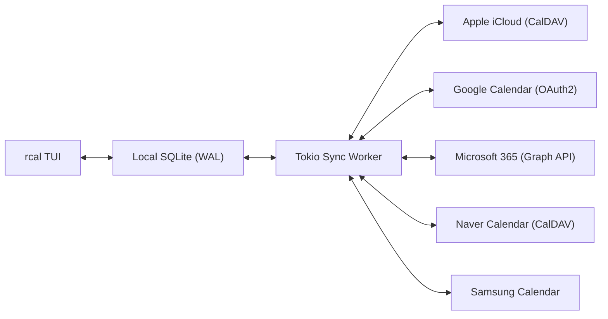
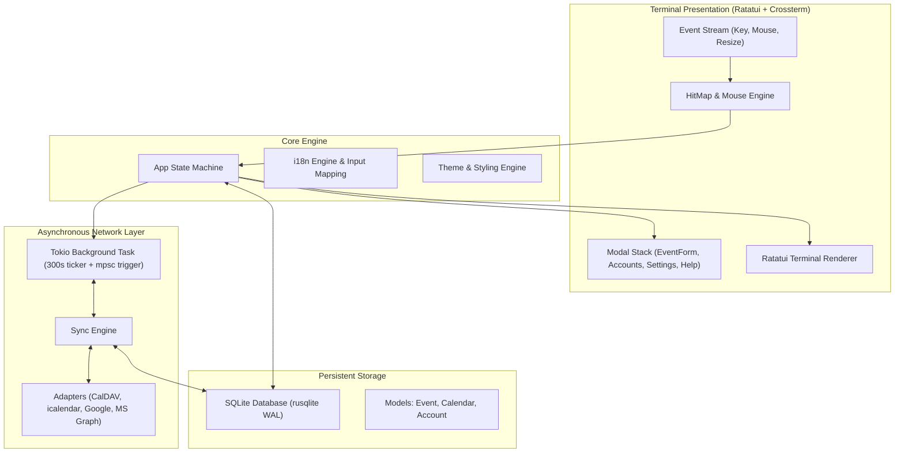

<div align="center">

```
  ██████╗  ██████╗ █████╗ ██╗     
  ██╔══██╗██╔════╝██╔══██╗██║     
  ██████╔╝██║     ███████║██║     
  ██╔══██╗██║     ██╔══██║██║     
  ██║  ██║╚██████╗██║  ██║███████╗
  ╚═╝  ╚═╝ ╚═════╝╚═╝  ╚═╝╚══════╝
```

### **Calendario de terminal en Rust rápido, moderno e interactivo con el ratón y sincronización multinube**

[](https://www.rust-lang.org)
[](../../LICENSE)
[](https://github.com/eeyees/rcal)
[](https://github.com/ratatui/ratatui)
[](https://www.sqlite.org)
[](https://tokio.rs)

<p align="center">
  🌐 <strong>Languages / 다국어 / 语言 / 言語 / Idiomas:</strong><br>
  <a href="../../README.md">English</a> •
  <a href="README.ko.md">한국어</a> •
  <a href="README.zh-CN.md">简体中文</a> •
  <a href="README.zh-TW.md">繁體中文</a> •
  <a href="README.ja.md">日本語</a> •
  <strong>Español</strong> •
  <a href="README.fr.md">Français</a> •
  <a href="README.de.md">Deutsch</a> •
  <a href="README.pt-BR.md">Português</a> •
  <a href="README.ru.md">Русский</a> •
  <a href="README.it.md">Italiano</a> •<br>
  <a href="README.id.md">Bahasa Indonesia</a> •
  <a href="README.vi.md">Tiếng Việt</a> •
  <a href="README.tr.md">Türkçe</a> •
  <a href="README.pl.md">Polski</a> •
  <a href="README.nl.md">Nederlands</a> •
  <a href="README.ar.md">العربية</a> •
  <a href="README.hi.md">हिन्दी</a> •
  <a href="README.bn.md">বাংলা</a> •
  <a href="README.sv.md">Svenska</a> •
  <a href="README.uk.md">Українська</a> •
  <a href="README.th.md">ภาษาไทย</a>
</p>

<p align="center">
  <a href="#-key-features">Características</a> •
  <a href="#-ui-views">Vistas</a> •
  <a href="#-controls">Controles</a> •
  <a href="#-cloud-sync">Sincronización</a> •
  <a href="#-themes">Temas</a> •
  <a href="#-installation">Instalación</a> •
  <a href="#-architecture">Arquitectura</a>
</p>

---

</div>

`rcal` es un calendario TUI ligero y ultrarrápido diseñado para desarrolladores y usuarios de terminal que buscan la claridad visual de Google Calendar sin retardo, con **cero lag**, **100% de interactividad con el ratón** y **sincronización bidireccional fluida con la nube**.

---

## <a id="-key-features"></a>✨ Características principales

- ⚡ **Arquitectura Offline-First sin latencia**: Arranque instantáneo en menos de 1 ms gracias a la base de datos SQLite integrada en modo WAL.
- 🖱️ **Interactividad completa con el ratón**: Clic en pestañas de vista, botones de navegación, doble clic en fechas para ver el detalle del día, clic en franjas horarias para crear eventos y rueda para desplazamiento.
- 📅 **4 Vistas intuitivas de alta densidad**: Vista mensual (7 columnas con insignias), semanal (bloques de color por horas), diaria (posicionamiento en paralelo para eventos concurrentes) y agenda cronológica.
- ☁️ **Motor de sincronización multinube y CalDAV**: Soporte para Apple iCloud, Naver, Google Calendar (OAuth2), Microsoft 365 Graph API y Samsung Calendar con un hilo en segundo plano en Tokio.
- ⌨️ **Atajos Vim y navegación fluida**: Teclas clásicas `h/j/k/l`, cambio rápido de vista y gestión transparente del teclado.
- 🌐 **Soporte nativo multilingüe (i18n)**: Detección automática del idioma del sistema y cambio instantáneo con 1 tecla.
- 🎨 **Temas enriquecidos y personalización**: 7 paletas de colores (Modern Dark, Nord, Dracula, Forest, Sunset, Monokai, Solarized) y configuración del primer día de la semana.

---

## <a id="-ui-views"></a>🖥️ Vistas

```
┌── rcal v2026.11.01.1 ─────────────────────────────────────────────── [ L: 한/EN ] [ ? Help ] [ ⚙ Settings ] ──┐
│ [ 1:Month ] [ 2:Week ] [ 3:Day ] [ 4:Agenda ]    [ < ] [ Today ] [ > ]  2026-11-01 (Sun)   [ ⟳ Sync ]  │
├────────────────────┬───────────────────────────────────────────────────────────────────────────────────┤
│ Calendars          │                             November 2026                                         │
│ [x] ■ Personal     │  Sun         Mon         Tue         Wed         Thu         Fri         Sat      │
│ [x] ■ Work         │ ┌───────────┬───────────┬───────────┬───────────┬───────────┬───────────┬───────────┐ │
│ [x] ■ Holidays     │ │ 1  TODAY  │ 2         │ 3         │ 4         │ 5         │ 6         │ 7         │ │
│                    │ │■ 10:00 AM │■ 09:00 AM │           │■ 14:00 PM │           │■ 19:00 PM │           │ │
│ Accounts           │ │  Sprint   │  Standup  │           │  Design   │           │  Dinner   │           │ │
│ • iCloud (Syncing) │ ├───────────┼───────────┼───────────┼───────────┼───────────┼───────────┼───────────┤ │
│ • Google (Active)  │ │ 8         │ 9         │ 10        │ 11        │ 12        │ 13        │ 14        │ │
│                    │ │           │           │           │           │           │           │           │ │
├────────────────────┴───────────────────────────────────────────────────────────────────────────────────┤
│ [c] New Event  [m/w/d/a] Switch View  [h/j/k/l] Navigate  [/] Search  [a] Accounts  [s] Settings  [q] Quit │
└────────────────────────────────────────────────────────────────────────────────────────────────────────┘
```

---

## <a id="-controls"></a>⌨️ Guía de controles de teclado y ratón

### 🧭 Controles 1: Navigation

| Atajo | Acción de ratón | Descripción |
| :--- | :--- | :--- |
| `h` / `j` / `k` / `l` o Flechas | Clic en celda o franja horaria | Mover cursor Izquierda / Abajo / Arriba / Derecha |
| `1` o `m` | Clic en pestaña `[ 1:Month ]` | Cambiar a **Vista mensual** |
| `2` o `w` | Clic en pestaña `[ 2:Week ]` | Cambiar a **Vista semanal** |
| `3` o `d` | Clic en pestaña `[ 3:Day ]` | Cambiar a **Vista diaria** |
| `4` o `a` | Clic en pestaña `[ 4:Agenda ]` | Cambiar a **Vista de agenda** |
| `t` | Clic en botón `[ Today ]` | Saltar a hoy |
| `[` / `]` | Clic en botones `[ < ]` / `[ > ]` | Período anterior / siguiente |
| Rueda de ratón | Girar rueda | Desplazar línea de tiempo o cambiar fechas |
| Doble clic | Doble clic en celda de día | Entrar directamente al detalle del día desde la vista mensual |

### 📝 Controles 2: Events & Modals

| Atajo | Acción de ratón | Descripción |
| :--- | :--- | :--- |
| `c` o `n` | Clic en `[ + New ]` o franja vacía | Abrir formulario de nuevo evento |
| `Enter` | Clic en bloque de evento | Abrir modal con detalles del evento |
| `e` | Clic en botón `[ Edit ]` | Editar evento |
| `x` o `Delete` | Clic en botón `[ Delete ]` | Eliminar evento seleccionado |
| `Tab` / `Shift+Tab` | Clic en campos o botones | Alternar foco entre campos del formulario |
| `Esc` o `q` | Clic en `[ Close ]` o fondo exterior | Cerrar ventana modal activa |

### ⚙️ Controles 3: System & Settings

| Atajo | Acción de ratón | Descripción |
| :--- | :--- | :--- |
| `L` | Clic en `[ L: 한/EN ]` | Cambiar idioma de la interfaz |
| `s` | Clic en `[ ⚙ Settings ]` | Abrir modal de ajustes del sistema |
| `a` | Clic en Cuentas en barra lateral | Abrir gestor de cuentas en la nube |
| `b` | Clic en botón de barra lateral | Mostrar u ocultar la barra lateral |
| `r` | Clic en `[ ⟳ Sync ]` | Lanzar sincronización en segundo plano |
| `?` | Clic en `[ ? Help ]` | Mostrar ayuda de atajos |
| `Ctrl+C` / `q` | - | Salir de `rcal` de forma segura |

---

## <a id="-cloud-sync"></a>☁️ Sincronización multinube y CalDAV

`rcal` cuenta con adaptadores robustos para sincronizar su agenda con los principales proveedores:



### Supported Providers

- **Apple iCloud**: Sincronización CalDAV con Apple ID y contraseña de aplicación.
- **Naver Calendar**: Detección y sincronización automática mediante CalDAV.
- **Google Calendar**: Integración con Google Calendar API mediante OAuth2.
- **Microsoft 365 / Outlook**: Conexión empresarial y personal con Microsoft Graph REST API.
- **Samsung Calendar**: Integración con cuentas Samsung Cloud.

---

## <a id="-themes"></a>🎨 Temas y personalización

Pulse `s` para abrir el **Modal de Ajustes** y personalizar su entorno:

### Built-in Color Palettes
- 🌙 **Modern Dark**: Tema oscuro moderno y limpio por defecto
- ❄️ **Nord**: Tonalidades azuladas árticas nórdicas
- 🧛 **Dracula**: Clásico tema oscuro de alto contraste
- 🌲 **Forest**: Tonos verdes matcha y tierra relajantes
- 🌆 **Sunset**: Estilo cyberpunk vibrante en morado y naranja
- 🎨 **Monokai**: Contraste clásico de editor de código
- ☀️ **Solarized**: Tema oscuro de bajo contraste que cuida la vista

### Primer día de la semana
Elija si su semana comienza en **domingo**, **lunes** o **sábado**.

---

## <a id="-architecture"></a>🏗️ Arquitectura



---

## <a id="-installation"></a>🚀 Instalación y uso

### Compilar desde el código fuente

```bash
# Clone the repository
git clone https://github.com/eeyees/rcal.git
cd rcal

# Build release
cargo build --release

# Run
./target/release/rcal
```

### Instalación global con Cargo

```bash
cargo install --path .
rcal
```

### Ubicación de la base de datos local

- **macOS**: `~/Library/Application Support/rcal/rcal.db`
- **Linux**: `~/.local/share/rcal/rcal.db`
- **Windows**: `%LOCALAPPDATA%\rcal\rcal.db`

---

## 🗺️ 🗺️ Hoja de ruta de desarrollo

- [x] **Fase 1**: MVP TUI local, 4 vistas, motor de clics, persistencia SQLite WAL, CRUD.
- [x] **Fase 2**: Motor CalDAV (Apple iCloud y Naver), tarea en Tokio, interfaz de cuentas.
- [x] **Fase 3**: Google Calendar, MS Graph, Samsung, 7 temas, inicio de semana.
- [ ] **Fase 4**: Ecosistema y protocolos abiertos:
    - [ ] Servidor MCP (Model Context Protocol) para agentes de IA
    - [ ] Servidor HTTP de suscripción WebCal / iCalendar (`.ics`)
    - [ ] Reglas de eventos recurrentes (RFC 5545 RRULE)
    - [ ] Creación de eventos con lenguaje natural
    - [ ] Notificaciones del sistema de escritorio

---

## 📜 📜 Licencia

Distribuido bajo la **Licencia MIT**. Consulte [`LICENSE`](../../LICENSE) para más detalles.
