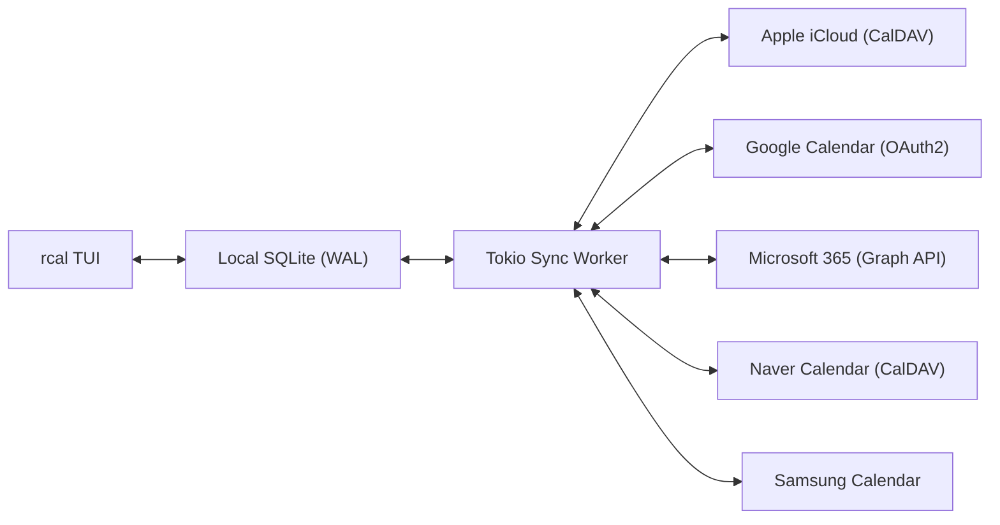
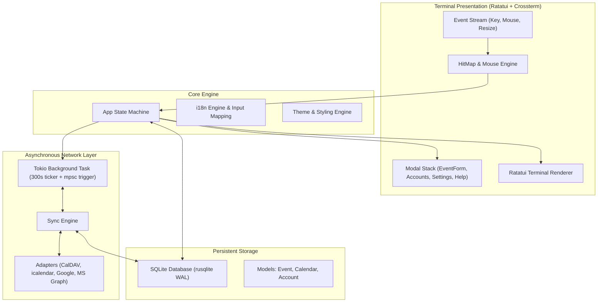

<div align="center">

```
  ██████╗  ██████╗ █████╗ ██╗     
  ██╔══██╗██╔════╝██╔══██╗██║     
  ██████╔╝██║     ███████║██║     
  ██╔══██╗██║     ██╔══██║██║     
  ██║  ██║╚██████╗██║  ██║███████╗
  ╚═╝  ╚═╝ ╚═════╝╚═╝  ╚═╝╚══════╝
```

### **Calendrier de terminal Rust rapide, moderne, interactif à la souris avec synchronisation multi-cloud**

[](https://www.rust-lang.org)
[](../../LICENSE)
[](https://github.com/eeyees/rcal)
[](https://github.com/ratatui/ratatui)
[](https://www.sqlite.org)
[](https://tokio.rs)

<p align="center">
  🌐 <strong>Languages / 다국어 / 语言 / 言語 / Idiomas:</strong><br>
  <a href="../../README.md">English</a> •
  <a href="README.ko.md">한국어</a> •
  <a href="README.zh-CN.md">简体中文</a> •
  <a href="README.zh-TW.md">繁體中文</a> •
  <a href="README.ja.md">日本語</a> •
  <a href="README.es.md">Español</a> •
  <strong>Français</strong> •
  <a href="README.de.md">Deutsch</a> •
  <a href="README.pt-BR.md">Português</a> •
  <a href="README.ru.md">Русский</a> •
  <a href="README.it.md">Italiano</a> •<br>
  <a href="README.id.md">Bahasa Indonesia</a> •
  <a href="README.vi.md">Tiếng Việt</a> •
  <a href="README.tr.md">Türkçe</a> •
  <a href="README.pl.md">Polski</a> •
  <a href="README.nl.md">Nederlands</a> •
  <a href="README.ar.md">العربية</a> •
  <a href="README.hi.md">हिन्दी</a> •
  <a href="README.bn.md">বাংলা</a> •
  <a href="README.sv.md">Svenska</a> •
  <a href="README.uk.md">Українська</a> •
  <a href="README.th.md">ภาษาไทย</a>
</p>

<p align="center">
  <a href="#-key-features">Fonctionnalités</a> •
  <a href="#-ui-views">Vues UI</a> •
  <a href="#-controls">Contrôles</a> •
  <a href="#-cloud-sync">Synchronisation</a> •
  <a href="#-themes">Thèmes</a> •
  <a href="#-installation">Installation</a> •
  <a href="#-architecture">Architecture</a>
</p>

---

</div>

`rcal` est un calendrier TUI léger et ultra-réactif conçu pour les développeurs et les passionnés du terminal souhaitant la clarté visuelle de Google Calendar sans latence, avec **zéro lag**, **100% d'interactivité souris** et une **synchronisation bidirectionnelle multi-cloud**.

---

## <a id="-key-features"></a>✨ Fonctionnalités principales

- ⚡ **Architecture Offline-First sans latence** : Démarrage instantané en moins d'une milliseconde grâce à la base SQLite intégrée en mode WAL.
- 🖱️ **Interactivité complète à la souris** : Clic sur les onglets de vue, boutons de navigation, double-clic sur un jour pour zoomer sur la journée, clic sur un créneau horaire pour créer un événement et molette pour défiler.
- 📅 **4 Vues haute densité familières** : Vues Mois, Semaine, Jour (positionnement intelligent côte à côte des événements qui se chevauchent) et Agenda chronologique.
- ☁️ **Moteur de synchronisation multi-cloud & CalDAV** : Prise en charge d'Apple iCloud, Naver, Google Calendar (OAuth2), Microsoft 365 Graph API et Samsung Calendar avec un travailleur en arrière-plan Tokio.
- ⌨️ **Raccourcis Vim et navigation fluide** : Touches `h/j/k/l`, bascule rapide de vue et gestion transparente des touches sans bips intempestifs.
- 🌐 **Prise en charge multilingue native (i18n)** : Détection automatique de la langue du système et bascule en 1 touche.
- 🎨 **Thèmes soignés et personnalisation** : 7 palettes de couleurs (Modern Dark, Nord, Dracula, Forest, Sunset, Monokai, Solarized) et choix du premier jour de la semaine.

---

## <a id="-ui-views"></a>🖥️ Vues UI

```
┌── rcal v2026.11.02.1 ─────────────────────────────────────────────── [ L: 한/EN ] [ ? Help ] [ ⚙ Settings ] ──┐
│ [ 1:Month ] [ 2:Week ] [ 3:Day ] [ 4:Agenda ]    [ < ] [ Today ] [ > ]  2026-11-01 (Sun)   [ ⟳ Sync ]  │
├────────────────────┬───────────────────────────────────────────────────────────────────────────────────┤
│ Calendars          │                             November 2026                                         │
│ [x] ■ Personal     │  Sun         Mon         Tue         Wed         Thu         Fri         Sat      │
│ [x] ■ Work         │ ┌───────────┬───────────┬───────────┬───────────┬───────────┬───────────┬───────────┐ │
│ [x] ■ Holidays     │ │ 1  TODAY  │ 2         │ 3         │ 4         │ 5         │ 6         │ 7         │ │
│                    │ │■ 10:00 AM │■ 09:00 AM │           │■ 14:00 PM │           │■ 19:00 PM │           │ │
│ Accounts           │ │  Sprint   │  Standup  │           │  Design   │           │  Dinner   │           │ │
│ • iCloud (Syncing) │ ├───────────┼───────────┼───────────┼───────────┼───────────┼───────────┼───────────┤ │
│ • Google (Active)  │ │ 8         │ 9         │ 10        │ 11        │ 12        │ 13        │ 14        │ │
│                    │ │           │           │           │           │           │           │           │ │
├────────────────────┴───────────────────────────────────────────────────────────────────────────────────┤
│ [c] New Event  [m/w/d/a] Switch View  [h/j/k/l] Navigate  [/] Search  [a] Accounts  [s] Settings  [q] Quit │
└────────────────────────────────────────────────────────────────────────────────────────────────────────┘
```

---

## <a id="-controls"></a>⌨️ Guide des raccourcis clavier et de la souris

### 🧭 Contrôles 1: Navigation

| Raccourci | Action souris | Description |
| :--- | :--- | :--- |
| `h` / `j` / `k` / `l` ou Flèches | Clic sur cellule / créneau horaire | Déplacer le curseur Gauche / Bas / Haut / Droite |
| `1` ou `m` | Clic sur onglet `[ 1:Month ]` | Passer à la **Vue Mois** |
| `2` ou `w` | Clic sur onglet `[ 2:Week ]` | Passer à la **Vue Semaine** |
| `3` ou `d` | Clic sur onglet `[ 3:Day ]` | Passer à la **Vue Jour** |
| `4` ou `a` | Clic sur onglet `[ 4:Agenda ]` | Passer à la **Vue Agenda** |
| `t` | Clic sur bouton `[ Today ]` | Aller à Aujourd'hui |
| `[` / `]` | Clic sur boutons `[ < ]` / `[ > ]` | Période précédente / suivante |
| Molette souris | Faire défiler la molette | Faire défiler la chronologie ou changer de date |
| Double-clic | Double-clic sur un jour | Zoomer directement sur la journée depuis la vue mois |

### 📝 Contrôles 2: Events & Modals

| Raccourci | Action souris | Description |
| :--- | :--- | :--- |
| `c` ou `n` | Clic sur `[ + New ]` ou créneau vide | Ouvrir le formulaire de nouvel événement |
| `Enter` | Clic sur le bloc d'événement | Ouvrir les détails de l'événement |
| `e` | Clic sur bouton `[ Edit ]` | Modifier l'événement |
| `x` ou `Delete` | Clic sur bouton `[ Delete ]` | Supprimer l'événement |
| `Tab` / `Shift+Tab` | Clic sur champ / bouton | Changer le focus dans le formulaire |
| `Esc` ou `q` | Clic sur `[ Close ]` ou en dehors | Fermer la fenêtre modale active |

### ⚙️ Contrôles 3: System & Settings

| Raccourci | Action souris | Description |
| :--- | :--- | :--- |
| `L` | Clic sur `[ L: 한/EN ]` | Changer la langue d'affichage |
| `s` | Clic sur `[ ⚙ Settings ]` | Ouvrir les paramètres système |
| `a` | Clic sur Comptes dans la barre latérale | Ouvrir le gestionnaire de comptes cloud |
| `b` | Clic sur bouton de barre latérale | Afficher / masquer la barre latérale |
| `r` | Clic sur `[ ⟳ Sync ]` | Lancer immédiatement la synchronisation cloud |
| `?` | Clic sur `[ ? Help ]` | Afficher l'aide des raccourcis |
| `Ctrl+C` / `q` | - | Quitter `rcal` proprement |

---

## <a id="-cloud-sync"></a>☁️ Synchronisation multi-cloud & CalDAV

`rcal` intègre des adaptateurs performants pour garder votre calendrier synchronisé :



### Supported Providers

- **Apple iCloud** : Synchronisation CalDAV via identifiant Apple et mot de passe d'application.
- **Naver Calendar** : Détection et synchronisation CalDAV automatique.
- **Google Calendar** : Synchronisation via l'API Google Calendar avec OAuth2.
- **Microsoft 365 / Outlook** : Connexion via l'API REST Microsoft Graph.
- **Samsung Calendar** : Intégration du cloud Samsung.

---

## <a id="-themes"></a>🎨 Thèmes et personnalisation

Appuyez sur `s` pour ouvrir les **Paramètres** et personnaliser votre affichage :

### Built-in Color Palettes
- 🌙 **Modern Dark** : Thème sombre moderne et épuré par défaut
- ❄️ **Nord** : Tons bleutés arctiques scandinaves
- 🧛 **Dracula** : Thème sombre emblématique à fort contraste
- 🌲 **Forest** : Vert matcha et teintes naturelles relaxantes
- 🌆 **Sunset** : Palette cyberpunk violette et orange vif
- 🎨 **Monokai** : Contraste classique inspiré des éditeurs de code
- ☀️ **Solarized** : Thème sombre à faible contraste doux pour les yeux

### Premier jour de la semaine
Choisissez de démarrer votre semaine le **dimanche**, le **lundi** ou le **samedi**.

---

## <a id="-architecture"></a>🏗️ Architecture



---

## <a id="-installation"></a>🚀 Installation & Démarrage

### Compiler depuis les sources

```bash
# Clone the repository
git clone https://github.com/eeyees/rcal.git
cd rcal

# Build release
cargo build --release

# Run
./target/release/rcal
```

### Installation globale via Cargo

```bash
cargo install --path .
rcal
```

### Emplacement de la base de données locale

- **macOS**: `~/Library/Application Support/rcal/rcal.db`
- **Linux**: `~/.local/share/rcal/rcal.db`
- **Windows**: `%LOCALAPPDATA%\rcal\rcal.db`

---

## 🗺️ 🗺️ Feuille de route

- [x] **Phase 1** : TUI local MVP, 4 vues, gestion complète de la souris, SQLite WAL, CRUD.
- [x] **Phase 2** : CalDAV (Apple iCloud et Naver), tâche de fond Tokio, gestion des comptes.
- [x] **Phase 3** : Google Calendar, MS Graph, Samsung, 7 thèmes, jour de début de semaine.
- [ ] **Phase 4** : Écosystème et protocoles ouverts :
    - [x] Serveur MCP (Model Context Protocol) pour agents IA
    - [ ] Serveur de diffusion HTTP WebCal / iCalendar (`.ics`)
    - [ ] Événements récurrents (RFC 5545 RRULE)
    - [ ] Ajout d'événements en langage naturel
    - [x] Notifications système du bureau

---

## 📜 📜 Licence

Distribué sous la **Licence MIT**. Consultez [`LICENSE`](../../LICENSE) pour plus d'informations.
