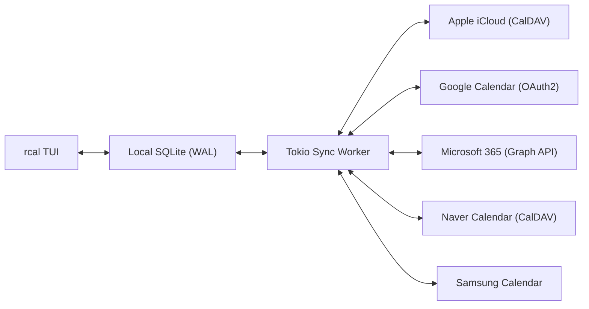
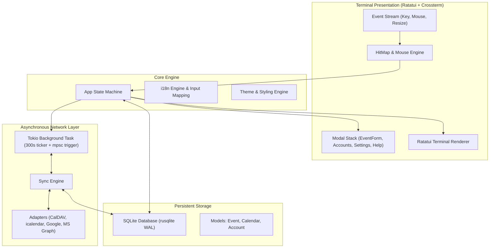

<div align="center">

```
  ██████╗  ██████╗ █████╗ ██╗     
  ██╔══██╗██╔════╝██╔══██╗██║     
  ██████╔╝██║     ███████║██║     
  ██╔══██╗██║     ██╔══██║██║     
  ██║  ██║╚██████╗██║  ██║███████╗
  ╚═╝  ╚═╝ ╚═════╝╚═╝  ╚═╝╚══════╝
```

### **मल्टी-क्लाउड सिंक के साथ तेज़, आधुनिक, माउस-इंटरैक्टिव रस्ट टर्मिनल कैलेंडर**

[](https://www.rust-lang.org)
[](../../LICENSE)
[](https://github.com/eeyees/rcal)
[](https://github.com/ratatui/ratatui)
[](https://www.sqlite.org)
[](https://tokio.rs)

<p align="center">
  🌐 <strong>Languages / 다국어 / 语言 / 言語 / Idiomas:</strong><br>
  <a href="../../README.md">English</a> •
  <a href="README.ko.md">한국어</a> •
  <a href="README.zh-CN.md">简体中文</a> •
  <a href="README.zh-TW.md">繁體中文</a> •
  <a href="README.ja.md">日本語</a> •
  <a href="README.es.md">Español</a> •
  <a href="README.fr.md">Français</a> •
  <a href="README.de.md">Deutsch</a> •
  <a href="README.pt-BR.md">Português</a> •
  <a href="README.ru.md">Русский</a> •
  <a href="README.it.md">Italiano</a> •<br>
  <a href="README.id.md">Bahasa Indonesia</a> •
  <a href="README.vi.md">Tiếng Việt</a> •
  <a href="README.tr.md">Türkçe</a> •
  <a href="README.pl.md">Polski</a> •
  <a href="README.nl.md">Nederlands</a> •
  <a href="README.ar.md">العربية</a> •
  <strong>हिन्दी</strong> •
  <a href="README.bn.md">বাংলা</a> •
  <a href="README.sv.md">Svenska</a> •
  <a href="README.uk.md">Українська</a> •
  <a href="README.th.md">ภาษาไทย</a>
</p>

<p align="center">
  <a href="#-key-features">प्रमुख विशेषताएं</a> •
  <a href="#-ui-views">इंटरफ़ेस दृश्य</a> •
  <a href="#-controls">नियंत्रण</a> •
  <a href="#-cloud-sync">क्लाउड सिंक</a> •
  <a href="#-themes">थीम्स</a> •
  <a href="#-installation">इंस्टॉलेशन</a> •
  <a href="#-architecture">आर्किटेक्चर</a>
</p>

---

</div>

`rcal` एक हल्का और त्वरित प्रतिक्रिया देने वाला TUI कैलेंडर है, जिसे डेवलपर्स और टर्मिनल उपयोगकर्ताओं के लिए डिज़ाइन किया गया है जो बिना किसी लैग के, 100% माउस नियंत्रण और सुचारू मल्टी-क्लाउड सिंक के साथ Google Calendar जैसी दृश्य शक्ति का अनुभव करना चाहते हैं।

---

## <a id="-key-features"></a>✨ प्रमुख विशेषताएं

- ⚡ **शून्य-लैग ऑफ़लाइन-प्रथम आर्किटेक्चर**: WAL मोड में एम्बेडेड SQLite डेटाबेस के साथ मिलीसेकंड से भी कम समय में तुरंत प्रारंभ।
- 🖱️ **पूर्ण माउस इंटरैक्शन**: दृश्य टैब, नेविगेशन बटन पर क्लिक करें, दिन के विस्तृत दृश्य के लिए डबल-क्लिक करें, इवेंट बनाने के लिए टाइम स्लॉट पर क्लिक करें, और स्क्रॉल करें।
- 📅 **4 परिचित कैलेंडर दृश्य**: माह दृश्य, सप्ताह दृश्य, दिन दृश्य (ओवरलैपिंग इवेंट्स के लिए बुद्धिमान समानांतर स्लॉटिंग), और दिनांक अनुसार व्यवस्थित एजेंडा दृश्य।
- ☁️ **मल्टी-क्लाउड और CalDAV सिंक इंजन**: Apple iCloud, Naver, Google Calendar (OAuth2), Microsoft 365 Graph API, और Samsung Calendar के साथ बैकग्राउंड में शांत सिंक्रनाइज़ेशन।
- ⌨️ **Vim कीबाइंडिंग और सहज नेविगेशन**: क्लासिक `h/j/k/l` नियंत्रण, तुरंत दृश्य बदलना, और बिना किसी रुकावट के त्वरित टाइपिंग।
- 🌐 **मूल बहुभाषी समर्थन (i18n)**: सिस्टम भाषा का स्वचालित पता लगाना और 1-कुंजी से तुरंत भाषा बदलना।
- 🎨 **समृद्ध थीम्स और अनुकूलन**: 7 अंतर्निहित रंग थीम (Modern Dark, Nord, Dracula, Forest, Sunset, Monokai, Solarized) और सप्ताह का पहला दिन चुनने का विकल्प।

---

## <a id="-ui-views"></a>🖥️ इंटरफ़ेस दृश्य

```
┌── rcal v0.1.0 ─────────────────────────────────────────────── [ L: 한/EN ] [ ? Help ] [ ⚙ Settings ] ──┐
│ [ 1:Month ] [ 2:Week ] [ 3:Day ] [ 4:Agenda ]    [ < ] [ Today ] [ > ]  2026-11-01 (Sun)   [ ⟳ Sync ]  │
├────────────────────┬───────────────────────────────────────────────────────────────────────────────────┤
│ Calendars          │                             November 2026                                         │
│ [x] ■ Personal     │  Sun         Mon         Tue         Wed         Thu         Fri         Sat      │
│ [x] ■ Work         │ ┌───────────┬───────────┬───────────┬───────────┬───────────┬───────────┬───────────┐ │
│ [x] ■ Holidays     │ │ 1  TODAY  │ 2         │ 3         │ 4         │ 5         │ 6         │ 7         │ │
│                    │ │■ 10:00 AM │■ 09:00 AM │           │■ 14:00 PM │           │■ 19:00 PM │           │ │
│ Accounts           │ │  Sprint   │  Standup  │           │  Design   │           │  Dinner   │           │ │
│ • iCloud (Syncing) │ ├───────────┼───────────┼───────────┼───────────┼───────────┼───────────┼───────────┤ │
│ • Google (Active)  │ │ 8         │ 9         │ 10        │ 11        │ 12        │ 13        │ 14        │ │
│                    │ │           │           │           │           │           │           │           │ │
├────────────────────┴───────────────────────────────────────────────────────────────────────────────────┤
│ [c] New Event  [m/w/d/a] Switch View  [h/j/k/l] Navigate  [/] Search  [a] Accounts  [s] Settings  [q] Quit │
└────────────────────────────────────────────────────────────────────────────────────────────────────────┘
```

---

## <a id="-controls"></a>⌨️ कीबोर्ड और माउस नियंत्रण

### 🧭 नियंत्रण 1: Navigation

| शॉर्टकट | माउस क्रिया | विवरण |
| :--- | :--- | :--- |
| `h` / `j` / `k` / `l` या तीर कुंजियाँ | दिनांक सेल / समय स्लॉट पर क्लिक | कर्सर को बाएँ / नीचे / ऊपर / दाएँ ले जाएँ |
| `1` या `m` | `[ 1:Month ]` टैब पर क्लिक | **माह दृश्य** पर स्विच करें |
| `2` या `w` | `[ 2:Week ]` टैब पर क्लिक | **सप्ताह दृश्य** पर स्विच करें |
| `3` या `d` | `[ 3:Day ]` टैब पर क्लिक | **दिन दृश्य** पर स्विच करें |
| `4` या `a` | `[ 4:Agenda ]` टैब पर क्लिक | **एजेंडा दृश्य** पर स्विच करें |
| `t` | `[ Today ]` बटन पर क्लिक | कर्सर आज की तारीख पर ले जाएँ |
| `[` / `]` | `[ < ]` / `[ > ]` बटन पर क्लिक | पिछली / अगली अवधि पर जाएँ |
| माउस स्क्रॉल | पहिया ऊपर/नीचे घुमाएँ | टाइमलाइन स्क्रॉल करें या तारीख बदलें |
| डबल क्लिक | दिनांक सेल पर डबल क्लिक | माह दृश्य से सीधे दिन के विवरण में जाएँ |

### 📝 नियंत्रण 2: Events & Modals

| शॉर्टकट | माउस क्रिया | विवरण |
| :--- | :--- | :--- |
| `c` या `n` | `[ + New ]` या खाली स्लॉट पर क्लिक | नया इवेंट फॉर्म खोलें |
| `Enter` | इवेंट ब्लॉक पर क्लिक | इवेंट का विवरण देखें |
| `e` | `[ Edit ]` बटन पर क्लिक | इवेंट संपादित करें |
| `x` या `Delete` | `[ Delete ]` बटन पर क्लिक | चयनित इवेंट हटाएं |
| `Tab` / `Shift+Tab` | इनपुट / बटन पर क्लिक | फ़ॉर्म फ़ील्ड्स के बीच फ़ोकस बदलें |
| `Esc` या `q` | `[ Close ]` या बाहर क्लिक | सक्रिय मोडल बंद करें |

### ⚙️ नियंत्रण 3: System & Settings

| शॉर्टकट | माउस क्रिया | विवरण |
| :--- | :--- | :--- |
| `L` | `[ L: 한/EN ]` बटन पर क्लिक | भाषा बदलें |
| `s` | `[ ⚙ Settings ]` पर क्लिक | सेटिंग्स मोडल खोलें |
| `a` | साइडबार में Accounts पर क्लिक | क्लाउड अकाउंट मैनेजर खोलें |
| `b` | साइडबार बटन पर क्लिक | साइडबार टॉगल करें |
| `r` | `[ ⟳ Sync ]` पर क्लिक | तुरंत क्लाउड सिंक शुरू करें |
| `?` | `[ ? Help ]` पर क्लिक | शॉर्टकट सहायता देखें |
| `Ctrl+C` / `q` | - | `rcal` सुरक्षित रूप से बंद करें |

---

## <a id="-cloud-sync"></a>☁️ मल्टी-क्लाउड और CalDAV सिंक

`rcal` आपके शेड्यूल को हमेशा अपडेट रखने के लिए विश्वसनीय सिंक एडेप्टर प्रदान करता है:



### Supported Providers

- **Apple iCloud**: Apple ID और ऐप-विशिष्ट पासवर्ड के माध्यम से CalDAV सिंक।
- **Naver Calendar**: CalDAV प्रोटोकॉल द्वारा स्वतः सिंक।
- **Google Calendar**: सुरक्षित OAuth2 के साथ Google Calendar API।
- **Microsoft 365 / Outlook**: Microsoft Graph REST API द्वारा एकीकरण।
- **Samsung Calendar**: सैमसंग क्लाउड एकीकरण।

---

## <a id="-themes"></a>🎨 थीम्स और अनुकूलन

`s` दबाकर **सेटिंग्स मोडल** में जाएं और अपने पसंदीदा रंग चुनें:

### Built-in Color Palettes
- 🌙 **Modern Dark**: मानक साफ़ डार्क थीम
- ❄️ **Nord**: शांत नॉर्डिक नीला-धूसर रंग
- 🧛 **Dracula**: लोकप्रिय उच्च कंट्रास्ट डार्क थीम
- 🌲 **Forest**: आंखों को सुकून देने वाला प्राकृतिक हरा रंग
- 🌆 **Sunset**: जीवंत साइबरपंक बैंगनी और नारंगी थीम
- 🎨 **Monokai**: क्लासिक कोड एडिटर कंट्रास्ट
- ☀️ **Solarized**: आंखों के अनुकूल कम कंट्रास्ट डार्क थीम

### सप्ताह का पहला दिन
सप्ताह का पहला दिन **रविवार**, **सोमवार**, या **शनिवार** चुनें।

---

## <a id="-architecture"></a>🏗️ आर्किटेक्चर



---

## <a id="-installation"></a>🚀 स्थापना और उपयोग

### स्रोत कोड से बनाएँ

```bash
# Clone the repository
git clone https://github.com/eeyees/rcal.git
cd rcal

# Build release
cargo build --release

# Run
./target/release/rcal
```

### Cargo से इंस्टॉल करें

```bash
cargo install --path .
rcal
```

### स्थानीय डेटाबेस फ़ाइल स्थान

- **macOS**: `~/Library/Application Support/rcal/rcal.db`
- **Linux**: `~/.local/share/rcal/rcal.db`
- **Windows**: `%LOCALAPPDATA%\rcal\rcal.db`

---

## 🗺️ 🗺️ विकास रोडमैप

- [x] **चरण 1: स्थानीय TUI MVP**: माह/सप्ताह/दिन/एजेंडा दृश्य, माउस इंजन, SQLite WAL, इवेंट CRUD।
- [x] **चरण 2: CalDAV सिंक**: Apple iCloud और Naver सिंक, Tokio वर्कर, खाता प्रबंधन।
- [x] **चरण 3: मल्टी-क्लाउड**: Google, MS Graph, Samsung, 7 थीम्स, सप्ताह प्रारंभ विकल्प।
- [ ] **चरण 4: भावी विस्तार**:
    - [ ] AI एजेंट्स के लिए MCP (Model Context Protocol) सर्वर
    - [ ] बाहरी कैलेंडरों के लिए WebCal / iCalendar (`.ics`) सर्वर
    - [ ] आवर्ती इवेंट नियम (RFC 5545 RRULE)
    - [ ] प्राकृतिक भाषा में इवेंट जोड़ना
    - [ ] सिस्टम डेस्कटॉप सूचनाएं

---

## 📜 📜 लाइसेंस

**MIT लाइसेंस** के तहत वितरित। अधिक जानकारी के लिए [`LICENSE`](../../LICENSE) देखें।
