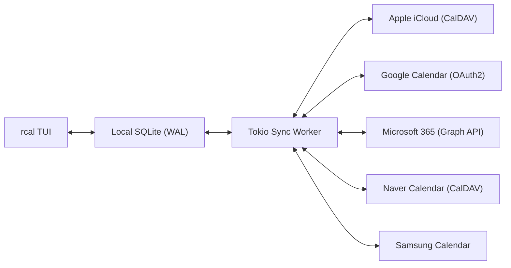
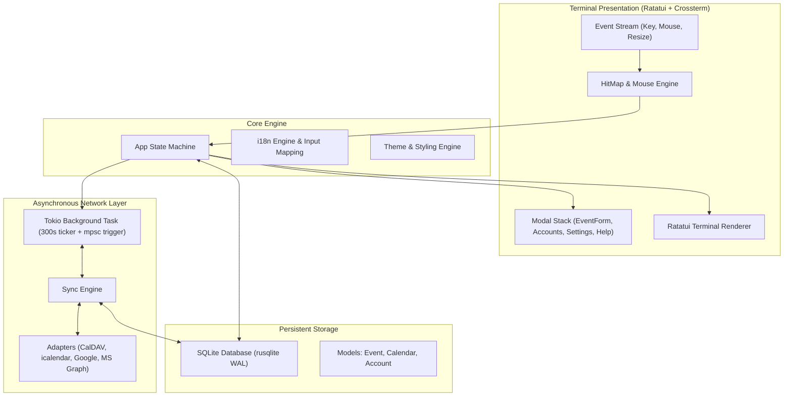

<div align="center">

```
  ██████╗  ██████╗ █████╗ ██╗     
  ██╔══██╗██╔════╝██╔══██╗██║     
  ██████╔╝██║     ███████║██║     
  ██╔══██╗██║     ██╔══██║██║     
  ██║  ██║╚██████╗██║  ██║███████╗
  ╚═╝  ╚═╝ ╚═════╝╚═╝  ╚═╝╚══════╝
```

### **Kalender Terminal Rust Cepat, Modern, Interaktif Mouse dengan Sinkronisasi Multi-Cloud**

[](https://www.rust-lang.org)
[](../../LICENSE)
[](https://github.com/eeyees/rcal)
[](https://github.com/ratatui/ratatui)
[](https://www.sqlite.org)
[](https://tokio.rs)

<p align="center">
  🌐 <strong>Languages / 다국어 / 语言 / 言語 / Idiomas:</strong><br>
  <a href="../../README.md">English</a> •
  <a href="README.ko.md">한국어</a> •
  <a href="README.zh-CN.md">简体中文</a> •
  <a href="README.zh-TW.md">繁體中文</a> •
  <a href="README.ja.md">日本語</a> •
  <a href="README.es.md">Español</a> •
  <a href="README.fr.md">Français</a> •
  <a href="README.de.md">Deutsch</a> •
  <a href="README.pt-BR.md">Português</a> •
  <a href="README.ru.md">Русский</a> •
  <a href="README.it.md">Italiano</a> •<br>
  <strong>Bahasa Indonesia</strong> •
  <a href="README.vi.md">Tiếng Việt</a> •
  <a href="README.tr.md">Türkçe</a> •
  <a href="README.pl.md">Polski</a> •
  <a href="README.nl.md">Nederlands</a> •
  <a href="README.ar.md">العربية</a> •
  <a href="README.hi.md">हिन्दी</a> •
  <a href="README.bn.md">বাংলা</a> •
  <a href="README.sv.md">Svenska</a> •
  <a href="README.uk.md">Українська</a> •
  <a href="README.th.md">ภาษาไทย</a>
</p>

<p align="center">
  <a href="#-key-features">Fitur Utama</a> •
  <a href="#-ui-views">Tampilan UI</a> •
  <a href="#-controls">Kontrol</a> •
  <a href="#-cloud-sync">Sinkronisasi Cloud</a> •
  <a href="#-themes">Tema</a> •
  <a href="#-installation">Instalasi</a> •
  <a href="#-architecture">Arsitektur</a>
</p>

---

</div>

`rcal` adalah kalender TUI yang ringan dan responsif, dibangun untuk pengembang dan pengguna terminal yang menginginkan kekuatan visual Google Calendar langsung di terminal tanpa lag, interaktivitas mouse 100%, dan sinkronisasi multi-cloud yang lancar.

---

## <a id="-key-features"></a>✨ Fitur Utama

- ⚡ **Arsitektur Tanpa Lag & Offline-First**: Startup instan di bawah milidetik berkat database SQLite tertanam dengan mode WAL (Write-Ahead Logging).
- 🖱️ **Interaktivitas Mouse Penuh**: Klik tab tampilan, tombol navigasi, klik dua kali tanggal untuk masuk ke tampilan Harian, klik slot waktu untuk membuat acara, dan putar roda mouse untuk menggulir.
- 📅 **4 Tampilan Kalender Familiar**: Tampilan Bulanan, Mingguan, Harian dengan penempatan pintar acara yang bersamaan, dan tampilan Agenda berurutan berdasarkan tanggal.
- ☁️ **Mesin Sinkronisasi Multi-Cloud & CalDAV**: Mendukung Apple iCloud, Naver Calendar, Google Calendar API (OAuth2), Microsoft 365 Graph API, dan Samsung Calendar dengan pekerja latar belakang Tokio otomatis.
- ⌨️ **Navigasi Vim & Penanganan IME Transparan**: Tombol arah `h/j/k/l`, pintasan praktis, dan pemetaan cerdas input keyboard tanpa gangguan.
- 🌐 **Dukungan Multi-Bahasa Asli (i18n)**: Deteksi lokal sistem otomatis dan peralihan 1 tombol antar bahasa.
- 🎨 **Tema Menarik & Kustomisasi**: 7 palet warna (Modern Dark, Nord, Dracula, Forest, Sunset, Monokai, Solarized) dan pilihan hari awal minggu (Minggu/Senin/Sabtu).

---

## <a id="-ui-views"></a>🖥️ Tampilan UI

```
┌── rcal v2026.11.01.2 ─────────────────────────────────────────────── [ L: 한/EN ] [ ? Help ] [ ⚙ Settings ] ──┐
│ [ 1:Month ] [ 2:Week ] [ 3:Day ] [ 4:Agenda ]    [ < ] [ Today ] [ > ]  2026-11-01 (Sun)   [ ⟳ Sync ]  │
├────────────────────┬───────────────────────────────────────────────────────────────────────────────────┤
│ Calendars          │                             November 2026                                         │
│ [x] ■ Personal     │  Sun         Mon         Tue         Wed         Thu         Fri         Sat      │
│ [x] ■ Work         │ ┌───────────┬───────────┬───────────┬───────────┬───────────┬───────────┬───────────┐ │
│ [x] ■ Holidays     │ │ 1  TODAY  │ 2         │ 3         │ 4         │ 5         │ 6         │ 7         │ │
│                    │ │■ 10:00 AM │■ 09:00 AM │           │■ 14:00 PM │           │■ 19:00 PM │           │ │
│ Accounts           │ │  Sprint   │  Standup  │           │  Design   │           │  Dinner   │           │ │
│ • iCloud (Syncing) │ ├───────────┼───────────┼───────────┼───────────┼───────────┼───────────┼───────────┤ │
│ • Google (Active)  │ │ 8         │ 9         │ 10        │ 11        │ 12        │ 13        │ 14        │ │
│                    │ │           │           │           │           │           │           │           │ │
├────────────────────┴───────────────────────────────────────────────────────────────────────────────────┤
│ [c] New Event  [m/w/d/a] Switch View  [h/j/k/l] Navigate  [/] Search  [a] Accounts  [s] Settings  [q] Quit │
└────────────────────────────────────────────────────────────────────────────────────────────────────────┘
```

---

## <a id="-controls"></a>⌨️ Panduan Kontrol Keyboard & Mouse

### 🧭 Kontrol 1: Navigation

| Pintasan | Aksi Mouse | Deskripsi |
| :--- | :--- | :--- |
| `h` / `j` / `k` / `l` atau Panah | Klik sel tanggal / slot jam | Pindah kursor Kiri / Bawah / Atas / Kanan |
| `1` atau `m` | Klik tab `[ 1:Month ]` | Beralih ke **Tampilan Bulanan** |
| `2` atau `w` | Klik tab `[ 2:Week ]` | Beralih ke **Tampilan Mingguan** |
| `3` atau `d` | Klik tab `[ 3:Day ]` | Beralih ke **Tampilan Harian** |
| `4` atau `a` | Klik tab `[ 4:Agenda ]` | Beralih ke **Tampilan Agenda** |
| `t` | Klik tombol `[ Today ]` | Lompat ke Hari Ini |
| `[` / `]` | Klik tombol `[ < ]` / `[ > ]` | Periode sebelumnya / berikutnya |
| Scroll Wheel | Putar roda mouse | Gulir linimasa atau ganti tanggal |
| Klik Ganda | Klik ganda sel tanggal | Buka detail hari langsung dari tampilan bulanan |

### 📝 Kontrol 2: Events & Modals

| Pintasan | Aksi Mouse | Deskripsi |
| :--- | :--- | :--- |
| `c` atau `n` | Klik `[ + New ]` atau slot kosong | Buka modal buat acara baru |
| `Enter` | Klik kotak acara | Buka modal detail acara |
| `e` | Klik tombol `[ Edit ]` | Edit acara |
| `x` atau `Delete` | Klik tombol `[ Delete ]` | Hapus acara yang dipilih |
| `Tab` / `Shift+Tab` | Klik input / tombol | Pindah fokus antar bidang formulir |
| `Esc` atau `q` | Klik `[ Close ]` / luar modal | Tutup modal yang aktif |

### ⚙️ Kontrol 3: System & Settings

| Pintasan | Aksi Mouse | Deskripsi |
| :--- | :--- | :--- |
| `L` | Klik `[ L: 한/EN ]` | Ganti bahasa tampilan |
| `s` | Klik `[ ⚙ Settings ]` | Buka modal Pengaturan |
| `a` | Klik Akun di bilah samping | Buka Pengelola Akun Cloud |
| `b` | Klik tombol sidebar | Alihkan visibilitas bilah samping |
| `r` | Klik `[ ⟳ Sync ]` | Jalankan sinkronisasi cloud langsung |
| `?` | Klik `[ ? Help ]` | Tampilkan bantuan pintasan |
| `Ctrl+C` / `q` | - | Keluar dari `rcal` |

---

## <a id="-cloud-sync"></a>☁️ Sinkronisasi Multi-Cloud & CalDAV

`rcal` menyediakan lapisan sinkronisasi handal untuk menjaga jadwal terminal Anda selalu terbarui:



### Supported Providers

- **Apple iCloud**: Koneksi CalDAV menggunakan ID Apple dan Kata Sandi Khusus Aplikasi.
- **Naver Calendar**: Sinkronisasi CalDAV otomatis dengan kalender Naver.
- **Google Calendar**: Integrasi API Google Calendar berbasis OAuth2.
- **Microsoft 365 / Outlook**: Sinkronisasi melalui Microsoft Graph REST API.
- **Samsung Calendar**: Integrasi akun Samsung Cloud.

---

## <a id="-themes"></a>🎨 Tema & Kustomisasi

Tekan `s` untuk membuka **Modal Pengaturan** dan atur kalender sesuai selera Anda:

### Built-in Color Palettes
- 🌙 **Modern Dark**: Tema gelap bersih standar
- ❄️ **Nord**: Nuansa biru dingin kutub Nordik
- 🧛 **Dracula**: Tema kontras tinggi klasik
- 🌲 **Forest**: Warna hijau matcha dan bumi yang menenangkan
- 🌆 **Sunset**: Nuansa ungu dan oranye cyberpunk
- 🎨 **Monokai**: Tema kontras tinggi editor kode klasik
- ☀️ **Solarized**: Tema gelap rendah kontras yang ramah mata

### Awal Hari Mingguan
Pilih awal minggu Anda antara **Minggu**, **Senin**, atau **Sabtu**.

---

## <a id="-architecture"></a>🏗️ Arsitektur



---

## <a id="-installation"></a>🚀 Instalasi & Menjalankan

### Kompilasi dari Kode Sumber

```bash
# Clone the repository
git clone https://github.com/eeyees/rcal.git
cd rcal

# Build release
cargo build --release

# Run
./target/release/rcal
```

### Instal Global via Cargo

```bash
cargo install --path .
rcal
```

### Lokasi Penyimpanan Database

- **macOS**: `~/Library/Application Support/rcal/rcal.db`
- **Linux**: `~/.local/share/rcal/rcal.db`
- **Windows**: `%LOCALAPPDATA%\rcal\rcal.db`

---

## 🗺️ 🗺️ Rencana Pengembangan

- [x] **Fase 1: TUI Lokal MVP**: Tampilan Bulan, Minggu, Hari, Agenda, mesin klik mouse, SQLite WAL, CRUD acara.
- [x] **Fase 2: Mesin CalDAV**: Sinkronisasi Apple iCloud & Naver, pekerja latar Tokio, UI akun.
- [x] **Fase 3: Multi-Cloud**: Google Calendar, MS Graph, Samsung, pemetaan IME, 7 tema, hari awal minggu.
- [ ] **Fase 4: Ekosistem & Protokol Terbuka**:
    - [x] Server MCP (Model Context Protocol) untuk agen AI
    - [ ] Server langganan HTTP WebCal / iCalendar (`.ics`)
    - [ ] Aturan acara berulang (RFC 5545 RRULE)
    - [ ] Penambahan acara bahasa alami
    - [ ] Notifikasi sistem desktop

---

## 📜 📜 Lisensi

Didistribusikan di bawah **Lisensi MIT**. Lihat file [`LICENSE`](../../LICENSE) untuk informasi lebih lanjut.
