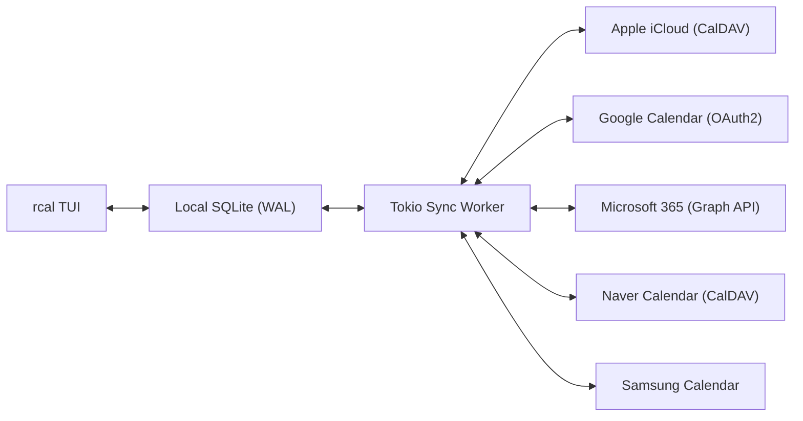
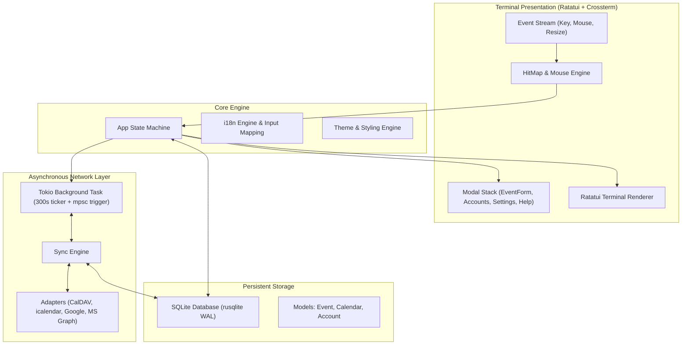

<div align="center">

```
  ██████╗  ██████╗ █████╗ ██╗     
  ██╔══██╗██╔════╝██╔══██╗██║     
  ██████╔╝██║     ███████║██║     
  ██╔══██╗██║     ██╔══██║██║     
  ██║  ██║╚██████╗██║  ██║███████╗
  ╚═╝  ╚═╝ ╚═════╝╚═╝  ╚═╝╚══════╝
```

### **Calendario da terminale in Rust veloce, moderno e interattivo con il mouse e sincronizzazione multi-cloud**

[](https://www.rust-lang.org)
[](../../LICENSE)
[](https://github.com/eeyees/rcal)
[](https://github.com/ratatui/ratatui)
[](https://www.sqlite.org)
[](https://tokio.rs)

<p align="center">
  🌐 <strong>Languages / 다국어 / 语言 / 言語 / Idiomas:</strong><br>
  <a href="../../README.md">English</a> •
  <a href="README.ko.md">한국어</a> •
  <a href="README.zh-CN.md">简体中文</a> •
  <a href="README.zh-TW.md">繁體中文</a> •
  <a href="README.ja.md">日本語</a> •
  <a href="README.es.md">Español</a> •
  <a href="README.fr.md">Français</a> •
  <a href="README.de.md">Deutsch</a> •
  <a href="README.pt-BR.md">Português</a> •
  <a href="README.ru.md">Русский</a> •
  <strong>Italiano</strong> •<br>
  <a href="README.id.md">Bahasa Indonesia</a> •
  <a href="README.vi.md">Tiếng Việt</a> •
  <a href="README.tr.md">Türkçe</a> •
  <a href="README.pl.md">Polski</a> •
  <a href="README.nl.md">Nederlands</a> •
  <a href="README.ar.md">العربية</a> •
  <a href="README.hi.md">हिन्दी</a> •
  <a href="README.bn.md">বাংলা</a> •
  <a href="README.sv.md">Svenska</a> •
  <a href="README.uk.md">Українська</a> •
  <a href="README.th.md">ภาษาไทย</a>
</p>

<p align="center">
  <a href="#-key-features">Funzionalità</a> •
  <a href="#-ui-views">Viste</a> •
  <a href="#-controls">Comandi</a> •
  <a href="#-cloud-sync">Sincronizzazione</a> •
  <a href="#-themes">Temi</a> •
  <a href="#-installation">Installazione</a> •
  <a href="#-architecture">Architettura</a>
</p>

---

</div>

`rcal` è un calendario TUI leggero e reattivo progettato per sviluppatori e appassionati del terminale che desiderano la comodità visiva di Google Calendar con **zero ritardo**, **interattività al 100% con il mouse** e **sincronizzazione bidirezionale multi-cloud**.

---

## <a id="-key-features"></a>✨ Funzionalità principali

- ⚡ **Architettura Offline-First a latenza zero**: Avvio istantaneo in meno di 1 ms grazie al database SQLite integrato in modalità WAL.
- 🖱️ **Interattività completa con il mouse**: Clic sulle schede, pulsanti di navigazione, doppio clic sulla data per il dettaglio del giorno, clic sugli slot orari per creare eventi e scorrimento con la rotellina.
- 📅 **4 Viste ad alta densità**: Vista Mese, Settimana, Giorno (con posizionamento affiancato intelligente degli eventi sovrapposti) e Agenda cronologica.
- ☁️ **Motore di sincronizzazione multi-cloud e CalDAV**: Connessione ad Apple iCloud, Naver, Google Calendar (OAuth2), Microsoft 365 Graph API e Samsung Calendar tramite processo in background Tokio.
- ⌨️ **Comandi Vim e navigazione naturale**: Tasti `h/j/k/l`, passaggio rapido tra le viste e digitazione confortevole.
- 🌐 **Supporto multilingue nativo (i18n)**: Rilevamento automatico della lingua di sistema e commutazione rapida con un solo tasto.
- 🎨 **7 Temi colore e personalizzazione**: Modern Dark, Nord, Dracula, Forest, Sunset, Monokai, Solarized e scelta del giorno di inizio settimana.

---

## <a id="-ui-views"></a>🖥️ Viste

```
┌── rcal v2026.11.05.1 ─────────────────────────────────────────────── [ L: 한/EN ] [ ? Help ] [ ⚙ Settings ] ──┐
│ [ 1:Month ] [ 2:Week ] [ 3:Day ] [ 4:Agenda ]    [ < ] [ Today ] [ > ]  2026-11-01 (Sun)   [ ⟳ Sync ]  │
├────────────────────┬───────────────────────────────────────────────────────────────────────────────────┤
│ Calendars          │                             November 2026                                         │
│ [x] ■ Personal     │  Sun         Mon         Tue         Wed         Thu         Fri         Sat      │
│ [x] ■ Work         │ ┌───────────┬───────────┬───────────┬───────────┬───────────┬───────────┬───────────┐ │
│ [x] ■ Holidays     │ │ 1  TODAY  │ 2         │ 3         │ 4         │ 5         │ 6         │ 7         │ │
│                    │ │■ 10:00 AM │■ 09:00 AM │           │■ 14:00 PM │           │■ 19:00 PM │           │ │
│ Accounts           │ │  Sprint   │  Standup  │           │  Design   │           │  Dinner   │           │ │
│ • iCloud (Syncing) │ ├───────────┼───────────┼───────────┼───────────┼───────────┼───────────┼───────────┤ │
│ • Google (Active)  │ │ 8         │ 9         │ 10        │ 11        │ 12        │ 13        │ 14        │ │
│                    │ │           │           │           │           │           │           │           │ │
├────────────────────┴───────────────────────────────────────────────────────────────────────────────────┤
│ [c] New Event  [m/w/d/a] Switch View  [h/j/k/l] Navigate  [/] Search  [a] Accounts  [s] Settings  [q] Quit │
└────────────────────────────────────────────────────────────────────────────────────────────────────────┘
```

---

## <a id="-controls"></a>⌨️ Guida ai comandi da tastiera e mouse

### 🧭 Comandi 1: Navigation

| Tasto | Azione mouse | Descrizione |
| :--- | :--- | :--- |
| `h` / `j` / `k` / `l` o Frecce | Clic su cella o slot orario | Sposta cursore a Sinistra / Giù / Su / Destra |
| `1` o `m` | Clic sulla scheda `[ 1:Month ]` | Passa alla **Vista Mese** |
| `2` o `w` | Clic sulla scheda `[ 2:Week ]` | Passa alla **Vista Settimana** |
| `3` o `d` | Clic sulla scheda `[ 3:Day ]` | Passa alla **Vista Giorno** |
| `4` o `a` | Clic sulla scheda `[ 4:Agenda ]` | Passa alla **Vista Agenda** |
| `t` | Clic sul pulsante `[ Today ]` | Vai a Oggi |
| `[` / `]` | Clic su `[ < ]` / `[ > ]` | Periodo precedente / successivo |
| Rotellina mouse | Ruota la rotellina | Scorri la timeline o cambia data |
| Doppio clic | Doppio clic sul giorno | Visualizza il dettaglio del giorno dal mese |

### 📝 Comandi 2: Events & Modals

| Tasto | Azione mouse | Descrizione |
| :--- | :--- | :--- |
| `c` o `n` | Clic su `[ + New ]` o slot vuoto | Apri modulo nuovo evento |
| `Enter` | Clic sul blocco evento | Apri dettagli dell'evento |
| `e` | Clic su `[ Edit ]` | Modifica evento |
| `x` o `Delete` | Clic su `[ Delete ]` | Elimina l'evento selezionato |
| `Tab` / `Shift+Tab` | Clic su campi / pulsanti | Sposta il focus nel modulo |
| `Esc` o `q` | Clic su `[ Close ]` o all'esterno | Chiudi finestra modale attiva |

### ⚙️ Comandi 3: System & Settings

| Tasto | Azione mouse | Descrizione |
| :--- | :--- | :--- |
| `L` | Clic su `[ L: 한/EN ]` | Cambia lingua |
| `s` | Clic su `[ ⚙ Settings ]` | Apri impostazioni di sistema |
| `a` | Clic su Accounts nella barra laterale | Gestione account cloud |
| `b` | Clic sul pulsante della barra laterale | Mostra / nascondi barra laterale |
| `r` | Clic su `[ ⟳ Sync ]` | Esegui sincronizzazione immediata |
| `?` | Clic su `[ ? Help ]` | Mostra guida delle scorciatoie |
| `Ctrl+C` / `q` | - | Esci da `rcal` in sicurezza |

---

## <a id="-cloud-sync"></a>☁️ Sincronizzazione multi-cloud e CalDAV

`rcal` include connettori stabili per sincronizzare il calendario con i servizi più diffusi:



### Supported Providers

- **Apple iCloud**: Sincronizzazione CalDAV con ID Apple e password specifica.
- **Naver Calendar**: Rilevamento e sincronizzazione automatica CalDAV.
- **Google Calendar**: Integrazione tramite API Google Calendar con OAuth2.
- **Microsoft 365 / Outlook**: Connessione tramite API REST di Microsoft Graph.
- **Samsung Calendar**: Integrazione con i servizi cloud Samsung.

---

## <a id="-themes"></a>🎨 Temi colore e personalizzazione

Premi `s` per aprire le **Impostazioni** e scegliere il tema ideale:

### Built-in Color Palettes
- 🌙 **Modern Dark**: Tema scuro moderno, pulito ed essenziale
- ❄️ **Nord**: Fredde sfumature artiche di grigio e blu
- 🧛 **Dracula**: Classico tema ad alto contrasto
- 🌲 **Forest**: Tonalità rilassanti di verde matcha e terra
- 🌆 **Sunset**: Stile cyberpunk viola e arancione vivace
- 🎨 **Monokai**: Contrasto classico da editor di codice
- ☀️ **Solarized**: Basso contrasto riposante per gli occhi

### Primo giorno della settimana
Scegli se iniziare la settimana da **domenica**, **lunedì** o **sabato**.

---

## <a id="-architecture"></a>🏗️ Architettura



---

## <a id="-installation"></a>🚀 Installazione e avvio

### Compilazione dal codice sorgente

```bash
# Clone the repository
git clone https://github.com/eeyees/rcal.git
cd rcal

# Build release
cargo build --release

# Run
./target/release/rcal
```

### Installazione globale tramite Cargo

```bash
cargo install --path .
rcal
```

### Percorso del database locale

- **macOS**: `~/Library/Application Support/rcal/rcal.db`
- **Linux**: `~/.local/share/rcal/rcal.db`
- **Windows**: `%LOCALAPPDATA%\rcal\rcal.db`

---

## 🗺️ 🗺️ Roadmap di sviluppo

- [x] **Fase 1**: TUI locale MVP, 4 viste, motore di clic, SQLite WAL, CRUD eventi.
- [x] **Fase 2**: Motore CalDAV (iCloud e Naver), worker Tokio, gestione account.
- [x] **Fase 3**: Google Calendar, MS Graph, Samsung, 7 temi, scelta inizio settimana.
- [ ] **Fase 4**: Ecosistema e protocolli aperti:
    - [x] Server MCP (Model Context Protocol) per agenti IA
    - [ ] Server di abbonamento HTTP WebCal / iCalendar (`.ics`)
    - [ ] Regole per eventi ricorrenti (RFC 5545 RRULE)
    - [ ] Creazione eventi in linguaggio naturale
    - [ ] Notifiche desktop di sistema

---

## 📜 📜 Licenza

Distribuito con licenza **MIT**. Consulta il file [`LICENSE`](../../LICENSE) per ulteriori dettagli.
