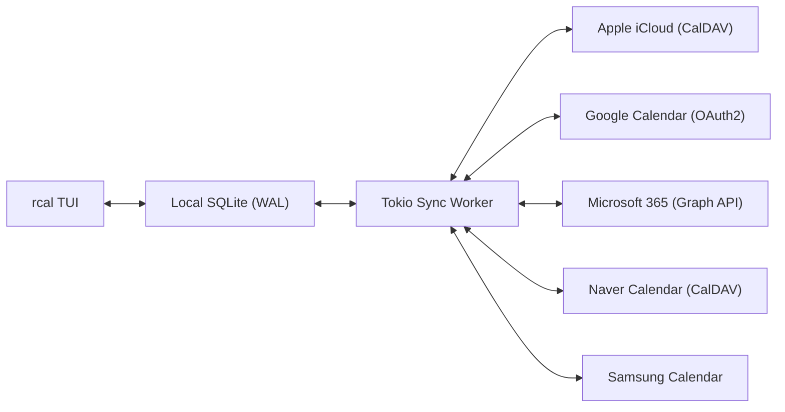
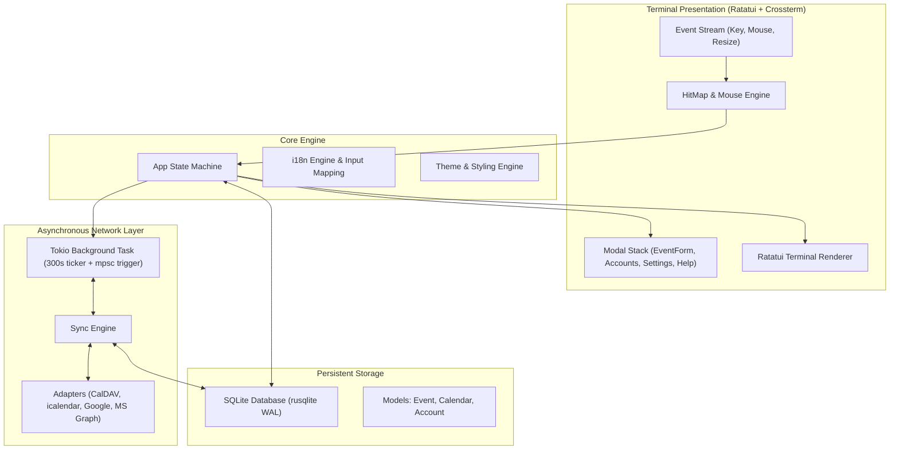

<div align="center">

```
  ██████╗  ██████╗ █████╗ ██╗     
  ██╔══██╗██╔════╝██╔══██╗██║     
  ██████╔╝██║     ███████║██║     
  ██╔══██╗██║     ██╔══██║██║     
  ██║  ██║╚██████╗██║  ██║███████╗
  ╚═╝  ╚═╝ ╚═════╝╚═╝  ╚═╝╚══════╝
```

### **マルチクラウド同期対応の高速・現代的マウス操作対応 Rust ターミナルカレンダー**

[](https://www.rust-lang.org)
[](../../LICENSE)
[](https://github.com/eeyees/rcal)
[](https://github.com/ratatui/ratatui)
[](https://www.sqlite.org)
[](https://tokio.rs)

<p align="center">
  🌐 <strong>Languages / 다국어 / 语言 / 言語 / Idiomas:</strong><br>
  <a href="../../README.md">English</a> •
  <a href="README.ko.md">한국어</a> •
  <a href="README.zh-CN.md">简体中文</a> •
  <a href="README.zh-TW.md">繁體中文</a> •
  <strong>日本語</strong> •
  <a href="README.es.md">Español</a> •
  <a href="README.fr.md">Français</a> •
  <a href="README.de.md">Deutsch</a> •
  <a href="README.pt-BR.md">Português</a> •
  <a href="README.ru.md">Русский</a> •
  <a href="README.it.md">Italiano</a> •<br>
  <a href="README.id.md">Bahasa Indonesia</a> •
  <a href="README.vi.md">Tiếng Việt</a> •
  <a href="README.tr.md">Türkçe</a> •
  <a href="README.pl.md">Polski</a> •
  <a href="README.nl.md">Nederlands</a> •
  <a href="README.ar.md">العربية</a> •
  <a href="README.hi.md">हिन्दी</a> •
  <a href="README.bn.md">বাংলা</a> •
  <a href="README.sv.md">Svenska</a> •
  <a href="README.uk.md">Українська</a> •
  <a href="README.th.md">ภาษาไทย</a>
</p>

<p align="center">
  <a href="#-key-features">主な機能</a> •
  <a href="#-ui-views">画面プレビュー</a> •
  <a href="#-controls">操作方法</a> •
  <a href="#-cloud-sync">クラウド同期</a> •
  <a href="#-themes">テーマ設定</a> •
  <a href="#-installation">インストール</a> •
  <a href="#-architecture">アーキテクチャ</a>
</p>

---

</div>

`rcal` は、Google カレンダーのような視覚的な使いやすさをターミナル上で完全な**ゼロ遅延**、**100% マウス操作**、そして**安全なマルチクラウド双方向同期**とともに実現するために設計された、Rust 製の軽量・超高速 TUI カレンダーです。

---

## <a id="-key-features"></a>✨ 主な機能

- ⚡ **ゼロ遅延オフラインファースト設計**：組み込み SQLite WAL (Write-Ahead Logging) モードにより、1 ミリ秒未満の爆速起動とオフライン即時クエリを実現。
- 🖱️ **完全マウス操作対応**：
  - 表示タブ（月・週・日・アジェンダ）やボタン（今日、同期、進む/戻る）をクリック操作。
  - 月ビューで日付セルをクリック選択、ダブルクリックで日ビューへドリルダウン。
  - 週・日ビューの空き時間スロットをクリックして予定を即座に作成。
  - 予定ブロックをクリックして詳細表示・編集モーダルを開く。
  - マウスホイールによる日付めくりとタイムラインスクロール。
- 📅 **4つの洗練された高密度ビュー**：
  - **月間ビュー (Month View)**：予定バッジと本日ハイライト付きの 7 列カレンダー。
  - **週間ビュー (Week View)**：週全体タイムラインと色分けされた予定ブロック。
  - **日間ビュー (Day View)**：重複する予定を自動で横並び配置 (Concurrent Slotting) する高精度タイムライン。
  - **アジェンダビュー (Agenda View)**：日付ごとにまとめられた時系列の今後の予定ストリーム。
- ☁️ **マルチクラウド & CalDAV 同期エンジン**：
  - **Apple iCloud**：CalDAV によるネイティブ双方向同期。
  - **Naver カレンダー**：CalDAV 自動検出と安定した同期。
  - **Google Calendar**：OAuth2 トークンによる Google カレンダー API 連携。
  - **Microsoft 365 / Outlook**：Microsoft Graph REST API アダプター。
  - **Samsung Calendar**：Galaxy / サムスンカレンダー連携。
  - **バックグラウンド非同期ワーカー**：Tokio ワーカースレッドが 5 分間隔または手動呼び出し時に UI をフリーズさせずに静かに同期。
- ⌨️ **Vim キーバインド & 日本語 IME 透過ナビゲーション**：
  - 定番の `h/j/k/l` 移動、番号によるビュー切り替え。
  - **IME 透過マッピング**：日本語入力モードのままでもショートカットが自動変換され、ターミナルの不快なビープ音や誤入力を防止。
- 🌐 **ネイティブ多言語対応 (i18n)**：システム言語の自動検出、実行時に `L` キーで言語を即座に切り替え可能。
- 🎨 **豊富なカラーテーマ & カスタマイズ**：
  - 7 種類のカラーパレット（Modern Dark, Nord, Dracula, Forest, Sunset, Monokai, Solarized）。
  - 週の始まりの曜日を設定可能（日曜日、月曜日、土曜日）。
  - カラータグ付きカスタムカレンダーの作成と管理。

---

## <a id="-ui-views"></a>🖥️ 画面プレビュー

```
┌── rcal v2026.11.01.1 ─────────────────────────────────────────────── [ L: 한/EN ] [ ? Help ] [ ⚙ Settings ] ──┐
│ [ 1:Month ] [ 2:Week ] [ 3:Day ] [ 4:Agenda ]    [ < ] [ Today ] [ > ]  2026-11-01 (Sun)   [ ⟳ Sync ]  │
├────────────────────┬───────────────────────────────────────────────────────────────────────────────────┤
│ Calendars          │                             November 2026                                         │
│ [x] ■ Personal     │  Sun         Mon         Tue         Wed         Thu         Fri         Sat      │
│ [x] ■ Work         │ ┌───────────┬───────────┬───────────┬───────────┬───────────┬───────────┬───────────┐ │
│ [x] ■ Holidays     │ │ 1  TODAY  │ 2         │ 3         │ 4         │ 5         │ 6         │ 7         │ │
│                    │ │■ 10:00 AM │■ 09:00 AM │           │■ 14:00 PM │           │■ 19:00 PM │           │ │
│ Accounts           │ │  Sprint   │  Standup  │           │  Design   │           │  Dinner   │           │ │
│ • iCloud (Syncing) │ ├───────────┼───────────┼───────────┼───────────┼───────────┼───────────┼───────────┤ │
│ • Google (Active)  │ │ 8         │ 9         │ 10        │ 11        │ 12        │ 13        │ 14        │ │
│                    │ │           │           │           │           │           │           │           │ │
├────────────────────┴───────────────────────────────────────────────────────────────────────────────────┤
│ [c] New Event  [m/w/d/a] Switch View  [h/j/k/l] Navigate  [/] Search  [a] Accounts  [s] Settings  [q] Quit │
└────────────────────────────────────────────────────────────────────────────────────────────────────────┘
```

---

## <a id="-controls"></a>⌨️ キーボード & マウス操作一覧

### 🧭 操作方法 1: Navigation

| ショートカット | マウス操作 | 説明 |
| :--- | :--- | :--- |
| `h` / `j` / `k` / `l` または 矢印キー | 日付セル / 時間スロットをクリック | カーソルを 左 / 下 / 上 / 右 に移動 |
| `1` または `m` | `[ 1:Month ]` タブをクリック | **月間ビュー**に切り替え |
| `2` または `w` | `[ 2:Week ]` タブをクリック | **週間ビュー**に切り替え |
| `3` または `d` | `[ 3:Day ]` タブをクリック | **日間ビュー**に切り替え |
| `4` または `a` | `[ 4:Agenda ]` タブをクリック | **アジェンダビュー**に切り替え |
| `t` | `[ Today ]` ボタンをクリック | 今日の日付へジャンプ |
| `[` / `]` | `[ < ]` / `[ > ]` ボタンをクリック | 前 / 次の期間へ移動（月/週/日単位） |
| ホイールスクロール | マウスホイール回転 | タイムラインのスクロールおよび日付移動 |
| ダブルクリック | 日付セルをダブルクリック | 月間ビューから日間ビューへ直接ドリルダウン |

### 📝 操作方法 2: Events & Modals

| ショートカット | マウス操作 | 説明 |
| :--- | :--- | :--- |
| `c` または `n` | `[ + New ]` または空きスロットをクリック | 新規予定作成モーダルを開く |
| `Enter` | 予定ブロックをクリック | 選択した予定の詳細モーダルを開く |
| `e` | `[ Edit ]` ボタンをクリック | 予定の内容を編集 |
| `x` または `Delete` | `[ Delete ]` ボタンをクリック | 選択した予定を削除 |
| `Tab` / `Shift+Tab` | 入力欄またはボタンをクリック | 入力フォームとボタン間でフォーカス移動 |
| `Esc` または `q` | `[ Close ]` または背景をクリック | 開いているモーダルを閉じる |

### ⚙️ 操作方法 3: System & Settings

| ショートカット | マウス操作 | 説明 |
| :--- | :--- | :--- |
| `L` | `[ L: 한/EN ]` ボタンをクリック | 表示言語の切り替え |
| `s` | `[ ⚙ Settings ]` ボタンをクリック | 設定モーダル（週の始まり、テーマ、言語） |
| `a` | サイドバーの Accounts をクリック | クラウド同期アカウント管理モーダル |
| `b` | サイドバー切り替えボタンをクリック | サイドバーの表示 / 非表示トグル |
| `r` | `[ ⟳ Sync ]` ボタンをクリック | クラウド同期を今すぐバックグラウンド実行 |
| `?` | `[ ? Help ]` ボタンをクリック | ショートカットキーヘルプを開く |
| `Ctrl+C` / `q` | - | `rcal` を安全に終了 |

---

## <a id="-cloud-sync"></a>☁️ マルチクラウド & CalDAV 同期

`rcal` は主要なクラウドカレンダーサービスと安全に通信できる同期エンジンを備えています：



### Supported Providers

- **Apple iCloud**：Apple ID と App 用パスワードを使用した CalDAV 双方向同期。
- **Naver カレンダー**：CalDAV プロトコルによる予定の自動同期。
- **Google Calendar**：Google Cloud OAuth2 認証によるカレンダー API 連携。
- **Microsoft 365 / Outlook**：Microsoft Graph API による職場および個人の Outlook 連携。
- **Samsung Calendar**：Galaxy サムスンクラウドカレンダー連携。

---

## <a id="-themes"></a>🎨 カラーテーマ & カスタマイズ

`s` キーを押して**設定モーダル**を開き、好みに合わせてカレンダーの外観をカスタマイズできます：

### Built-in Color Palettes
- 🌙 **Modern Dark**：標準の洗練されたダークテーマ
- ❄️ **Nord**：落ち着きのある北欧の氷河をイメージしたブルーグレー
- 🧛 **Dracula**：コントラストの効いた人気ダークパレット
- 🌲 **Forest**：目に優しい抹茶＆アースグリーン
- 🌆 **Sunset**：鮮やかなサイバーパンク風パープル＆オレンジ
- 🎨 **Monokai**：定番コードエディタ風の高コントラスト配色
- ☀️ **Solarized**：精密に調整された目に優しいソラライズドダーク

### 週の始まりの曜日
ライフスタイルに合わせてカレンダーの週の始まりを**日曜日**、**月曜日**、または**土曜日**から選択できます。

---

## <a id="-architecture"></a>🏗️ アーキテクチャ



---

## <a id="-installation"></a>🚀 インストール & 実行

### ソースコードからビルド

```bash
# Clone the repository
git clone https://github.com/eeyees/rcal.git
cd rcal

# Build release
cargo build --release

# Run
./target/release/rcal
```

### Cargo を使ってグローバルインストール

```bash
cargo install --path .
rcal
```

### ローカルデータベースの保存先

- **macOS**: `~/Library/Application Support/rcal/rcal.db`
- **Linux**: `~/.local/share/rcal/rcal.db`
- **Windows**: `%LOCALAPPDATA%\rcal\rcal.db`

---

## 🗺️ 🗺️ 開発ロードマップ

- [x] **フェーズ 1：ローカル TUI MVP**：月/週/日(重複判定)/アジェンダビュー、100% マウス当たり判定エンジン、SQLite WAL 保存、予定 CRUD。
- [x] **フェーズ 2：CalDAV 同期エンジン**：Apple iCloud と Naver カレンダーの双方向同期、Tokio バックグラウンドワーカー、アカウント管理 UI。
- [x] **フェーズ 3：マルチクラウド & ユーザビリティ向上**：Google Calendar API、Microsoft Graph、IME 透過マッピング、7 色テーマ、週開始日設定。
- [ ] **フェーズ 4：エコシステム拡張 & オープンプロトコル**：
    - [ ] AI エージェント連携用 MCP (Model Context Protocol) サーバー
    - [ ] 外部カレンダー連携用 WebCal / iCalendar (`.ics`) HTTP 配信サーバー
    - [ ] 定期的な繰り返し予定ルール（RFC 5545 RRULE）
    - [ ] 自然言語による予定追加（例: `rcal add "明日15時にミーティング"`）
    - [ ] OS ネイティブデスクトップ通知

---

## 📜 📜 ライセンス

このプロジェクトは **MIT ライセンス** のもとで公開されています。詳細は [`LICENSE`](../../LICENSE) ファイルをご確認ください。
