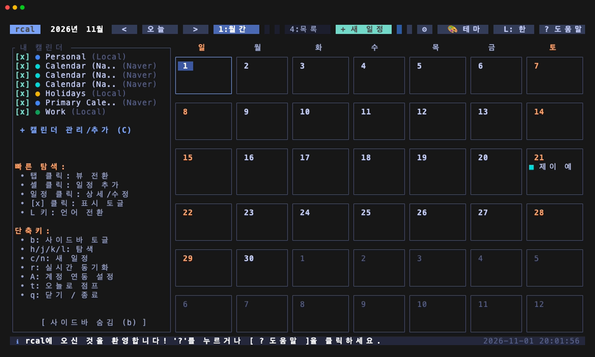
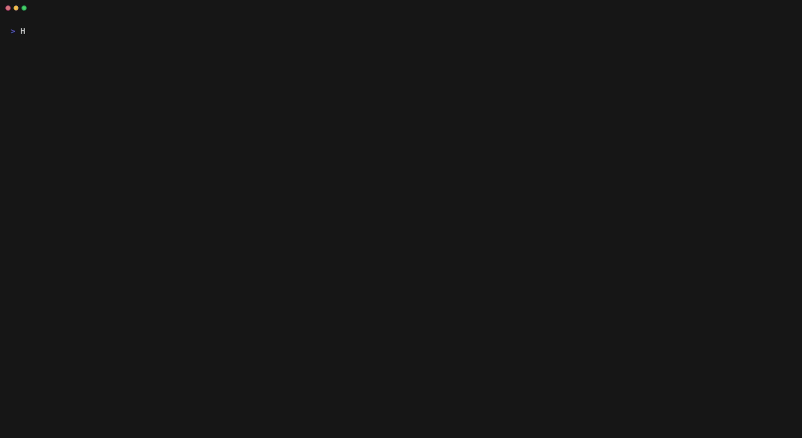
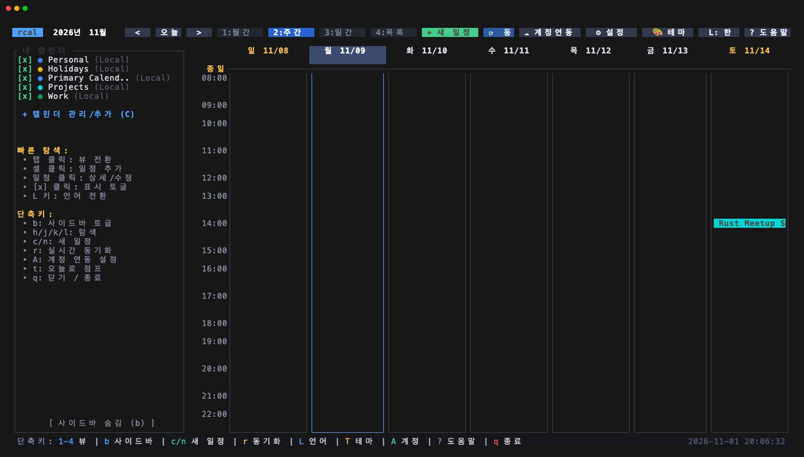
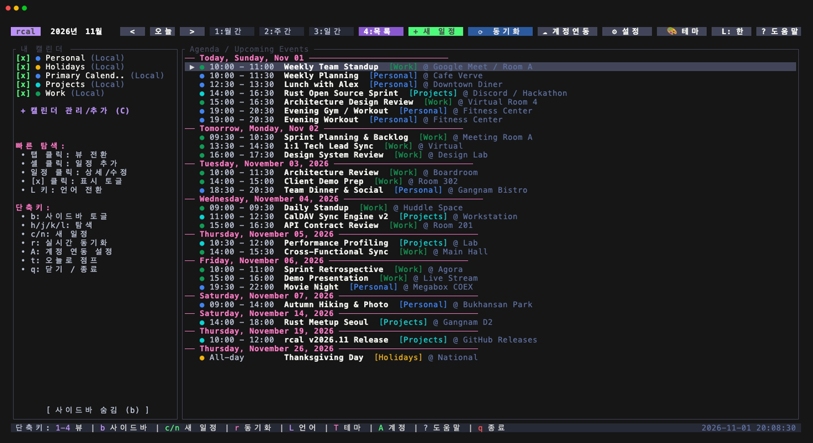
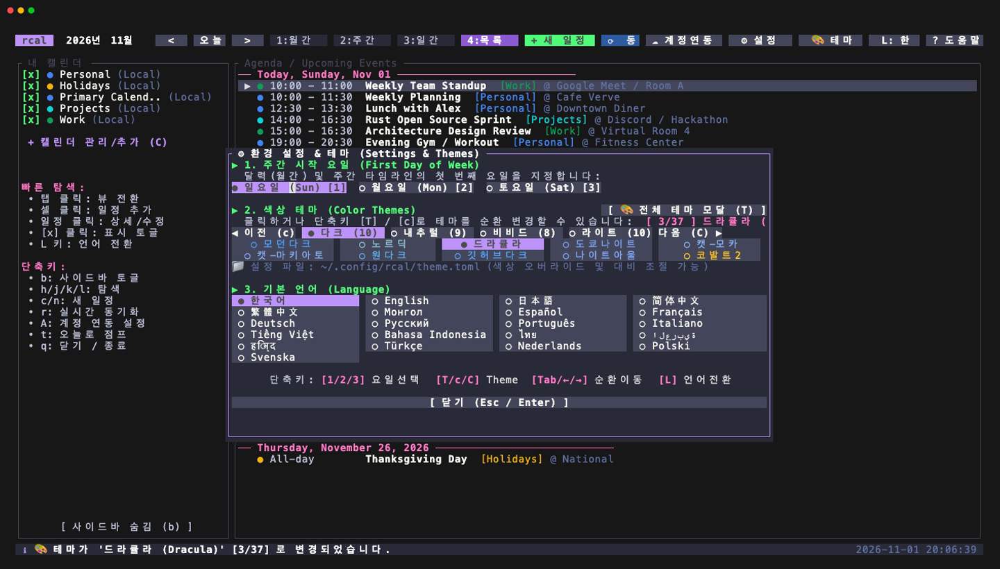
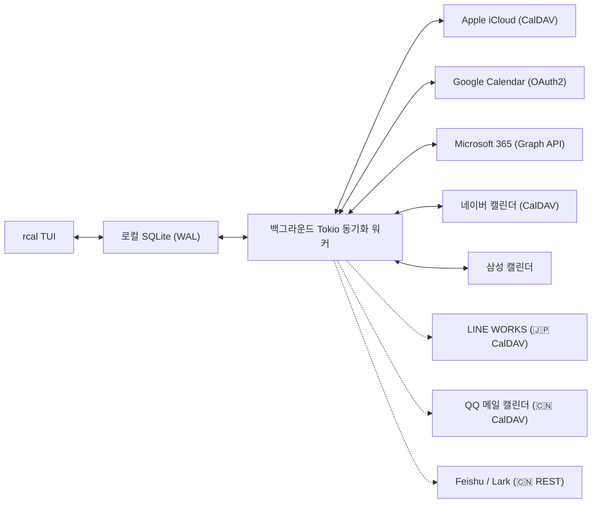
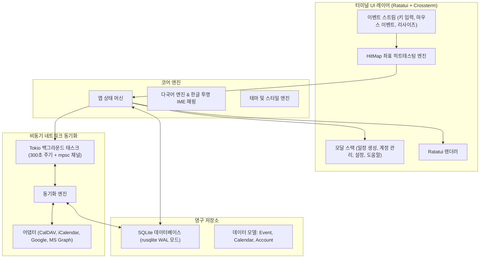

<div align="center">

```
  ██████╗  ██████╗ █████╗ ██╗     
  ██╔══██╗██╔════╝██╔══██╗██║     
  ██████╔╝██║     ███████║██║     
  ██╔══██╗██║     ██╔══██║██║     
  ██║  ██║╚██████╗██║  ██║███████╗
  ╚═╝  ╚═╝ ╚═════╝╚═╝  ╚═╝╚══════╝
```

### **멀티 클라우드 동기화를 지원하는 빠르고 현대적인 마우스 인터랙티브 Rust 터미널 캘린더**

[](https://www.rust-lang.org)
[](../../LICENSE)
[](https://github.com/eeyees/rcal)
[](https://github.com/ratatui/ratatui)
[](https://www.sqlite.org)
[](https://tokio.rs)

<p align="center">
  
</p>

<p align="center">
  🌐 <strong>Languages / 언어:</strong><br>
  <a href="../../README.md">English</a> •
  <a href="./README.ko.md"><strong>한국어</strong></a> •
  <a href="./README.zh-CN.md">简体中文</a> •
  <a href="./README.zh-TW.md">繁體中文</a> •
  <a href="./README.ja.md">日本語</a> •
  <a href="./README.es.md">Español</a> •
  <a href="./README.fr.md">Français</a> •
  <a href="./README.de.md">Deutsch</a> •
  <a href="./README.pt-BR.md">Português</a> •
  <a href="./README.ru.md">Русский</a> •
  <a href="./README.it.md">Italiano</a> •
  <a href="./README.id.md">Bahasa Indonesia</a> •
  <a href="./README.vi.md">Tiếng Việt</a> •
  <a href="./README.tr.md">Türkçe</a> •
  <a href="./README.pl.md">Polski</a> •
  <a href="./README.nl.md">Nederlands</a> •
  <a href="./README.ar.md">العربية</a> •
  <a href="./README.hi.md">हिन्दी</a> •
  <a href="./README.bn.md">বাংলা</a> •
  <a href="./README.sv.md">Svenska</a> •
  <a href="./README.uk.md">Українська</a> •
  <a href="./README.th.md">ภาษาไทย</a>
</p>

<p align="center">
  <a href="#-주요-기능">주요 기능</a> •
  <a href="#-ui-뷰--화면-쇼케이스">UI 뷰 & 쇼케이스</a> •
  <a href="#-키보드--마우스-조작법">조작법</a> •
  <a href="#-멀티-클라우드--caldav-동기화">클라우드 동기화</a> •
  <a href="#-테마--개인화">테마</a> •
  <a href="#-ai-에이전트를-위한-mcpmodel-context-protocol-서버-지원">MCP 서버</a> •
  <a href="#-설치--실행">설치</a> •
  <a href="#-아키텍처">아키텍처</a>
</p>

---

</div>

`rcal`은 터미널 환경에서도 구글 캘린더 수준의 직관적인 시각화와 편리함을 누릴 수 있도록 개발된 초경량 고성능 TUI 캘린더입니다. **지연 시간 없는 즉각적인 반응성**, **100% 마우스 인터랙션**, 그리고 **안정적인 멀티 클라우드 양방향 동기화**를 제공합니다.

---

## ✨ 주요 기능

- ⚡ **지연 없는 오프라인 퍼스트 아키텍처**: 임베디드 SQLite WAL(Write-Ahead Logging) 모드를 기반으로 하여 1밀리초 미만의 초고속 시작 속도와 오프라인 조회를 지원합니다.
- 🖱️ **완벽한 마우스 상호작용 지원**:
  - 뷰 탭(`[ 1:월간 ]`, `[ 2:주간 ]`, `[ 3:일간 ]`, `[ 4:목록 ]`) 및 헤더 버튼(`[ < ]`, `[ 오늘 ]`, `[ > ]`, `[ ⟳ 동기화 ]`) 클릭 동작.
  - 월간 뷰에서 날짜 클릭 시 해당 날짜 선택, 더블 클릭 시 즉시 일간 뷰 상세 화면으로 전환.
  - 주간 및 일간 뷰에서 원하는 시간 슬롯 클릭 시 해당 시간에 바로 일정 생성 모달 열림.
  - 일정 블록 클릭 시 상세 보기 및 수정 모달 실행.
  - 마우스 휠 스크롤을 통한 날짜 이동 및 시간 타임라인 스크롤.
- 📅 **4가지 친숙한 고밀도 캘린더 뷰**:
  - **월간 뷰 (Month View)**: 일정 수 표시 배지, 오늘 날짜 강조 표시가 포함된 7열 레이아웃.
  - **주간 뷰 (Week View)**: 일~토(또는 월/토 시작) 타임라인과 시간대별 컬러 일정 블록 배치.
  - **일간 뷰 (Day View)**: 동시간대 겹치는 일정들을 나란히 배치(Concurrent Overlap Slotting)하는 고정밀 타임라인.
  - **목록 뷰 (Agenda View)**: 날짜별로 그룹화된 다가오는 일정 목록 스트림.
- ☁️ **멀티 클라우드 & CalDAV 동기화 엔진**:
  - **Apple iCloud**: CalDAV 기반 안정적인 양방향 동기화 (앱 암호 연동).
  - **네이버 캘린더 (Naver)**: CalDAV 표준 자동 탐색 및 실시간 2-way 동기화 완비 (실제 일정 연동 검증 완료).
  - **Google Calendar**: Google API v3 REST 어댑터 (원클릭 브라우저 OAuth2 루프백 인증 및 수동 토큰 지원).
  - **Microsoft 365 / Outlook**: Microsoft Graph API 어댑터 (원클릭 브라우저 OAuth2 루프백 인증 및 수동 토큰 지원).
  - **삼성 캘린더 (Samsung)**: CalDAV 엔드포인트 또는 Microsoft Graph 계정 연동 브릿지 fallback.
  - **백그라운드 비동기 워커**: UI를 멈추지 않고 5분 주기 또는 수동 호출 시 백그라운드 Tokio 워커가 조용히 동기화 수행.
- ⌨️ **Vim 키바인딩 & 투명 한글 IME 네비게이션**:
  - `h` / `j` / `k` / `l` 방향 이동, 숫자 뷰 전환, 간편한 단축키 제공.
  - **한글 입력 상태 투명 변환**: 한글 입력기(`ㅗ/ㅓ/ㅏ/ㅣ` 등)가 켜져 있어도 영문 단축키로 자동 매핑되어 터미널 경고음 없이 쾌적하게 조작 가능.
- 🌐 **다국어(i18n) 시스템 지원**:
  - OS 시스템 언어 설정(macOS / Windows / Linux) 자동 감지 (미지원 언어일 경우 영어로 기본 적용).
  - `L` 키 또는 `[ L: 한/EN ]` 클릭으로 런타임 중 즉시 **한국어** ↔ **English** 전환.
  - 날짜 표기, 요일, 모달 안내, 상태 메시지 전체 다국어 처리.
- 🎨 **다채로운 테마 및 개인화**:
  - 37가지 엄선된 컬러 팔레트: **모던 다크**, **노르딕**, **드라큘라**, **도쿄 나이트**, **캣푸친**, **원 다크**, **깃허브 다크/라이트**, **카나가와** 등 4개 카테고리(다크, 내추럴, 비비드, 라이트).
  - 커스텀 `theme.toml`을 통한 색상 오버라이드 및 대비 조절 기능.
  - 주의 시작 요일 설정: **일요일**, **월요일**, **토요일** 중 선택 가능.
  - 커스텀 캘린더 생성 및 색상 태그 관리 (`개인`, `업무`, `공휴일` 등).

---

## 🖥️ UI 뷰 & 화면 쇼케이스

### 🎬 인터랙티브 라이브 데모

<p align="center">
  
</p>

### 📸 고해상도 스크린샷 갤러리

| 📅 **월간 뷰 (Month View)** | ⏱️ **주간 뷰 (Week View)** |
| :---: | :---: |
| [](../../assets/screenshot.png) | [](../../assets/week_view.png) |
| *7열 월간 달력, 캘린더별 색상 뱃지, 오늘 하이라이트 및 사이드바 탐색* | *시간대별 7일 타임라인과 일정 블록 자동 정렬 및 컬러 시각화* |
| 📋 **목록 뷰 (Agenda View)** | 🎨 **환경 설정 & 테마 모달 (Settings & Themes)** |
| [](../../assets/agenda_view.png) | [](../../assets/theme_modal.png) |
| *다가오는 일정들의 날짜별 연대기 스트림 및 장소, 카테고리 표시* | *37종 테마 실시간 전환, 주간 시작 요일 선택, 22개 언어 실시간 토글* |

<details>
<summary><b>🔍 아스키 텍스트 터미널 레이아웃 보기 (ASCII Preview)</b></summary>

```
┌── rcal v2026.11.05.1 ─────────────────────────────────────────────── [ L: 한/EN ] [ ? 도움말 ] [ ⚙ 설정 ] ──┐
│ [ 1:월간 ] [ 2:주간 ] [ 3:일간 ] [ 4:목록 ]      [ < ] [ 오늘 ] [ > ]  2026-11-01 (일)   [ ⟳ 동기화 ]  │
├────────────────────┬───────────────────────────────────────────────────────────────────────────────────┤
│ 캘린더 목록        │                               2026년 11월                                         │
│ [x] ■ 개인         │  일          월          화          수          목          금          토       │
│ [x] ■ 업무         │ ┌───────────┬───────────┬───────────┬───────────┬───────────┬───────────┬───────────┐ │
│ [x] ■ 공휴일       │ │ 1  오늘   │ 2         │ 3         │ 4         │ 5         │ 6         │ 7         │ │
│                    │ │■ 10:00    │■ 09:00    │           │■ 14:00    │           │■ 19:00    │           │ │
│ 계정               │ │  스프린트 │  스탠드업 │           │  디자인   │           │  저녁약속 │           │ │
│ • iCloud (동기화중)│ ├───────────┼───────────┼───────────┼───────────┼───────────┼───────────┼───────────┤ │
│ • Google (연결됨)  │ │ 8         │ 9         │ 10        │ 11        │ 12        │ 13        │ 14        │ │
│                    │ │           │           │           │           │           │           │           │ │
├────────────────────┴───────────────────────────────────────────────────────────────────────────────────┤
│ [c] 새 일정  [m/w/d/a] 뷰 전환  [h/j/k/l] 이동  [/] 검색  [a] 계정 관리  [s] 설정  [q] 종료            │
└────────────────────────────────────────────────────────────────────────────────────────────────────────┘
```

</details>

---

## ⌨️ 키보드 & 마우스 조작법

### 🧭 탐색 및 뷰 전환

| 단축키 | 마우스 동작 | 설명 |
| :--- | :--- | :--- |
| `h` / `j` / `k` / `l` 또는 방향키 | 날짜 셀 / 시간 슬롯 클릭 | 좌 / 하 / 상 / 우 커서 이동 |
| `1` 또는 `m` | `[ 1:월간 ]` 탭 클릭 | **월간 뷰**로 전환 |
| `2` 또는 `w` | `[ 2:주간 ]` 탭 클릭 | **주간 뷰**로 전환 |
| `3` 또는 `d` | `[ 3:일간 ]` 탭 클릭 | **일간 뷰**로 전환 |
| `4` 또는 `a` | `[ 4:목록 ]` 탭 클릭 | **목록(Agenda) 뷰**로 전환 |
| `t` | `[ 오늘 ]` 버튼 클릭 | 커서를 오늘 날짜로 이동 |
| `[` / `]` | `[ < ]` / `[ > ]` 버튼 클릭 | 이전 / 다음 기간 이동 (월/주/일 단위) |
| 마우스 휠 스크롤 | 휠 위/아래 굴리기 | 타임라인 스크롤 및 날짜 이동 |
| 더블 클릭 | 월간 뷰 날짜 셀 더블 클릭 | 해당 날짜의 일간 뷰로 즉시 드릴다운 |

### 📝 일정 생성 및 모달 관리

| 단축키 | 마우스 동작 | 설명 |
| :--- | :--- | :--- |
| `c` 또는 `n` | `[ + 새 일정 ]` 또는 빈 슬롯 클릭 | 새 일정 생성 모달 열기 |
| `Enter` | 일정 블록 클릭 | 선택한 일정 상세 보기 모달 열기 |
| `e` | `[ 수정 ]` 버튼 클릭 | 일정 정보 수정 |
| `d` 또는 `Delete` | `[ 삭제 ]` 버튼 클릭 | 선택한 일정/캘린더/계정 삭제 요청 (안전을 위해 2차 확인 모달 실행: `y` 확인 / `n` 취소) |
| `Tab` / `Shift+Tab` | 입력 필드 / 버튼 클릭 | 입력 폼 필드 및 버튼 간 포커스 이동 |
| `Esc` 또는 `q` | `[ 닫기 ]` 또는 백드롭 클릭 | 열려 있는 모달 닫기 |

### ⚙️ 시스템 설정 및 동기화

| 단축키 | 마우스 동작 | 설명 |
| :--- | :--- | :--- |
| `v` 또는 `C` | 사이드바 `+ 캘린더 관리/선택` 클릭 | **캘린더 표시 선택 및 관리 모달** 열기 (`Space` 또는 `1`~`9`로 체크박스 `[x]`/`[ ]` 토글, `s` 또는 `Enter`로 저장 및 적용, `n` 생성, `d` 삭제) |
| `T` | `[ 🎨 테마 ]` 버튼 클릭 | **테마 선택 모달** 열기 (37가지 테마 및 좌측 단축키/카테고리 메뉴) |
| `L` | `[ L: 한/EN ]` 버튼 클릭 | 언어 전환 (한국어 ↔ English) |
| `s` | `[ ⚙ 설정 ]` 버튼 클릭 | 환경설정 모달 (주 시작 요일, 테마, 언어) |
| `a` | 사이드바 계정 메뉴 클릭 | 클라우드 계정 관리자 모달 열기 |
| `b` | 사이드바 접기 버튼 클릭 | 사이드바 표시/숨김 토글 |
| `r` | `[ ⟳ 동기화 ]` 버튼 클릭 | 즉시 클라우드 백그라운드 동기화 실행 |
| `?` | `[ ? 도움말 ]` 버튼 클릭 | 전체 단축키 안내 도움말 열기 |
| `Ctrl+C` / `q` | - | `rcal` 안전하게 종료 |

---

## ☁️ 멀티 클라우드 & CalDAV 동기화

`rcal`은 외부 캘린더 서비스와 항상 최신 일정을 주고받을 수 있도록 견고한 동기화 레이어를 제공합니다.



### 클라우드 제공자별 지원 현황

| 캘린더 제공자 | 엔진 및 프로토콜 | 현재 상태 | 상세 설명 |
| :--- | :--- | :---: | :--- |
| **네이버 캘린더** | CalDAV (RFC 4791) | ✅ **완전 지원** | CalDAV 자동 탐색 및 2단계 인증 애플리케이션 비밀번호로 양방향 동기화 완비 |
| **Apple iCloud** | CalDAV (RFC 4791) | ✅ **완전 지원** | Apple ID 및 앱 암호(App-Specific Password) 기반 양방향 동기화 |
| **Google Calendar** | Google Calendar API v3 | ✅ **완전 지원** | REST API CRUD 클라이언트 및 1-클릭 브라우저 OAuth2 루프백 인증 (`localhost:8088`) 지원 (수동 토큰 입력도 가능) |
| **Microsoft 365** | MS Graph REST API | ✅ **완전 지원** | Graph API 클라이언트 및 1-클릭 브라우저 OAuth2 루프백 인증 (`localhost:8088`) 지원 (수동 토큰 입력도 가능) |
| **삼성 캘린더** | CalDAV / MS 브릿지 | 🔄 **브릿지 Fallback** | 독자 클라우드 API 부재로 맞춤 CalDAV 엔드포인트 또는 MS Outlook 연동 기능 브릿지 사용 |
| **LINE WORKS** (🇯🇵) | CalDAV (RFC 4791) | 📋 **예정 (우선 지원)** | 일본 1위 업무용 협업 캘린더 (`caldav.worksmobile.com`) |
| **QQ 메일 캘린더** (🇨🇳) | CalDAV (RFC 4791) | 📋 **예정 (우선 지원)** | 텐센트 QQ 메일 기반 중국 최대 개인 캘린더 (`dav.qq.com`) 앱 인증코드 연동 |
| **Feishu / Lark (飞书)** (🇨🇳/🌏) | REST API v4 | 📋 **예정** | 바이트댄스의 올인원 협업 플랫폼 오픈 API 캘린더 연동 |
| **딩딩 (DingTalk / 钉钉)** (🇨🇳) | OpenAPI v2.0 | 📋 **예정** | 알리바바 엔터프라이즈 협업 플랫폼 일정 동기화 |
| **넷이즈 163 기업메일** (🇨🇳) | CalDAV (RFC 4791) | 📋 **예정** | 163 기업메일 CalDAV 연동 (`caldav.qiye.163.com`) |
| **사이보즈 가룬 (Cybozu)** (🇯🇵) | REST API / iCal | 📋 **예정** | 일본 엔터프라이즈 그룹웨어 1위 스케줄 연동 어댑터 |
| **타임트리 (TimeTree)** (🇯🇵) | 커뮤니티 브릿지 | 🔍 **검토 중** | 일본 1위 공유 캘린더 (공식 개발자 API 서비스 종료에 따른 iCal/웹훅 대체 연동 검토) |

`rcal` 실행 후 `a` 키를 누르거나 사이드바의 **계정** 항목을 클릭하여 손쉽게 계정을 등록할 수 있습니다.  
동아시아(일본 및 중국) 주요 캘린더 서비스의 상세 분석 및 연동 계획은 [동아시아 캘린더 연동 계획서](../cloud_integration_plan.md)를 참고하세요.

---

## 🎨 테마 & 개인화

`s` 키를 눌러 **환경설정 모달**에서 취향에 맞게 설정할 수 있습니다:

### 지원 테마
- 🌙 **Modern Dark** (기본 깔끔한 모던 다크)
- ❄️ **Nord** (차분한 북유럽 아틱 블루)
- 🧛 **Dracula** (선명한 고대비 다크)
- 🌲 **Forest** (편안한 말차 & 자연 감성 그린)
- 🌆 **Sunset** (화려한 사이버펑크 퍼플 & 오렌지)
- 🎨 **Monokai** (클래식 개발자 에디터 스타일)
- ☀️ **Solarized** (정밀하게 조율된 솔라라이즈드 다크)

### 주의 시작 요일
사용자의 생활 패턴 및 근무 환경에 맞춰 주의 시작 요일을 **일요일**, **월요일**, **토요일** 중에서 선택할 수 있습니다.

---

## 🏗️ 아키텍처



---

## 🚀 설치 & 실행

### 사전 요구사항

- [Rust 1.80 이상](https://www.rust-lang.org/tools/install) (`cargo` 및 `rustup`)

### 소스코드에서 빌드

```bash
# 리포지토리 복제
git clone https://github.com/eeyees/rcal.git
cd rcal

# 최적화 릴리스 빌드
cargo build --release

# 실행
./target/release/rcal
```

### Cargo 전역 설치

```bash
cargo install --path .
rcal
```

### 로컬 데이터 저장 위치

- **macOS**: `~/Library/Application Support/rcal/rcal.db`
- **Linux**: `~/.local/share/rcal/rcal.db`
- **Windows**: `%LOCALAPPDATA%\rcal\rcal.db`

---

## 🤖 AI 에이전트를 위한 MCP(Model Context Protocol) 서버 지원

`rcal`은 표준 입출력(`stdio`) 기반의 네이티브 **Model Context Protocol (MCP)** 서버 모드를 내장하고 있습니다. **Claude Desktop**, **Cursor**, **Google Antigravity**, **Cline**, **Zed** 등 최신 AI 코딩 및 비서 에이전트가 캘린더 일정을 조회, 검색, 등록, 수정, 조율할 수 있습니다.

### MCP 서버 실행

```bash
# 기본 SQLite 데이터베이스로 MCP 서버 실행
rcal mcp

# 사용자 지정 DB 경로 지정 실행
rcal mcp --db /path/to/custom_calendar.db
```

### AI 클라이언트별 설정 예시

#### Claude Desktop (`claude_desktop_config.json`)
```json
{
  "mcpServers": {
    "rcal": {
      "command": "rcal",
      "args": ["mcp"]
    }
  }
}
```

#### Cursor (`설정` -> `Features` -> `MCP`)
- **이름**: `rcal`
- **유형**: `command`
- **명령어**: `rcal mcp`

#### Google Antigravity / AGY CLI (`~/.gemini/antigravity-cli/mcp.json`)
```json
{
  "mcpServers": {
    "rcal": {
      "command": "rcal",
      "args": ["mcp"]
    }
  }
}
```

### 제공되는 MCP 기능

#### 🛠️ 도구 (Tools)
| 도구 이름 | 설명 |
| :--- | :--- |
| `list_calendars` | 등록된 모든 캘린더 ID, 이름, 색상, 제공자(Google, Apple, Naver 등), 활성화 상태 조회 |
| `list_events` | 지정 날짜/시간 범위 일정 목록 조회 (캘린더 필터, 검색 키워드, 개수 제한 지원) |
| `get_event` | 고유 ID 기반 개별 일정 상세 정보 조회 |
| `create_event` | 새 일정 생성 (ISO 8601 시각, 종일 일정 여부, 캘린더 지정, 장소, 설명) |
| `update_event` | 기존 일정의 제목, 시각, 장소, 설명, 캘린더 점진적 수정 |
| `delete_event` | 고유 ID 기반 일정 삭제 (클라우드 동기화 상태 자동 반영) |
| `search_events` | 일정 제목, 본문 설명, 장소 전체 대상 전문 키워드 검색 |
| `find_free_slots` | 업무 시간(예: 09:00 ~ 18:00) 내 회의를 위한 최적의 빈 시간 슬롯 자동 계산 |
| `get_current_time` | 시스템 로컬 현재 날짜, 시각, 요일, 타임존 오프셋 반환 (상대적 날짜 계산용) |
| `sync_calendars` | 등록된 모든 클라우드 계정(Google, iCloud, Naver 등)과 즉시 양방향 동기화 실행 |

#### 📦 리소스 (Resources)
- `rcal://today` - 오늘 하루의 전체 일정 및 요약 JSON
- `rcal://upcoming` - 향후 7일간의 예정 일정 목록 JSON
- `rcal://calendars` - 등록된 모든 캘린더 및 설정 상태 JSON

#### 💬 프롬프트 (Prompts)
- `daily_briefing` - 특정 날짜의 우선순위 아침 일정 브리핑 프롬프트 템플릿
- `schedule_event` - 기존 일정과의 충돌 여부를 감지하며 새 일정을 잡는 프롬프트 템플릿
- `find_free_time` - 업무 시간 내 빈 시간대를 검토하여 회의 시간을 제안하는 프롬프트 템플릿

---

## 🗺️ 개발 로드맵

- [x] **1단계: 로컬 TUI MVP**
  - 월간, 주간, 일간(겹침 감지), 목록 뷰 구현
  - 100% 마우스 인터랙션 히트테스팅 엔진
  - SQLite WAL 기반 영구 저장 및 캐시
  - 일정 CRUD 모달 및 유효성 검사
- [x] **2단계: CalDAV 동기화 (완전 작동)**
  - [x] Apple iCloud 양방향 동기화 (앱 전용 암호)
  - [x] 네이버 캘린더 양방향 동기화 (CalDAV 자동 탐색)
  - [x] Tokio 비동기 백그라운드 동기화 워커 (5분 주기 자동 갱신)
  - [x] 클라우드 계정 관리자 UI (`A` key / 마우스 클릭)
- [x] **3단계: 멀티 클라우드 어댑터 및 완성도 향상 (완료 ✅)**
  - [x] 한글 IME 상태 투명 단축키 매핑 (`ㅗ/ㅓ/ㅏ/ㅣ` -> `h/j/k/l`)
  - [x] 37가지 테마 컬러 팔레트 및 실시간 테마 모달 (`T` 키)
  - [x] 주 시작 요일 설정 (일요일 / 월요일 / 토요일)
  - [x] Google Calendar REST API 클라이언트 (원클릭 브라우저 OAuth2 및 토큰 수동 입력 지원)
  - [x] Microsoft 365 Graph API 어댑터 (원클릭 브라우저 OAuth2 및 토큰 수동 입력 지원)
  - [x] 삼성 캘린더 CalDAV / MS 브릿지 연동
  - [x] 브라우저 자동 팝업 원클릭 OAuth2 루프백 인증 서버 (`localhost:8088`) 지원 (Google & Microsoft 365)
- [ ] **4단계: 동아시아 특화 멀티 클라우드 어댑터 (한/중/일)**
  - **일본 (🇯🇵)**:
    - [ ] **LINE WORKS**: CalDAV 2방향 실시간 동기화 (`caldav.worksmobile.com`) 프리셋 지원
    - [ ] **Cybozu Garoon / Office**: REST API 및 iCal 스케줄 브릿지 연동
    - [ ] **TimeTree**: 커뮤니티 연동 (iCal 구독 / 생태계 모니터링)
  - **중국 (🇨🇳)**:
    - [ ] **텐센트 QQ 메일 캘린더 (QQ邮箱)**: CalDAV 2방향 동기화 (`dav.qq.com`) 앱 인증코드 프리셋 지원
    - [ ] **바이트댄스 Feishu / Lark (飞书)**: Open Platform Calendar REST API v4 어댑터 연동
    - [ ] **알리바바 딩딩 (DingTalk / 钉钉)**: OpenAPI v2.0 기업 일정 어댑터
    - [ ] **넷이즈 163 기업메일 (163企业邮箱)**: CalDAV 동기화 (`caldav.qiye.163.com`)
- [ ] **5단계: 확장 생태계 및 프로토콜 지원**
  - [x] AI 에이전트를 위한 MCP(Model Context Protocol) 서버 모드 지원
  - [ ] 외부 캘린더용 WebCal / iCalendar(`.ics`) HTTP 구독 서버
  - [ ] 반복 일정 규칙(RFC 5545 RRULE) 지원
  - [ ] 자연어 일정 등록 (예: `rcal add "내일 오후 2시 팀 회의"`)
  - [x] OS 시스템 알림 연동 (macOS / Linux / Windows 네이티브 알림 및 백그라운드 모니터링)

---

## 🤝 기여하기

버그 리포트, 기능 제안, PR(Pull Request) 모두 환영합니다!  
[GitHub Issues](https://github.com/eeyees/rcal/issues)를 통해 의견을 남겨주세요.

---

## 📜 라이선스

이 프로젝트는 **MIT 라이선스**에 따라 배포됩니다. 자세한 내용은 [`LICENSE`](../../LICENSE) 파일을 참조하세요.
