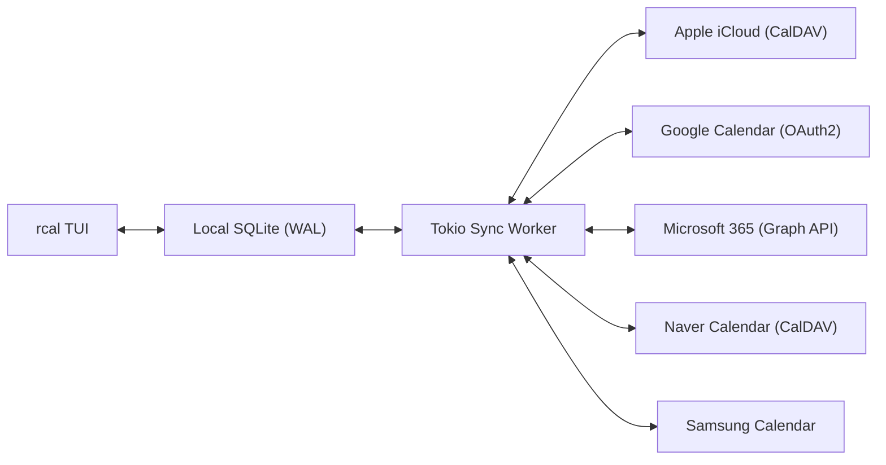
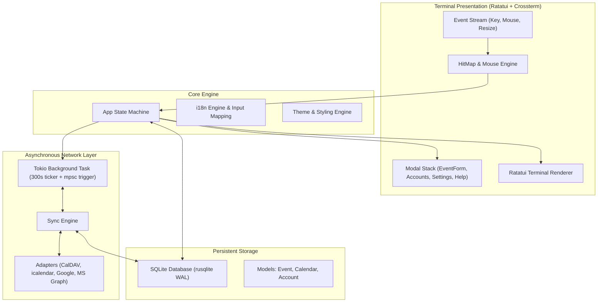

<div align="center">

```
  ██████╗  ██████╗ █████╗ ██╗     
  ██╔══██╗██╔════╝██╔══██╗██║     
  ██████╔╝██║     ███████║██║     
  ██╔══██╗██║     ██╔══██║██║     
  ██║  ██║╚██████╗██║  ██║███████╗
  ╚═╝  ╚═╝ ╚═════╝╚═╝  ╚═╝╚══════╝
```

### **Snelle, moderne, muis-interactieve Rust terminalkalender met multi-cloudsynchronisatie**

[](https://www.rust-lang.org)
[](../../LICENSE)
[](https://github.com/eeyees/rcal)
[](https://github.com/ratatui/ratatui)
[](https://www.sqlite.org)
[](https://tokio.rs)

<p align="center">
  🌐 <strong>Languages / 다국어 / 语言 / 言語 / Idiomas:</strong><br>
  <a href="../../README.md">English</a> •
  <a href="README.ko.md">한국어</a> •
  <a href="README.zh-CN.md">简体中文</a> •
  <a href="README.zh-TW.md">繁體中文</a> •
  <a href="README.ja.md">日本語</a> •
  <a href="README.es.md">Español</a> •
  <a href="README.fr.md">Français</a> •
  <a href="README.de.md">Deutsch</a> •
  <a href="README.pt-BR.md">Português</a> •
  <a href="README.ru.md">Русский</a> •
  <a href="README.it.md">Italiano</a> •<br>
  <a href="README.id.md">Bahasa Indonesia</a> •
  <a href="README.vi.md">Tiếng Việt</a> •
  <a href="README.tr.md">Türkçe</a> •
  <a href="README.pl.md">Polski</a> •
  <strong>Nederlands</strong> •
  <a href="README.ar.md">العربية</a> •
  <a href="README.hi.md">हिन्दी</a> •
  <a href="README.bn.md">বাংলা</a> •
  <a href="README.sv.md">Svenska</a> •
  <a href="README.uk.md">Українська</a> •
  <a href="README.th.md">ภาษาไทย</a>
</p>

<p align="center">
  <a href="#-key-features">Functies</a> •
  <a href="#-ui-views">Weergaven</a> •
  <a href="#-controls">Bediening</a> •
  <a href="#-cloud-sync">Cloudsync</a> •
  <a href="#-themes">Thema's</a> •
  <a href="#-installation">Installatie</a> •
  <a href="#-architecture">Architectuur</a>
</p>

---

</div>

`rcal` is een lichte en responsieve TUI-kalender ontworpen voor ontwikkelaars en terminalliefhebbers. Het brengt de visuele kracht van Google Agenda rechtstreeks naar uw terminal met **nul vertraging**, **100% muisinteractiviteit** en **betrouwbare multi-cloud tweewegsynchronisatie**.

---

## <a id="-key-features"></a>✨ Belangrijkste functies

- ⚡ **Offline-First architectuur zonder vertraging**: Start binnen 1 ms op dankzij een ingebouwde SQLite-database in WAL-modus.
- 🖱️ **Volledige muisondersteuning**: Klik op weergavetabbladen, navigatieknoppen, dubbelklik op een datum voor dagdetails, klik op tijdvakken om afspraken te maken en scroll met het muiswiel.
- 📅 **4 Vertrouwde kalenderweergaven**: Maand-, Week-, Dagweergave (met slimme parallelle weergave van gelijktijdige afspraken) en een chronologische Agendaweergave.
- ☁️ **Multi-cloud & CalDAV synchronisatie**: Ondersteunt Apple iCloud, Naver, Google Calendar (OAuth2), Microsoft 365 Graph API en Samsung Calendar met een stille Tokio-achtergrondtaak.
- ⌨️ **Vim-toetsen & vlotte navigatie**: Handige `h/j/k/l`-toetsen, snelle weergavewissels en naadloze bediening.
- 🌐 **Native meertalige ondersteuning (i18n)**: Automatische herkenning van systeemtaal en snelle wisseling met 1 toets.
- 🎨 **7 Kleurenthema's & Aanpassingsopties**: Modern Dark, Nord, Dracula, Forest, Sunset, Monokai, Solarized en aanpasbare eerste dag van de week.

---

## <a id="-ui-views"></a>🖥️ Weergaven

```
┌── rcal v2026.11.01.2 ─────────────────────────────────────────────── [ L: 한/EN ] [ ? Help ] [ ⚙ Settings ] ──┐
│ [ 1:Month ] [ 2:Week ] [ 3:Day ] [ 4:Agenda ]    [ < ] [ Today ] [ > ]  2026-11-01 (Sun)   [ ⟳ Sync ]  │
├────────────────────┬───────────────────────────────────────────────────────────────────────────────────┤
│ Calendars          │                             November 2026                                         │
│ [x] ■ Personal     │  Sun         Mon         Tue         Wed         Thu         Fri         Sat      │
│ [x] ■ Work         │ ┌───────────┬───────────┬───────────┬───────────┬───────────┬───────────┬───────────┐ │
│ [x] ■ Holidays     │ │ 1  TODAY  │ 2         │ 3         │ 4         │ 5         │ 6         │ 7         │ │
│                    │ │■ 10:00 AM │■ 09:00 AM │           │■ 14:00 PM │           │■ 19:00 PM │           │ │
│ Accounts           │ │  Sprint   │  Standup  │           │  Design   │           │  Dinner   │           │ │
│ • iCloud (Syncing) │ ├───────────┼───────────┼───────────┼───────────┼───────────┼───────────┼───────────┤ │
│ • Google (Active)  │ │ 8         │ 9         │ 10        │ 11        │ 12        │ 13        │ 14        │ │
│                    │ │           │           │           │           │           │           │           │ │
├────────────────────┴───────────────────────────────────────────────────────────────────────────────────┤
│ [c] New Event  [m/w/d/a] Switch View  [h/j/k/l] Navigate  [/] Search  [a] Accounts  [s] Settings  [q] Quit │
└────────────────────────────────────────────────────────────────────────────────────────────────────────┘
```

---

## <a id="-controls"></a>⌨️ Toetsenbord- en muisbediening

### 🧭 Bediening 1: Navigation

| Sneltoets | Muisactie | Beschrijving |
| :--- | :--- | :--- |
| `h` / `j` / `k` / `l` of Pijltjes | Klik op datumcel / tijdvak | Verplaats cursor naar Links / Omlaag / Omhoog / Rechts |
| `1` of `m` | Klik op tabblad `[ 1:Month ]` | Ga naar **Maandweergave** |
| `2` of `w` | Klik op tabblad `[ 2:Week ]` | Ga naar **Weekweergave** |
| `3` of `d` | Klik op tabblad `[ 3:Day ]` | Ga naar **Dagweergave** |
| `4` of `a` | Klik op tabblad `[ 4:Agenda ]` | Ga naar **Agendaweergave** |
| `t` | Klik op knop `[ Today ]` | Ga naar Vandaag |
| `[` / `]` | Klik op `[ < ]` / `[ > ]` | Vorige / volgende periode |
| Muiswiel | Draai muiswiel | Door tijdlijn scrollen of datum wijzigen |
| Dubbelklik | Dubbelklik op datumvak | Direct dagdetails openen vanuit maandweergave |

### 📝 Bediening 2: Events & Modals

| Sneltoets | Muisactie | Beschrijving |
| :--- | :--- | :--- |
| `c` of `n` | Klik op `[ + New ]` of leeg vak | Open formulier voor nieuwe afspraak |
| `Enter` | Klik op afspraakblok | Open afspraakdetails |
| `e` | Klik op knop `[ Edit ]` | Afspraak bewerken |
| `x` of `Delete` | Klik op knop `[ Delete ]` | Geselecteerde afspraak verwijderen |
| `Tab` / `Shift+Tab` | Klik op invoerveld / knop | Wissel focus tussen formuliervelden |
| `Esc` of `q` | Klik op `[ Close ]` of buiten modal | Sluit actieve modal |

### ⚙️ Bediening 3: System & Settings

| Sneltoets | Muisactie | Beschrijving |
| :--- | :--- | :--- |
| `L` | Klik op `[ L: 한/EN ]` | Taal wisselen |
| `s` | Klik op `[ ⚙ Settings ]` | Instellingen openen |
| `a` | Klik op Accounts in zijbalk | Cloudaccountbeheer openen |
| `b` | Klik op knop in zijbalk | Zijbalk tonen / verbergen |
| `r` | Klik op `[ ⟳ Sync ]` | Start direct cloudsynchronisatie in achtergrond |
| `?` | Klik op `[ ? Help ]` | Toon sneltoetshulp |
| `Ctrl+C` / `q` | - | `rcal` veilig afsluiten |

---

## <a id="-cloud-sync"></a>☁️ Multi-cloud & CalDAV synchronisatie

`rcal` biedt robuuste adapters om uw kalender up-to-date te houden:



### Supported Providers

- **Apple iCloud**: CalDAV-synchronisatie met Apple ID en app-specifiek wachtwoord.
- **Naver Calendar**: Automatische CalDAV-detectie en synchronisatie.
- **Google Calendar**: Google Calendar API-koppeling met veilige OAuth2.
- **Microsoft 365 / Outlook**: Verbinding via Microsoft Graph REST API.
- **Samsung Calendar**: Integratie met Samsung Cloud.

---

## <a id="-themes"></a>🎨 Thema's en personalisatie

Druk op `s` om de **Instellingen** te openen en uw stijl te kiezen:

### Built-in Color Palettes
- 🌙 **Modern Dark**: Schoon en modern donker standaardthema
- ❄️ **Nord**: Rustgevende noordelijke blauwgrijze tinten
- 🧛 **Dracula**: Populair hoog-contrast donker thema
- 🌲 **Forest**: Kalmerend matcha- en bosgroen
- 🌆 **Sunset**: Levendig cyberpunk paars en oranje
- 🎨 **Monokai**: Klassiek contrast van code-editors
- ☀️ **Solarized**: Zacht donker thema met laag contrast voor de ogen

### Eerste dag van de week
Kies of uw week begint op **zondag**, **maandag** of **zaterdag**.

---

## <a id="-architecture"></a>🏗️ Architectuur



---

## <a id="-installation"></a>🚀 Installatie en gebruik

### Bouwen vanuit broncode

```bash
# Clone the repository
git clone https://github.com/eeyees/rcal.git
cd rcal

# Build release
cargo build --release

# Run
./target/release/rcal
```

### Wereldwijd installeren via Cargo

```bash
cargo install --path .
rcal
```

### Locatie van lokale database

- **macOS**: `~/Library/Application Support/rcal/rcal.db`
- **Linux**: `~/.local/share/rcal/rcal.db`
- **Windows**: `%LOCALAPPDATA%\rcal\rcal.db`

---

## 🗺️ 🗺️ Ontwikkelingsstappenplan

- [x] **Fase 1**: Lokale TUI MVP, 4 weergaven, muisengine, SQLite WAL, CRUD.
- [x] **Fase 2**: CalDAV-engine (Apple iCloud & Naver), Tokio-achtergrondtaak, account-UI.
- [x] **Fase 3**: Google Calendar, MS Graph, Samsung, 7 thema's, instelling eerste dag van de week.
- [ ] **Fase 4**: Ecosysteem & open protocollen:
    - [x] MCP (Model Context Protocol) server voor AI-agents
    - [ ] WebCal / iCalendar (`.ics`) HTTP-abonnementserver
    - [ ] Herhalende afspraken (RFC 5545 RRULE)
    - [ ] Afspraken toevoegen met natuurlijke taal
    - [ ] Desktopmeldingen

---

## 📜 📜 Licentie

Uitgebracht onder de **MIT-licentie**. Zie het bestand [`LICENSE`](../../LICENSE) voor details.
