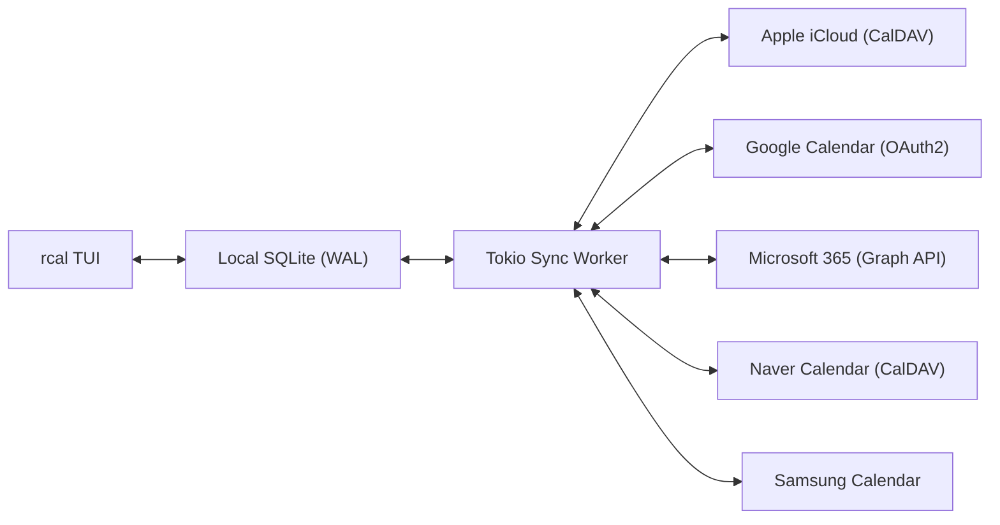
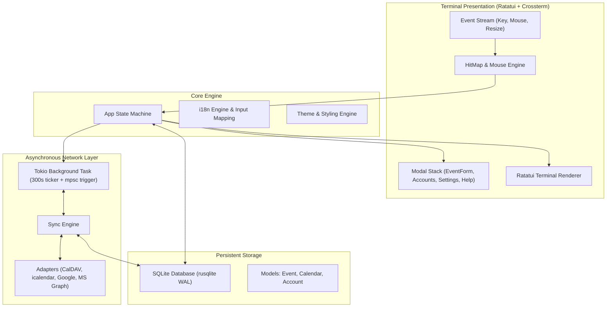

<div align="center">

```
  ██████╗  ██████╗ █████╗ ██╗     
  ██╔══██╗██╔════╝██╔══██╗██║     
  ██████╔╝██║     ███████║██║     
  ██╔══██╗██║     ██╔══██║██║     
  ██║  ██║╚██████╗██║  ██║███████╗
  ╚═╝  ╚═╝ ╚═════╝╚═╝  ╚═╝╚══════╝
```

### **Szybki, nowoczesny kalendarz terminalowy w Rust z obsługą myszy i synchronizacją multi-cloud**

[](https://www.rust-lang.org)
[](../../LICENSE)
[](https://github.com/eeyees/rcal)
[](https://github.com/ratatui/ratatui)
[](https://www.sqlite.org)
[](https://tokio.rs)

<p align="center">
  🌐 <strong>Languages / 다국어 / 语言 / 言語 / Idiomas:</strong><br>
  <a href="../../README.md">English</a> •
  <a href="README.ko.md">한국어</a> •
  <a href="README.zh-CN.md">简体中文</a> •
  <a href="README.zh-TW.md">繁體中文</a> •
  <a href="README.ja.md">日本語</a> •
  <a href="README.es.md">Español</a> •
  <a href="README.fr.md">Français</a> •
  <a href="README.de.md">Deutsch</a> •
  <a href="README.pt-BR.md">Português</a> •
  <a href="README.ru.md">Русский</a> •
  <a href="README.it.md">Italiano</a> •<br>
  <a href="README.id.md">Bahasa Indonesia</a> •
  <a href="README.vi.md">Tiếng Việt</a> •
  <a href="README.tr.md">Türkçe</a> •
  <strong>Polski</strong> •
  <a href="README.nl.md">Nederlands</a> •
  <a href="README.ar.md">العربية</a> •
  <a href="README.hi.md">हिन्दी</a> •
  <a href="README.bn.md">বাংলা</a> •
  <a href="README.sv.md">Svenska</a> •
  <a href="README.uk.md">Українська</a> •
  <a href="README.th.md">ภาษาไทย</a>
</p>

<p align="center">
  <a href="#-key-features">Funkcje</a> •
  <a href="#-ui-views">Widoki</a> •
  <a href="#-controls">Sterowanie</a> •
  <a href="#-cloud-sync">Synchronizacja</a> •
  <a href="#-themes">Motywy</a> •
  <a href="#-installation">Instalacja</a> •
  <a href="#-architecture">Architektura</a>
</p>

---

</div>

`rcal` to lekki i responsywny kalendarz TUI stworzony dla programistów i użytkowników terminala. Oferuje przejrzystość wizualną Google Calendar bezpośrednio w terminalu z **zerowym opóźnieniem**, **100% interakcją z myszą** i **niezawodną synchronizacją z chmurą**.

---

## <a id="-key-features"></a>✨ Główne funkcje

- ⚡ **Architektura Offline-First bez opóźnień**: Błyskawiczny start poniżej 1 ms dzięki wbudowanej bazie SQLite w trybie WAL.
- 🖱️ **Pełna interaktywność myszy**: Klikanie zakładek widoku, przycisków nawigacji, dwuklik na dacie w celu przejścia do widoku dnia, klikanie na sloty czasowe i przewijanie kółkiem.
- 📅 **4 Praktyczne widoki kalendarza**: Widok Miesiąca, Tygodnia, Dnia (inteligentne układanie nakładających się wydarzeń obok siebie) oraz chronologiczny terminarz (Agenda).
- ☁️ **Synchronizacja z Multi-Cloud i CalDAV**: Obsługa Apple iCloud, Naver, Google Calendar (OAuth2), Microsoft 365 Graph API oraz Samsung Calendar z cichym procesem w tle Tokio.
- ⌨️ **Skróty Vim i płynna obsługa**: Klawisze `h/j/k/l`, szybkie przełączanie i wygodna praca z klawiaturą.
- 🌐 **Natywne wsparcie wielu języków (i18n)**: Automatyczne wykrywanie języka systemu oraz szybka zmiana jednym klawiszem.
- 🎨 **7 Motywów kolorystycznych i personalizacja**: Modern Dark, Nord, Dracula, Forest, Sunset, Monokai, Solarized oraz wybór pierwszego dnia tygodnia.

---

## <a id="-ui-views"></a>🖥️ Widoki

```
┌── rcal v2026.11.05.1 ─────────────────────────────────────────────── [ L: 한/EN ] [ ? Help ] [ ⚙ Settings ] ──┐
│ [ 1:Month ] [ 2:Week ] [ 3:Day ] [ 4:Agenda ]    [ < ] [ Today ] [ > ]  2026-11-01 (Sun)   [ ⟳ Sync ]  │
├────────────────────┬───────────────────────────────────────────────────────────────────────────────────┤
│ Calendars          │                             November 2026                                         │
│ [x] ■ Personal     │  Sun         Mon         Tue         Wed         Thu         Fri         Sat      │
│ [x] ■ Work         │ ┌───────────┬───────────┬───────────┬───────────┬───────────┬───────────┬───────────┐ │
│ [x] ■ Holidays     │ │ 1  TODAY  │ 2         │ 3         │ 4         │ 5         │ 6         │ 7         │ │
│                    │ │■ 10:00 AM │■ 09:00 AM │           │■ 14:00 PM │           │■ 19:00 PM │           │ │
│ Accounts           │ │  Sprint   │  Standup  │           │  Design   │           │  Dinner   │           │ │
│ • iCloud (Syncing) │ ├───────────┼───────────┼───────────┼───────────┼───────────┼───────────┼───────────┤ │
│ • Google (Active)  │ │ 8         │ 9         │ 10        │ 11        │ 12        │ 13        │ 14        │ │
│                    │ │           │           │           │           │           │           │           │ │
├────────────────────┴───────────────────────────────────────────────────────────────────────────────────┤
│ [c] New Event  [m/w/d/a] Switch View  [h/j/k/l] Navigate  [/] Search  [a] Accounts  [s] Settings  [q] Quit │
└────────────────────────────────────────────────────────────────────────────────────────────────────────┘
```

---

## <a id="-controls"></a>⌨️ Klawiatura i obsługa myszą

### 🧭 Sterowanie 1: Navigation

| Skrót | Akcja myszy | Opis |
| :--- | :--- | :--- |
| `h` / `j` / `k` / `l` lub Strzałki | Kliknięcie w pole / slot | Przesuń kursor w Lewo / Dół / Górę / Prawo |
| `1` lub `m` | Kliknij zakładkę `[ 1:Month ]` | Przejdź do **Widoku Miesiąca** |
| `2` lub `w` | Kliknij zakładkę `[ 2:Week ]` | Przejdź do **Widoku Tygodnia** |
| `3` lub `d` | Kliknij zakładkę `[ 3:Day ]` | Przejdź do **Widoku Dnia** |
| `4` lub `a` | Kliknij zakładkę `[ 4:Agenda ]` | Przejdź do **Widoku Terminarza (Agenda)** |
| `t` | Kliknij przycisk `[ Today ]` | Przejdź do Dzisiaj |
| `[` / `]` | Kliknij `[ < ]` / `[ > ]` | Poprzedni / następny okres |
| Kółko myszy | Obrót kółkiem | Przewijanie osi czasu lub zmiana dat |
| Dwuklik | Dwuklik na komórce dnia | Przejdź z widoku miesiąca do szczegółów dnia |

### 📝 Sterowanie 2: Events & Modals

| Skrót | Akcja myszy | Opis |
| :--- | :--- | :--- |
| `c` lub `n` | Kliknij `[ + New ]` lub pusty slot | Otwórz formularz nowego wydarzenia |
| `Enter` | Kliknij w blok wydarzenia | Otwórz szczegóły wydarzenia |
| `e` | Kliknij przycisk `[ Edit ]` | Edytuj wydarzenie |
| `x` lub `Delete` | Kliknij przycisk `[ Delete ]` | Usuń wybrane wydarzenie |
| `Tab` / `Shift+Tab` | Kliknij w pole / przycisk | Przełączaj pola formularza |
| `Esc` lub `q` | Kliknij `[ Close ]` lub tło | Zamknij aktywne okno |

### ⚙️ Sterowanie 3: System & Settings

| Skrót | Akcja myszy | Opis |
| :--- | :--- | :--- |
| `L` | Kliknij `[ L: 한/EN ]` | Zmień język interfejsu |
| `s` | Kliknij `[ ⚙ Settings ]` | Otwórz Ustawienia |
| `a` | Kliknij Konta na pasku bocznym | Zarządzanie kontami chmurowymi |
| `b` | Kliknij przycisk paska bocznego | Pokaż / ukryj pasek boczny |
| `r` | Kliknij `[ ⟳ Sync ]` | Uruchom natychmiastową synchronizację w tle |
| `?` | Kliknij `[ ? Help ]` | Pokaż pomoc dotyczącą skrótów |
| `Ctrl+C` / `q` | - | Bezpiecznie zamknij `rcal` |

---

## <a id="-cloud-sync"></a>☁️ Synchronizacja Multi-Cloud i CalDAV

`rcal` zawiera wbudowane adaptery synchronizacji z wiodącymi dostawcami:



### Supported Providers

- **Apple iCloud**: Synchronizacja CalDAV z Apple ID i hasłem aplikacji.
- **Naver Calendar**: Automatyczna synchronizacja poprzez CalDAV.
- **Google Calendar**: Integracja z API Google Calendar z obsługą OAuth2.
- **Microsoft 365 / Outlook**: Łączność przez Microsoft Graph REST API.
- **Samsung Calendar**: Integracja z Samsung Cloud.

---

## <a id="-themes"></a>🎨 Motywy i personalizacja

Naciśnij `s`, aby otworzyć **Ustawienia** i dostosować wygląd:

### Built-in Color Palettes
- 🌙 **Modern Dark**: Czysty i nowoczesny domyślny ciemny motyw
- ❄️ **Nord**: Chłodne arktyczne odcienie szarości i błękitu
- 🧛 **Dracula**: Klasyczny kontrastowy ciemny motyw
- 🌲 **Forest**: Kojące odcienie zieleni i barw ziemi
- 🌆 **Sunset**: Cyberpunkowe fiolety i energetyczny pomarańcz
- 🎨 **Monokai**: Styl klasycznych edytorów kodu
- ☀️ **Solarized**: Łagodny dla oczu ciemny motyw o niskim kontraście

### Pierwszy dzień tygodnia
Wybierz, czy tydzień zaczyna się w **niedzielę**, **poniedziałek** czy **sobotę**.

---

## <a id="-architecture"></a>🏗️ Architektura



---

## <a id="-installation"></a>🚀 Instalacja i uruchomienie

### Kompilacja z kodu źródłowego

```bash
# Clone the repository
git clone https://github.com/eeyees/rcal.git
cd rcal

# Build release
cargo build --release

# Run
./target/release/rcal
```

### Instalacja globalna za pomocą Cargo

```bash
cargo install --path .
rcal
```

### Lokalizacja lokalnej bazy danych

- **macOS**: `~/Library/Application Support/rcal/rcal.db`
- **Linux**: `~/.local/share/rcal/rcal.db`
- **Windows**: `%LOCALAPPDATA%\rcal\rcal.db`

---

## 🗺️ 🗺️ Plan rozwoju

- [x] **Faza 1**: Lokalne TUI MVP, 4 widoki, silnik myszy, SQLite WAL, CRUD.
- [x] **Faza 2**: Silnik CalDAV (Apple iCloud i Naver), wątek Tokio, UI kont.
- [x] **Faza 3**: Google Calendar, MS Graph, Samsung, 7 motywów, wybór początku tygodnia.
- [ ] **Faza 4**: Ekosystem i otwarte protokoły:
    - [x] Serwer MCP (Model Context Protocol) dla agentów AI
    - [ ] Serwer subskrypcji HTTP WebCal / iCalendar (`.ics`)
    - [ ] Reguły powtarzania wydarzeń (RFC 5545 RRULE)
    - [ ] Dodawanie wydarzeń w języku naturalnym
    - [ ] Powiadomienia pulpitu

---

## 📜 📜 Licencja

Projekt jest dostępny na licencji **MIT**. Szczegóły w pliku [`LICENSE`](../../LICENSE).
