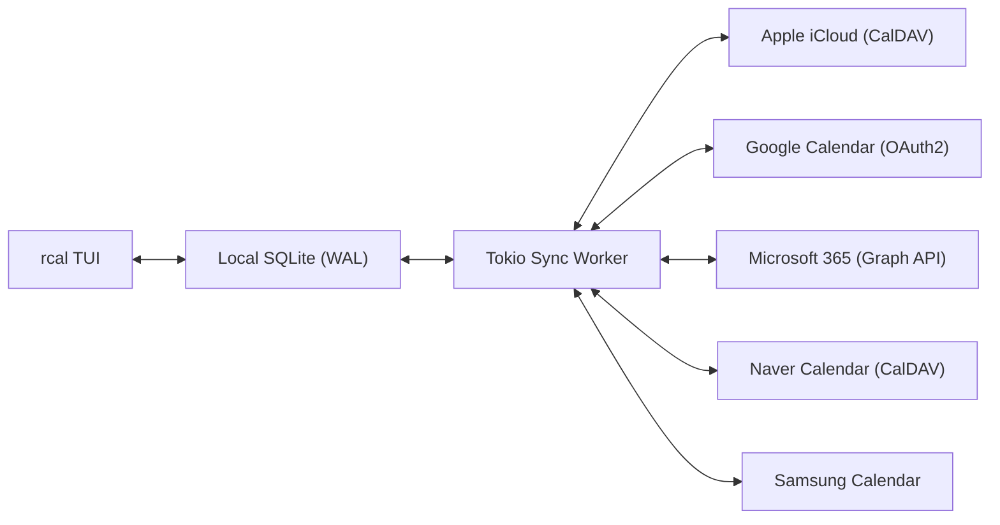
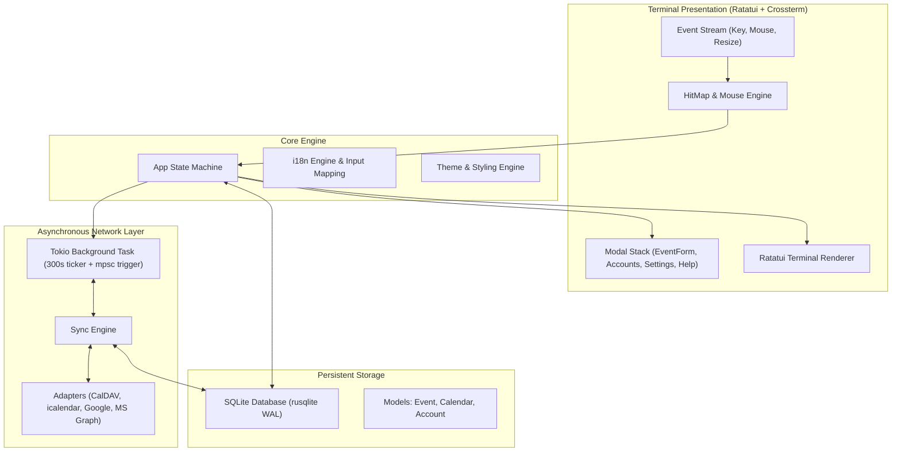

<div align="center">

```
  ██████╗  ██████╗ █████╗ ██╗     
  ██╔══██╗██╔════╝██╔══██╗██║     
  ██████╔╝██║     ███████║██║     
  ██╔══██╗██║     ██╔══██║██║     
  ██║  ██║╚██████╗██║  ██║███████╗
  ╚═╝  ╚═╝ ╚═════╝╚═╝  ╚═╝╚══════╝
```

### **Calendário de terminal Rust rápido, moderno e interativo com mouse e sincronização multi-cloud**

[](https://www.rust-lang.org)
[](../../LICENSE)
[](https://github.com/eeyees/rcal)
[](https://github.com/ratatui/ratatui)
[](https://www.sqlite.org)
[](https://tokio.rs)

<p align="center">
  🌐 <strong>Languages / 다국어 / 语言 / 言語 / Idiomas:</strong><br>
  <a href="../../README.md">English</a> •
  <a href="README.ko.md">한국어</a> •
  <a href="README.zh-CN.md">简体中文</a> •
  <a href="README.zh-TW.md">繁體中文</a> •
  <a href="README.ja.md">日本語</a> •
  <a href="README.es.md">Español</a> •
  <a href="README.fr.md">Français</a> •
  <a href="README.de.md">Deutsch</a> •
  <strong>Português</strong> •
  <a href="README.ru.md">Русский</a> •
  <a href="README.it.md">Italiano</a> •<br>
  <a href="README.id.md">Bahasa Indonesia</a> •
  <a href="README.vi.md">Tiếng Việt</a> •
  <a href="README.tr.md">Türkçe</a> •
  <a href="README.pl.md">Polski</a> •
  <a href="README.nl.md">Nederlands</a> •
  <a href="README.ar.md">العربية</a> •
  <a href="README.hi.md">हिन्दी</a> •
  <a href="README.bn.md">বাংলা</a> •
  <a href="README.sv.md">Svenska</a> •
  <a href="README.uk.md">Українська</a> •
  <a href="README.th.md">ภาษาไทย</a>
</p>

<p align="center">
  <a href="#-key-features">Recursos</a> •
  <a href="#-ui-views">Visualizações</a> •
  <a href="#-controls">Controles</a> •
  <a href="#-cloud-sync">Sincronização</a> •
  <a href="#-themes">Temas</a> •
  <a href="#-installation">Instalação</a> •
  <a href="#-architecture">Arquitetura</a>
</p>

---

</div>

`rcal` é um calendário TUI leve e altamente responsivo feito para desenvolvedores e entusiastas de terminal que desejam a facilidade visual do Google Agenda diretamente no terminal, com **zero atraso**, **100% de interatividade com o mouse** e **sincronização bidirecional confiável na nuvem**.

---

## <a id="-key-features"></a>✨ Principais recursos

- ⚡ **Arquitetura Offline-First sem atraso**: Inicialização instantânea em menos de 1 ms graças ao banco de dados SQLite embutido em modo WAL.
- 🖱️ **Interatividade completa com o mouse**: Clique em abas de visualização, botões de navegação, duplo clique na data para detalhes do dia, clique em horários para criar eventos e rolagem no mouse.
- 📅 **4 Visualizações ricas e familiares**: Mensal, Semanal, Diária (com posicionamento inteligente lado a lado de eventos simultâneos) e Agenda cronológica.
- ☁️ **Motor de sincronização multi-cloud e CalDAV**: Conexão com Apple iCloud, Naver, Google Calendar (OAuth2), Microsoft 365 Graph API e Samsung Calendar com tarefa em segundo plano no Tokio.
- ⌨️ **Atalhos Vim e navegação fluida**: Teclas clássicas `h/j/k/l`, troca rápida de visualizações e digitação sem interrupções.
- 🌐 **Suporte nativo a múltiplos idiomas (i18n)**: Detecção automática da linguagem do sistema e troca rápida com 1 tecla.
- 🎨 **7 Paletas de cores e personalização**: Modern Dark, Nord, Dracula, Forest, Sunset, Monokai, Solarized e escolha do primeiro dia da semana.

---

## <a id="-ui-views"></a>🖥️ Visualizações

```
┌── rcal v2026.11.05.1 ─────────────────────────────────────────────── [ L: 한/EN ] [ ? Help ] [ ⚙ Settings ] ──┐
│ [ 1:Month ] [ 2:Week ] [ 3:Day ] [ 4:Agenda ]    [ < ] [ Today ] [ > ]  2026-11-01 (Sun)   [ ⟳ Sync ]  │
├────────────────────┬───────────────────────────────────────────────────────────────────────────────────┤
│ Calendars          │                             November 2026                                         │
│ [x] ■ Personal     │  Sun         Mon         Tue         Wed         Thu         Fri         Sat      │
│ [x] ■ Work         │ ┌───────────┬───────────┬───────────┬───────────┬───────────┬───────────┬───────────┐ │
│ [x] ■ Holidays     │ │ 1  TODAY  │ 2         │ 3         │ 4         │ 5         │ 6         │ 7         │ │
│                    │ │■ 10:00 AM │■ 09:00 AM │           │■ 14:00 PM │           │■ 19:00 PM │           │ │
│ Accounts           │ │  Sprint   │  Standup  │           │  Design   │           │  Dinner   │           │ │
│ • iCloud (Syncing) │ ├───────────┼───────────┼───────────┼───────────┼───────────┼───────────┼───────────┤ │
│ • Google (Active)  │ │ 8         │ 9         │ 10        │ 11        │ 12        │ 13        │ 14        │ │
│                    │ │           │           │           │           │           │           │           │ │
├────────────────────┴───────────────────────────────────────────────────────────────────────────────────┤
│ [c] New Event  [m/w/d/a] Switch View  [h/j/k/l] Navigate  [/] Search  [a] Accounts  [s] Settings  [q] Quit │
└────────────────────────────────────────────────────────────────────────────────────────────────────────┘
```

---

## <a id="-controls"></a>⌨️ Guia de controles de teclado e mouse

### 🧭 Controles 1: Navigation

| Atalho | Ação do mouse | Descrição |
| :--- | :--- | :--- |
| `h` / `j` / `k` / `l` ou Setas | Clique na célula ou horário | Mover cursor Esquerda / Baixo / Cima / Direita |
| `1` ou `m` | Clique na aba `[ 1:Month ]` | Mudar para **Visualização Mensal** |
| `2` ou `w` | Clique na aba `[ 2:Week ]` | Mudar para **Visualização Semanal** |
| `3` ou `d` | Clique na aba `[ 3:Day ]` | Mudar para **Visualização Diária** |
| `4` ou `a` | Clique na aba `[ 4:Agenda ]` | Mudar para **Visualização Agenda** |
| `t` | Clique no botão `[ Today ]` | Ir para Hoje |
| `[` / `]` | Clique em `[ < ]` / `[ > ]` | Período anterior / seguinte |
| Roda do mouse | Girar roda | Rolar linha do tempo ou alternar datas |
| Duplo clique | Duplo clique na célula do dia | Abrir o dia diretamente a partir da visualização mensal |

### 📝 Controles 2: Events & Modals

| Atalho | Ação do mouse | Descrição |
| :--- | :--- | :--- |
| `c` ou `n` | Clique em `[ + New ]` ou horário vazio | Abrir formulário de novo evento |
| `Enter` | Clique no bloco do evento | Abrir detalhes do evento |
| `e` | Clique em `[ Edit ]` | Editar evento |
| `x` ou `Delete` | Clique em `[ Delete ]` | Excluir evento selecionado |
| `Tab` / `Shift+Tab` | Clique no campo / botão | Alternar foco nos campos do formulário |
| `Esc` ou `q` | Clique em `[ Close ]` ou fora | Fechar janela modal ativa |

### ⚙️ Controles 3: System & Settings

| Atalho | Ação do mouse | Descrição |
| :--- | :--- | :--- |
| `L` | Clique em `[ L: 한/EN ]` | Alternar idioma de exibição |
| `s` | Clique em `[ ⚙ Settings ]` | Abrir configurações do sistema |
| `a` | Clique em Contas na barra lateral | Abrir gerenciador de contas na nuvem |
| `b` | Clique no botão da barra lateral | Mostrar ou ocultar a barra lateral |
| `r` | Clique em `[ ⟳ Sync ]` | Executar sincronização em segundo plano |
| `?` | Clique em `[ ? Help ]` | Exibir ajuda de atalhos |
| `Ctrl+C` / `q` | - | Sair do `rcal` com segurança |

---

## <a id="-cloud-sync"></a>☁️ Sincronização multi-cloud e CalDAV

`rcal` integra adaptadores robustos para sincronizar seus calendários com facilidade:



### Supported Providers

- **Apple iCloud**: Sincronização CalDAV com Apple ID e senha específica de aplicativo.
- **Naver Calendar**: Descoberta e sincronização automática via CalDAV.
- **Google Calendar**: Integração com a API do Google Calendar via OAuth2.
- **Microsoft 365 / Outlook**: Integração via API REST do Microsoft Graph.
- **Samsung Calendar**: Integração com serviços Samsung Cloud.

---

## <a id="-themes"></a>🎨 Temas e personalização

Pressione `s` para abrir as **Configurações** e escolher o estilo que preferir:

### Built-in Color Palettes
- 🌙 **Modern Dark**: Tema escuro moderno e clean padrão
- ❄️ **Nord**: Tons azulados do ártico nórdico
- 🧛 **Dracula**: Clássico tema escuro de alto contraste
- 🌲 **Forest**: Verdes suaves e naturais relaxantes
- 🌆 **Sunset**: Estilo cyberpunk vibrante em roxo e laranja
- 🎨 **Monokai**: Contraste clássico de editor de código
- ☀️ **Solarized**: Conforto visual com baixo contraste

### Primeiro dia da semana
Defina o início da sua semana entre **domingo**, **segunda-feira** ou **sábado**.

---

## <a id="-architecture"></a>🏗️ Arquitetura



---

## <a id="-installation"></a>🚀 Instalação e execução

### Compilar a partir do código-fonte

```bash
# Clone the repository
git clone https://github.com/eeyees/rcal.git
cd rcal

# Build release
cargo build --release

# Run
./target/release/rcal
```

### Instalação global com Cargo

```bash
cargo install --path .
rcal
```

### Local de armazenamento do banco de dados

- **macOS**: `~/Library/Application Support/rcal/rcal.db`
- **Linux**: `~/.local/share/rcal/rcal.db`
- **Windows**: `%LOCALAPPDATA%\rcal\rcal.db`

---

## 🗺️ 🗺️ Roteiro de desenvolvimento

- [x] **Fase 1**: TUI local MVP, 4 visualizações, motor de mouse, SQLite WAL, CRUD.
- [x] **Fase 2**: CalDAV (Apple iCloud e Naver), tarefa em Tokio, interface de contas.
- [x] **Fase 3**: Google Calendar, MS Graph, Samsung, 7 temas, início da semana.
- [ ] **Fase 4**: Ecossistema e protocolos abertos:
    - [x] Servidor MCP (Model Context Protocol) para agentes de IA
    - [ ] Servidor HTTP de exportação WebCal / iCalendar (`.ics`)
    - [ ] Eventos recorrentes (RFC 5545 RRULE)
    - [ ] Criação de eventos com linguagem natural
    - [ ] Notificações no desktop

---

## 📜 📜 Licença

Distribuído sob a **Licença MIT**. Consulte [`LICENSE`](../../LICENSE) para obter mais informações.
