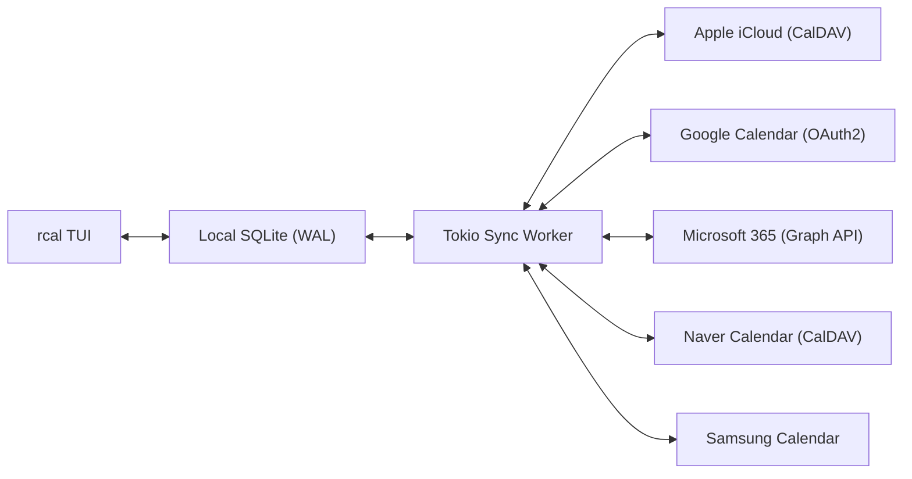
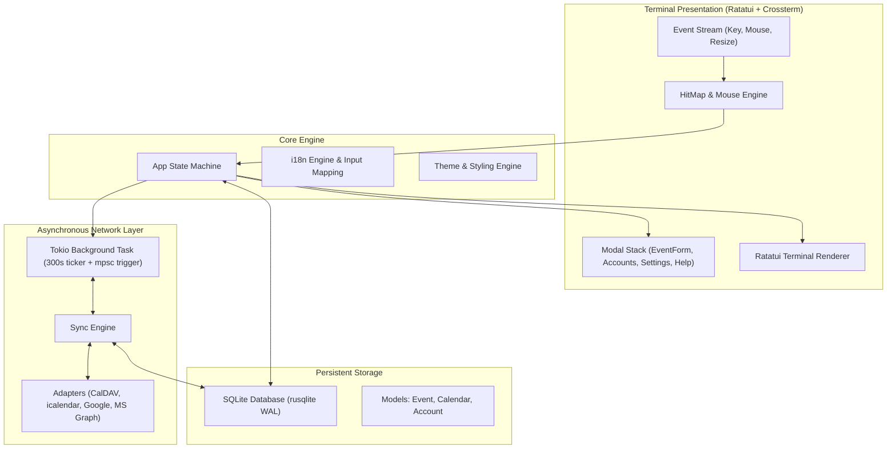

<div align="center">

```
  ██████╗  ██████╗ █████╗ ██╗     
  ██╔══██╗██╔════╝██╔══██╗██║     
  ██████╔╝██║     ███████║██║     
  ██╔══██╗██║     ██╔══██║██║     
  ██║  ██║╚██████╗██║  ██║███████╗
  ╚═╝  ╚═╝ ╚═════╝╚═╝  ╚═╝╚══════╝
```

### **Быстрый, современный терминальный календарь на Rust с поддержкой мыши и мульти-облачной синхронизацией**

[](https://www.rust-lang.org)
[](../../LICENSE)
[](https://github.com/eeyees/rcal)
[](https://github.com/ratatui/ratatui)
[](https://www.sqlite.org)
[](https://tokio.rs)

<p align="center">
  🌐 <strong>Languages / 다국어 / 语言 / 言語 / Idiomas:</strong><br>
  <a href="../../README.md">English</a> •
  <a href="README.ko.md">한국어</a> •
  <a href="README.zh-CN.md">简体中文</a> •
  <a href="README.zh-TW.md">繁體中文</a> •
  <a href="README.ja.md">日本語</a> •
  <a href="README.es.md">Español</a> •
  <a href="README.fr.md">Français</a> •
  <a href="README.de.md">Deutsch</a> •
  <a href="README.pt-BR.md">Português</a> •
  <strong>Русский</strong> •
  <a href="README.it.md">Italiano</a> •<br>
  <a href="README.id.md">Bahasa Indonesia</a> •
  <a href="README.vi.md">Tiếng Việt</a> •
  <a href="README.tr.md">Türkçe</a> •
  <a href="README.pl.md">Polski</a> •
  <a href="README.nl.md">Nederlands</a> •
  <a href="README.ar.md">العربية</a> •
  <a href="README.hi.md">हिन्दी</a> •
  <a href="README.bn.md">বাংলা</a> •
  <a href="README.sv.md">Svenska</a> •
  <a href="README.uk.md">Українська</a> •
  <a href="README.th.md">ภาษาไทย</a>
</p>

<p align="center">
  <a href="#-key-features">Возможности</a> •
  <a href="#-ui-views">Интерфейс</a> •
  <a href="#-controls">Управление</a> •
  <a href="#-cloud-sync">Синхронизация</a> •
  <a href="#-themes">Темы</a> •
  <a href="#-installation">Установка</a> •
  <a href="#-architecture">Архитектура</a>
</p>

---

</div>

`rcal` — это легковесный и отзывчивый TUI-календарь, созданный для разработчиков и пользователей терминала. Он сочетает наглядность Google Calendar с мощью терминала: **нулевая задержка**, **100% интерактивность мыши** и **надежная двусторонняя синхронизация с облаком**.

---

## <a id="-key-features"></a>✨ Ключевые возможности

- ⚡ **Архитектура Offline-First без задержек**: Мгновенный запуск менее чем за 1 мс благодаря встроенной базе SQLite в режиме WAL.
- 🖱️ **Полная поддержка мыши**: Переключение вкладок, навигационные кнопки, двойной клик по дате для перехода в режим дня, клик по временному интервалу для создания события и колесико для прокрутки.
- 📅 **4 Удобных режима отображения**: Месяц, Неделя, День (интеллектуальное параллельное размещение пересекающихся событий) и хронологическая лента событий (Agenda).
- ☁️ **Синхронизация с мульти-облаком и CalDAV**: Поддержка Apple iCloud, Naver, Google Calendar (OAuth2), Microsoft 365 Graph API и Samsung Calendar с фоновой службой Tokio.
- ⌨️ **Vim-навигация и плавная работа**: Привычные клавиши `h/j/k/l`, быстрое переключение экранов и комфортная работа без сбоев ввода.
- 🌐 **Нативная поддержка языков (i18n)**: Автоопределение локали системы и переключение языка одной клавишей.
- 🎨 **7 Стильных тем и кастомизация**: Modern Dark, Nord, Dracula, Forest, Sunset, Monokai, Solarized и выбор первого дня недели (воскресенье, понедельник или суббота).

---

## <a id="-ui-views"></a>🖥️ Интерфейс

```
┌── rcal v2026.11.02.1 ─────────────────────────────────────────────── [ L: 한/EN ] [ ? Help ] [ ⚙ Settings ] ──┐
│ [ 1:Month ] [ 2:Week ] [ 3:Day ] [ 4:Agenda ]    [ < ] [ Today ] [ > ]  2026-11-01 (Sun)   [ ⟳ Sync ]  │
├────────────────────┬───────────────────────────────────────────────────────────────────────────────────┤
│ Calendars          │                             November 2026                                         │
│ [x] ■ Personal     │  Sun         Mon         Tue         Wed         Thu         Fri         Sat      │
│ [x] ■ Work         │ ┌───────────┬───────────┬───────────┬───────────┬───────────┬───────────┬───────────┐ │
│ [x] ■ Holidays     │ │ 1  TODAY  │ 2         │ 3         │ 4         │ 5         │ 6         │ 7         │ │
│                    │ │■ 10:00 AM │■ 09:00 AM │           │■ 14:00 PM │           │■ 19:00 PM │           │ │
│ Accounts           │ │  Sprint   │  Standup  │           │  Design   │           │  Dinner   │           │ │
│ • iCloud (Syncing) │ ├───────────┼───────────┼───────────┼───────────┼───────────┼───────────┼───────────┤ │
│ • Google (Active)  │ │ 8         │ 9         │ 10        │ 11        │ 12        │ 13        │ 14        │ │
│                    │ │           │           │           │           │           │           │           │ │
├────────────────────┴───────────────────────────────────────────────────────────────────────────────────┤
│ [c] New Event  [m/w/d/a] Switch View  [h/j/k/l] Navigate  [/] Search  [a] Accounts  [s] Settings  [q] Quit │
└────────────────────────────────────────────────────────────────────────────────────────────────────────┘
```

---

## <a id="-controls"></a>⌨️ Руководство по управлению (клавиатура и мышь)

### 🧭 Управление 1: Navigation

| Клавиша | Действие мыши | Описание |
| :--- | :--- | :--- |
| `h` / `j` / `k` / `l` или Стрелки | Клик по дате / интервалу | Перемещение курсора Влево / Вниз / Вверх / Вправо |
| `1` или `m` | Клик по вкладке `[ 1:Month ]` | Перейти в **Режим месяца** |
| `2` или `w` | Клик по вкладке `[ 2:Week ]` | Перейти в **Режим недели** |
| `3` или `d` | Клик по вкладке `[ 3:Day ]` | Перейти в **Режим дня** |
| `4` или `a` | Клик по вкладке `[ 4:Agenda ]` | Перейти в **Режим повестки (Agenda)** |
| `t` | Клик по кнопке `[ Today ]` | Перейти к сегодняшнему дню |
| `[` / `]` | Клик по `[ < ]` / `[ > ]` | Предыдущий / следующий период |
| Колесико мыши | Прокрутка колесика | Прокрутка расписания или смена дат |
| Двойной клик | Двойной клик по ячейке даты | Переход к подробному дневному расписанию из режима месяца |

### 📝 Управление 2: Events & Modals

| Клавиша | Действие мыши | Описание |
| :--- | :--- | :--- |
| `c` или `n` | Клик по `[ + New ]` или интервалу | Открыть окно создания события |
| `Enter` | Клик по блоку события | Открыть подробности события |
| `e` | Клик по `[ Edit ]` | Редактировать событие |
| `x` или `Delete` | Клик по `[ Delete ]` | Удалить выбранное событие |
| `Tab` / `Shift+Tab` | Клик по полю / кнопке | Переключение между полями ввода |
| `Esc` или `q` | Клик по `[ Close ]` или фону | Закрыть текущее окно |

### ⚙️ Управление 3: System & Settings

| Клавиша | Действие мыши | Описание |
| :--- | :--- | :--- |
| `L` | Клик по `[ L: 한/EN ]` | Переключить язык интерфейса |
| `s` | Клик по `[ ⚙ Settings ]` | Открыть настройки системы |
| `a` | Клик по Accounts в боковой панели | Открыть менеджер облачных учетных записей |
| `b` | Клик по кнопке боковой панели | Показать / скрыть боковую панель |
| `r` | Клик по `[ ⟳ Sync ]` | Запустить фоновую синхронизацию прямо сейчас |
| `?` | Клик по `[ ? Help ]` | Показать справку по клавишам |
| `Ctrl+C` / `q` | - | Безопасно выйти из `rcal` |

---

## <a id="-cloud-sync"></a>☁️ Синхронизация с мульти-облаком и CalDAV

`rcal` включает надежные адаптеры для связи с популярными провайдерами:



### Supported Providers

- **Apple iCloud**: Двусторонняя синхронизация CalDAV с Apple ID и паролем приложения.
- **Naver Calendar**: Автоматическое подключение и синхронизация по CalDAV.
- **Google Calendar**: Интеграция с Google Calendar API через OAuth2.
- **Microsoft 365 / Outlook**: Подключение через Microsoft Graph REST API.
- **Samsung Calendar**: Интеграция с сервисами Samsung Cloud.

---

## <a id="-themes"></a>🎨 Темы оформления и настройка

Нажмите `s` для открытия **Настроек** и выберите подходящую цветовую схему:

### Built-in Color Palettes
- 🌙 **Modern Dark**: Стандартная современная темная тема
- ❄️ **Nord**: Спокойные арктические серо-голубые тона
- 🧛 **Dracula**: Популярная высококонтрастная тема
- 🌲 **Forest**: Успокаивающие зеленые и природные оттенки
- 🌆 **Sunset**: Яркие киберпанк-тона фиолетового и оранжевого
- 🎨 **Monokai**: Классический стиль редакторов кода
- ☀️ **Solarized**: Мягкая темная тема с низкой контрастностью для комфорта глаз

### Первый день недели
Настройте начало недели на **воскресенье**, **понедельник** или **субботу**.

---

## <a id="-architecture"></a>🏗️ Архитектура



---

## <a id="-installation"></a>🚀 Установка и запуск

### Сборка из исходного кода

```bash
# Clone the repository
git clone https://github.com/eeyees/rcal.git
cd rcal

# Build release
cargo build --release

# Run
./target/release/rcal
```

### Глобальная установка через Cargo

```bash
cargo install --path .
rcal
```

### Расположение локальной базы данных

- **macOS**: `~/Library/Application Support/rcal/rcal.db`
- **Linux**: `~/.local/share/rcal/rcal.db`
- **Windows**: `%LOCALAPPDATA%\rcal\rcal.db`

---

## 🗺️ 🗺️ План развития проекта

- [x] **Этап 1**: Локальный TUI MVP, 4 режима, движок мыши, SQLite WAL, CRUD событий.
- [x] **Этап 2**: Движок CalDAV (iCloud и Naver), фоновый поток Tokio, интерфейс аккаунтов.
- [x] **Этап 3**: Google Calendar, MS Graph, Samsung, 7 тем, настройка первого дня недели.
- [ ] **Этап 4**: Экосистема и открытые протоколы:
    - [x] Сервер MCP (Model Context Protocol) для подключения AI-агентов
    - [ ] HTTP-сервер подписки WebCal / iCalendar (`.ics`)
    - [ ] Повторяющиеся события (RFC 5545 RRULE)
    - [ ] Добавление событий на естественном языке
    - [ ] Уведомления операционной системы

---

## 📜 📜 Лицензия

Распространяется под лицензией **MIT License**. Подробнее см. в файле [`LICENSE`](../../LICENSE).
