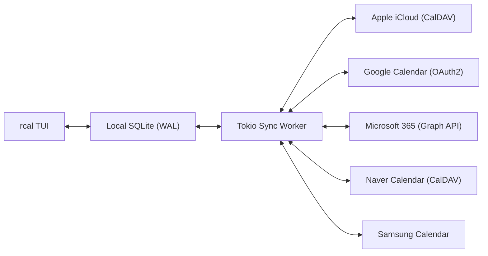
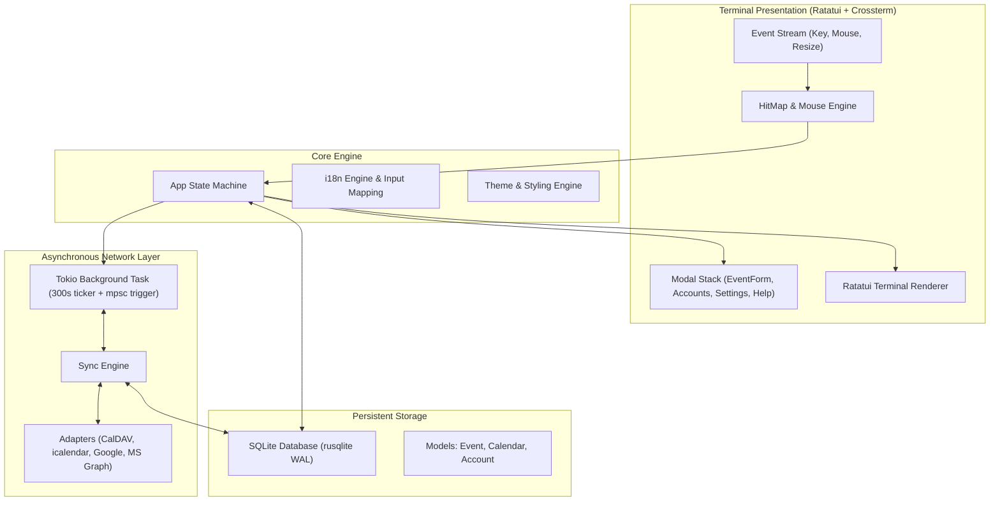

<div align="center">

```
  ██████╗  ██████╗ █████╗ ██╗     
  ██╔══██╗██╔════╝██╔══██╗██║     
  ██████╔╝██║     ███████║██║     
  ██╔══██╗██║     ██╔══██║██║     
  ██║  ██║╚██████╗██║  ██║███████╗
  ╚═╝  ╚═╝ ╚═════╝╚═╝  ╚═╝╚══════╝
```

### **Snabb, modern, mus-interaktiv Rust terminalkalender med flermolnssynkronisering**

[](https://www.rust-lang.org)
[](../../LICENSE)
[](https://github.com/eeyees/rcal)
[](https://github.com/ratatui/ratatui)
[](https://www.sqlite.org)
[](https://tokio.rs)

<p align="center">
  🌐 <strong>Languages / 다국어 / 语言 / 言語 / Idiomas:</strong><br>
  <a href="../../README.md">English</a> •
  <a href="README.ko.md">한국어</a> •
  <a href="README.zh-CN.md">简体中文</a> •
  <a href="README.zh-TW.md">繁體中文</a> •
  <a href="README.ja.md">日本語</a> •
  <a href="README.es.md">Español</a> •
  <a href="README.fr.md">Français</a> •
  <a href="README.de.md">Deutsch</a> •
  <a href="README.pt-BR.md">Português</a> •
  <a href="README.ru.md">Русский</a> •
  <a href="README.it.md">Italiano</a> •<br>
  <a href="README.id.md">Bahasa Indonesia</a> •
  <a href="README.vi.md">Tiếng Việt</a> •
  <a href="README.tr.md">Türkçe</a> •
  <a href="README.pl.md">Polski</a> •
  <a href="README.nl.md">Nederlands</a> •
  <a href="README.ar.md">العربية</a> •
  <a href="README.hi.md">हिन्दी</a> •
  <a href="README.bn.md">বাংলা</a> •
  <strong>Svenska</strong> •
  <a href="README.uk.md">Українська</a> •
  <a href="README.th.md">ภาษาไทย</a>
</p>

<p align="center">
  <a href="#-key-features">Funktioner</a> •
  <a href="#-ui-views">Vyer</a> •
  <a href="#-controls">Kontroller</a> •
  <a href="#-cloud-sync">Molnsynk</a> •
  <a href="#-themes">Teman</a> •
  <a href="#-installation">Installation</a> •
  <a href="#-architecture">Arkitektur</a>
</p>

---

</div>

`rcal` är en lätt och responsiv TUI-kalender byggd för utvecklare och terminalentusiaster. Den ger Google Calendars visuella överskådlighet direkt i terminalen med **noll fördröjning**, **100 % musinteraktivitet** och **smidig tvåvägs flermolnssynk**.

---

## <a id="-key-features"></a>✨ Nyckelfunktioner

- ⚡ **Offline-First arkitektur utan fördröjning**: Omedelbar start på under 1 ms tack vare en inbäddad SQLite-databas i WAL-läge.
- 🖱️ **Full musinteraktivitet**: Klicka på vyflikar, navigeringsknappar, dubbelklicka på datum för dagsvy, klicka på tidluckor för att skapa händelser och rulla med mushjulet.
- 📅 **4 Bekanta kalendervyer**: Månadsvy, Veckovy, Dagsvy (med smart parallell layout för samtidiga händelser) och kronologisk Agendavy.
- ☁️ **Flermolns- & CalDAV-synkronisering**: Stöd för Apple iCloud, Naver, Google Calendar (OAuth2), Microsoft 365 Graph API och Samsung Calendar med tyst bakgrundsprocess i Tokio.
- ⌨️ **Vim-navigering & transparent tangentbord**: Tangenter `h/j/k/l`, snabba vybyten och bekväm hantering.
- 🌐 **Inbyggt stöd för flera språk (i18n)**: Automatisk identifiering av systemspråk och snabb växling med 1 tangent.
- 🎨 **7 Färgteman & anpassning**: Modern Dark, Nord, Dracula, Forest, Sunset, Monokai, Solarized och val av veckans startdag.

---

## <a id="-ui-views"></a>🖥️ Vyer

```
┌── rcal v2026.11.02.1 ─────────────────────────────────────────────── [ L: 한/EN ] [ ? Help ] [ ⚙ Settings ] ──┐
│ [ 1:Month ] [ 2:Week ] [ 3:Day ] [ 4:Agenda ]    [ < ] [ Today ] [ > ]  2026-11-01 (Sun)   [ ⟳ Sync ]  │
├────────────────────┬───────────────────────────────────────────────────────────────────────────────────┤
│ Calendars          │                             November 2026                                         │
│ [x] ■ Personal     │  Sun         Mon         Tue         Wed         Thu         Fri         Sat      │
│ [x] ■ Work         │ ┌───────────┬───────────┬───────────┬───────────┬───────────┬───────────┬───────────┐ │
│ [x] ■ Holidays     │ │ 1  TODAY  │ 2         │ 3         │ 4         │ 5         │ 6         │ 7         │ │
│                    │ │■ 10:00 AM │■ 09:00 AM │           │■ 14:00 PM │           │■ 19:00 PM │           │ │
│ Accounts           │ │  Sprint   │  Standup  │           │  Design   │           │  Dinner   │           │ │
│ • iCloud (Syncing) │ ├───────────┼───────────┼───────────┼───────────┼───────────┼───────────┼───────────┤ │
│ • Google (Active)  │ │ 8         │ 9         │ 10        │ 11        │ 12        │ 13        │ 14        │ │
│                    │ │           │           │           │           │           │           │           │ │
├────────────────────┴───────────────────────────────────────────────────────────────────────────────────┤
│ [c] New Event  [m/w/d/a] Switch View  [h/j/k/l] Navigate  [/] Search  [a] Accounts  [s] Settings  [q] Quit │
└────────────────────────────────────────────────────────────────────────────────────────────────────────┘
```

---

## <a id="-controls"></a>⌨️ Tangentbords- och muskontroller

### 🧭 Kontroller 1: Navigation

| Kortkommando | Musåtgärd | Beskrivning |
| :--- | :--- | :--- |
| `h` / `j` / `k` / `l` eller Pilar | Klicka på datumcell / tidlucka | Flytta markör Vänster / Ner / Upp / Höger |
| `1` eller `m` | Klicka på fliken `[ 1:Month ]` | Byt till **Månadsvy** |
| `2` eller `w` | Klicka på fliken `[ 2:Week ]` | Byt till **Veckovy** |
| `3` eller `d` | Klicka på fliken `[ 3:Day ]` | Byt till **Dagsvy** |
| `4` eller `a` | Klicka på fliken `[ 4:Agenda ]` | Byt till **Agendavy** |
| `t` | Klicka på knappen `[ Today ]` | Hoppa till Idag |
| `[` / `]` | Klicka på `[ < ]` / `[ > ]` | Föregående / nästa period |
| Mushjul | Rulla hjulet | Rulla tidslinje eller bläddra datum |
| Dubbelklick | Dubbelklicka på datumruta | Öppna dagens detaljer direkt från månadsvyn |

### 📝 Kontroller 2: Events & Modals

| Kortkommando | Musåtgärd | Beskrivning |
| :--- | :--- | :--- |
| `c` eller `n` | Klicka på `[ + New ]` / tom lucka | Öppna formulär för ny händelse |
| `Enter` | Klicka på händelseblock | Öppna detaljer för händelse |
| `e` | Klicka på knappen `[ Edit ]` | Redigera händelse |
| `x` eller `Delete` | Klicka på knappen `[ Delete ]` | Ta bort markerad händelse |
| `Tab` / `Shift+Tab` | Klicka på fält / knapp | Växla fokus mellan fält |
| `Esc` eller `q` | Klicka på `[ Close ]` / utanför | Stäng aktiv modal |

### ⚙️ Kontroller 3: System & Settings

| Kortkommando | Musåtgärd | Beskrivning |
| :--- | :--- | :--- |
| `L` | Klicka på `[ L: 한/EN ]` | Byt visningsspråk |
| `s` | Klicka på `[ ⚙ Settings ]` | Öppna inställningar |
| `a` | Klicka på Konton i sidopanelen | Öppna molnkontohanterare |
| `b` | Klicka på sidopanelsknapp | Visa / dölj sidopanel |
| `r` | Klicka på `[ ⟳ Sync ]` | Kör molnsynk i bakgrunden nu |
| `?` | Klicka på `[ ? Help ]` | Visa genvägshjälp |
| `Ctrl+C` / `q` | - | Avsluta `rcal` säkert |

---

## <a id="-cloud-sync"></a>☁️ Flermolns- och CalDAV-synkronisering

`rcal` erbjuder pålitliga kopplingar till ledande molntjänster:



### Supported Providers

- **Apple iCloud**: CalDAV-synkronisering med Apple-ID och appspecifikt lösenord.
- **Naver Calendar**: Automatisk CalDAV-synkronisering.
- **Google Calendar**: Google Calendar API med säker OAuth2.
- **Microsoft 365 / Outlook**: Anslutning via Microsoft Graph REST API.
- **Samsung Calendar**: Samsung Cloud-integration.

---

## <a id="-themes"></a>🎨 Teman och anpassning

Tryck på `s` för att öppna **Inställningar** och välja stil:

### Built-in Color Palettes
- 🌙 **Modern Dark**: Rent och modernt mörkt standardtema
- ❄️ **Nord**: Sval arktisk blågrå färgskala
- 🧛 **Dracula**: Populärt högkontrasttema
- 🌲 **Forest**: Lugnande skogsgröna nyanser
- 🌆 **Sunset**: Cyberpunk-inspirerat lila och orange
- 🎨 **Monokai**: Klassisk kodredigeringsstil
- ☀️ **Solarized**: Mjukt mörkt tema med låg kontrast som skonar ögonen

### Veckans startdag
Välj om din vecka börjar på **söndag**, **måndag** eller **lördag**.

---

## <a id="-architecture"></a>🏗️ Arkitektur



---

## <a id="-installation"></a>🚀 Installation och körning

### Bygg från källkod

```bash
# Clone the repository
git clone https://github.com/eeyees/rcal.git
cd rcal

# Build release
cargo build --release

# Run
./target/release/rcal
```

### Installera globalt med Cargo

```bash
cargo install --path .
rcal
```

### Lokal databasplacering

- **macOS**: `~/Library/Application Support/rcal/rcal.db`
- **Linux**: `~/.local/share/rcal/rcal.db`
- **Windows**: `%LOCALAPPDATA%\rcal\rcal.db`

---

## 🗺️ 🗺️ Utvecklingsplan

- [x] **Fas 1**: Lokal TUI MVP, 4 vyer, musmotor, SQLite WAL, CRUD.
- [x] **Fas 2**: CalDAV-motor (Apple iCloud & Naver), Tokio-bakgrundstråd, konto-UI.
- [x] **Fas 3**: Google Calendar, MS Graph, Samsung, 7 teman, val av startdag.
- [ ] **Fas 4**: Ekosystem & öppna protokoll:
    - [x] MCP (Model Context Protocol) server för AI-agenter
    - [ ] WebCal / iCalendar (`.ics`) HTTP-prenumerationsserver
    - [ ] Återkommande händelser (RFC 5545 RRULE)
    - [ ] Skapa händelser med naturligt språk
    - [ ] Skrivbordsaviseringar

---

## 📜 📜 Licens

Distribueras under **MIT-licensen**. Se filen [`LICENSE`](../../LICENSE) för mer information.
