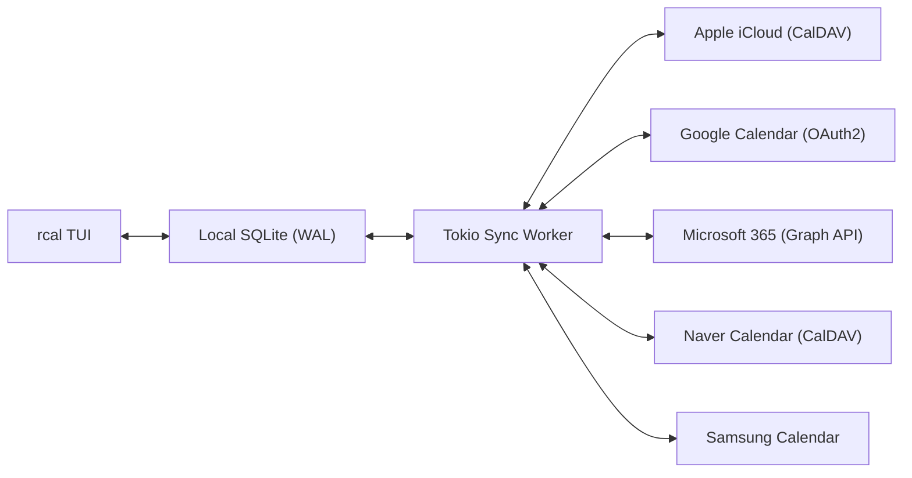
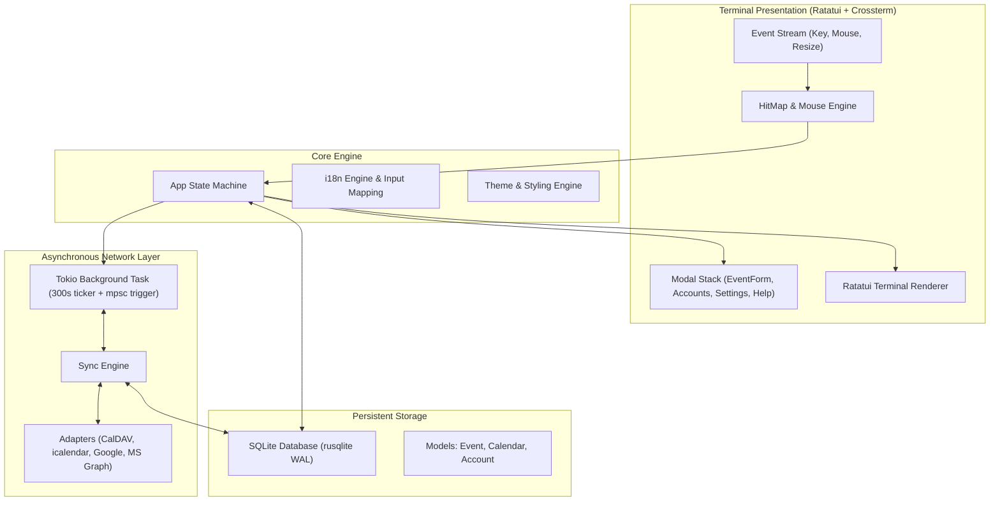

<div align="center">

```
  ██████╗  ██████╗ █████╗ ██╗     
  ██╔══██╗██╔════╝██╔══██╗██║     
  ██████╔╝██║     ███████║██║     
  ██╔══██╗██║     ██╔══██║██║     
  ██║  ██║╚██████╗██║  ██║███████╗
  ╚═╝  ╚═╝ ╚═════╝╚═╝  ╚═╝╚══════╝
```

### **ปฏิทินเทอร์มินัล Rust ที่เร็ว ทันสมัย ควบคุมด้วยเมาส์ พร้อมการซิงค์มัลติคลาวด์**

[](https://www.rust-lang.org)
[](../../LICENSE)
[](https://github.com/eeyees/rcal)
[](https://github.com/ratatui/ratatui)
[](https://www.sqlite.org)
[](https://tokio.rs)

<p align="center">
  🌐 <strong>Languages / 다국어 / 语言 / 言語 / Idiomas:</strong><br>
  <a href="../../README.md">English</a> •
  <a href="README.ko.md">한국어</a> •
  <a href="README.zh-CN.md">简体中文</a> •
  <a href="README.zh-TW.md">繁體中文</a> •
  <a href="README.ja.md">日本語</a> •
  <a href="README.es.md">Español</a> •
  <a href="README.fr.md">Français</a> •
  <a href="README.de.md">Deutsch</a> •
  <a href="README.pt-BR.md">Português</a> •
  <a href="README.ru.md">Русский</a> •
  <a href="README.it.md">Italiano</a> •<br>
  <a href="README.id.md">Bahasa Indonesia</a> •
  <a href="README.vi.md">Tiếng Việt</a> •
  <a href="README.tr.md">Türkçe</a> •
  <a href="README.pl.md">Polski</a> •
  <a href="README.nl.md">Nederlands</a> •
  <a href="README.ar.md">العربية</a> •
  <a href="README.hi.md">हिन्दी</a> •
  <a href="README.bn.md">বাংলা</a> •
  <a href="README.sv.md">Svenska</a> •
  <a href="README.uk.md">Українська</a> •
  <strong>ภาษาไทย</strong>
</p>

<p align="center">
  <a href="#-key-features">ฟีเจอร์เด่น</a> •
  <a href="#-ui-views">หน้าจอตัวอย่าง</a> •
  <a href="#-controls">การควบคุม</a> •
  <a href="#-cloud-sync">ซิงค์คลาวด์</a> •
  <a href="#-themes">ธีม</a> •
  <a href="#-installation">การติดตั้ง</a> •
  <a href="#-architecture">สถาปัตยกรรม</a>
</p>

---

</div>

`rcal` เป็นแอปพลิเคชันปฏิทิน TUI ขนาดเล็กและรวดเร็ว ออกแบบมาเพื่อให้คุณใช้งานปฏิทินที่สวยงามและใช้งานง่ายแบบ Google Calendar ได้โดยตรงบนเทอร์มินัลด้วย **ความเร็วสูงไม่มีแล็ก**, **รองรับการใช้เมาส์ 100%**, และ **การซิงค์ข้อมูลสองทางกับคลาวด์ชั้นนำ**

---

## <a id="-key-features"></a>✨ ฟีเจอร์เด่น

- ⚡ **สถาปัตยกรรม Offline-First ไร้ความล่าช้า**: เปิดใช้งานได้ทันทีในเสี้ยววินาทีด้วยฐานข้อมูล SQLite ในโหมด WAL
- 🖱️ **รองรับการคลิกเมาส์เต็มรูปแบบ**: คลิกเปลี่ยนแท็บมุมมอง, คลิกปุ่มนำทาง, ดับเบิลคลิกวันที่เพื่อดูรายละเอียดวัน, คลิกช่องเวลาเพื่อสร้างกิจกรรม, และใช้ล้อเมาส์เลื่อนดูตารางเวลา
- 📅 **4 มุมมองปฏิทินที่คุ้นเคย**: มุมมองรายเดือน, รายสัปดาห์, รายวัน (พร้อมระบบจัดกิจกรรมที่เวลาซ้อนทับกันให้อยู่เคียงข้างกันอย่างชาญฉลาด), และมุมมองกำหนดการ (Agenda)
- ☁️ **ระบบซิงค์ข้อมูลกับมัลติคลาวด์และ CalDAV**: รองรับ Apple iCloud, Naver, Google Calendar (OAuth2), Microsoft 365 Graph API, และ Samsung Calendar พร้อมเบื้องหลัง Tokio ที่ทำงานเงียบๆ ทุก 5 นาที
- ⌨️ **ปุ่มลัดสไตล์ Vim และการนำทางที่ลื่นไหล**: เคลื่อนที่ด้วยปุ่ม `h/j/k/l`, สลับมุมมอง และการพิมพ์ที่ไม่สะดุด
- 🌐 **รองรับหลายภาษา (i18n)**: ตรวจจับภาษาของระบบอัตโนมัติ และสลับภาษาได้ทันทีด้วยปุ่มเดียว
- 🎨 **ธีมสีสวยงามและการปรับแต่ง**: 7 ธีมสี (Modern Dark, Nord, Dracula, Forest, Sunset, Monokai, Solarized) และเลือกวันเริ่มต้นสัปดาห์ได้ตามต้องการ

---

## <a id="-ui-views"></a>🖥️ หน้าจอตัวอย่าง

```
┌── rcal v2026.11.05.1 ─────────────────────────────────────────────── [ L: 한/EN ] [ ? Help ] [ ⚙ Settings ] ──┐
│ [ 1:Month ] [ 2:Week ] [ 3:Day ] [ 4:Agenda ]    [ < ] [ Today ] [ > ]  2026-11-01 (Sun)   [ ⟳ Sync ]  │
├────────────────────┬───────────────────────────────────────────────────────────────────────────────────┤
│ Calendars          │                             November 2026                                         │
│ [x] ■ Personal     │  Sun         Mon         Tue         Wed         Thu         Fri         Sat      │
│ [x] ■ Work         │ ┌───────────┬───────────┬───────────┬───────────┬───────────┬───────────┬───────────┐ │
│ [x] ■ Holidays     │ │ 1  TODAY  │ 2         │ 3         │ 4         │ 5         │ 6         │ 7         │ │
│                    │ │■ 10:00 AM │■ 09:00 AM │           │■ 14:00 PM │           │■ 19:00 PM │           │ │
│ Accounts           │ │  Sprint   │  Standup  │           │  Design   │           │  Dinner   │           │ │
│ • iCloud (Syncing) │ ├───────────┼───────────┼───────────┼───────────┼───────────┼───────────┼───────────┤ │
│ • Google (Active)  │ │ 8         │ 9         │ 10        │ 11        │ 12        │ 13        │ 14        │ │
│                    │ │           │           │           │           │           │           │           │ │
├────────────────────┴───────────────────────────────────────────────────────────────────────────────────┤
│ [c] New Event  [m/w/d/a] Switch View  [h/j/k/l] Navigate  [/] Search  [a] Accounts  [s] Settings  [q] Quit │
└────────────────────────────────────────────────────────────────────────────────────────────────────────┘
```

---

## <a id="-controls"></a>⌨️ แป้นพิมพ์ลัดและการใช้งานเมาส์

### 🧭 การควบคุม 1: Navigation

| ปุ่มลัด | การกระทำของเมาส์ | คำอธิบาย |
| :--- | :--- | :--- |
| `h` / `j` / `k` / `l` หรือ ลูกศร | คลิกช่องวันที่ / ช่องเวลา | เลื่อนเคอร์เซอร์ ซ้าย / ลง / ขึ้น / ขวา |
| `1` หรือ `m` | คลิกแท็บ `[ 1:Month ]` | สลับไปที่ **มุมมองรายเดือน** |
| `2` หรือ `w` | คลิกแท็บ `[ 2:Week ]` | สลับไปที่ **มุมมองรายสัปดาห์** |
| `3` หรือ `d` | คลิกแท็บ `[ 3:Day ]` | สลับไปที่ **มุมมองรายวัน** |
| `4` หรือ `a` | คลิกแท็บ `[ 4:Agenda ]` | สลับไปที่ **มุมมองกำหนดการ** |
| `t` | คลิกปุ่ม `[ Today ]` | ข้ามไปยังวันนี้ |
| `[` / `]` | คลิก `[ < ]` / `[ > ]` | ช่วงเวลาก่อนหน้า / ถัดไป |
| หมุนล้อเมาส์ | หมุนล้อเมาส์ขึ้น/ลง | เลื่อนดูเส้นเวลาหรือเปลี่ยนวัน |
| ดับเบิลคลิก | ดับเบิลคลิกช่องวันที่ | เปิดดูรายละเอียดรายวันจากมุมมองเดือน |

### 📝 การควบคุม 2: Events & Modals

| ปุ่มลัด | การกระทำของเมาส์ | คำอธิบาย |
| :--- | :--- | :--- |
| `c` หรือ `n` | คลิก `[ + New ]` หรือช่องว่าง | เปิดหน้าต่างสร้างกิจกรรมใหม่ |
| `Enter` | คลิกบล็อกกิจกรรม | เปิดดูรายละเอียดกิจกรรม |
| `e` | คลิกปุ่ม `[ Edit ]` | แก้ไขกิจกรรม |
| `x` หรือ `Delete` | คลิกปุ่ม `[ Delete ]` | ลบกิจกรรมที่เลือก |
| `Tab` / `Shift+Tab` | คลิกช่องกรอก / ปุ่ม | สลับโฟกัสระหว่างช่องกรอกข้อมูล |
| `Esc` หรือ `q` | คลิก `[ Close ]` หรือพื้นที่ด้านนอก | ปิดหน้าต่างปัจจุบัน |

### ⚙️ การควบคุม 3: System & Settings

| ปุ่มลัด | การกระทำของเมาส์ | คำอธิบาย |
| :--- | :--- | :--- |
| `L` | คลิก `[ L: 한/EN ]` | สลับภาษาที่แสดง |
| `s` | คลิก `[ ⚙ Settings ]` | เปิดการตั้งค่าระบบ |
| `a` | คลิกบัญชีที่แถบด้านข้าง | เปิดหน้าต่างจัดการบัญชีคลาวด์ |
| `b` | คลิกปุ่มแถบข้าง | แสดง / ซ่อนแถบด้านข้าง |
| `r` | คลิก `[ ⟳ Sync ]` | สั่งซิงค์คลาวด์เบื้องหลังทันที |
| `?` | คลิก `[ ? Help ]` | เปิดหน้าต่างช่วยเหลือคีย์ลัด |
| `Ctrl+C` / `q` | - | ออกจากโปรแกรมอย่างปลอดภัย |

---

## <a id="-cloud-sync"></a>☁️ การซิงค์มัลติคลาวด์และ CalDAV

`rcal` มีระบบซิงค์ที่แข็งแกร่งเชื่อมต่อกับผู้ให้บริการคลาวด์ชั้นนำ:



### Supported Providers

- **Apple iCloud**: เชื่อมต่อผ่าน CalDAV โดยใช้ Apple ID และรหัสผ่านเฉพาะแอป
- **Naver Calendar**: ค้นหาและซิงค์ปฏิทิน Naver อัตโนมัติผ่าน CalDAV
- **Google Calendar**: ซิงค์ผ่าน Google Calendar API พร้อม OAuth2 ปลอดภัย
- **Microsoft 365 / Outlook**: เชื่อมต่อผ่าน Microsoft Graph REST API
- **Samsung Calendar**: ผสานการทำงานกับ Samsung Cloud

---

## <a id="-themes"></a>🎨 ธีมสีและการปรับแต่ง

กดปุ่ม `s` เพื่อเปิด **หน้าต่างการตั้งค่า** และเลือกธีมที่เหมาะกับคุณ:

### Built-in Color Palettes
- 🌙 **Modern Dark**: ธีมมืดเรียบหรูมาตรฐาน
- ❄️ **Nord**: โทนสีฟ้าเทาขั้วโลกเหนือ
- 🧛 **Dracula**: ธีมมืดคอนทราสต์สูงยอดนิยม
- 🌲 **Forest**: โทนสีเขียวธรรมชาติสบายตา
- 🌆 **Sunset**: ธีมไซเบอร์พังก์โทนม่วงส้ม
- 🎨 **Monokai**: สไตล์โปรแกรมแก้ไขโค้ดยอดนิยม
- ☀️ **Solarized**: คอนทราสต์นุ่มนวลถนอมสายตา

### วันเริ่มต้นสัปดาห์
เลือกวันเริ่มต้นสัปดาห์ระหว่าง **วันอาทิตย์**, **วันจันทร์**, หรือ **วันเสาร์**

---

## <a id="-architecture"></a>🏗️ สถาปัตยกรรม



---

## <a id="-installation"></a>🚀 การติดตั้งและใช้งาน

### คอมไพล์จากซอร์สโค้ด

```bash
# Clone the repository
git clone https://github.com/eeyees/rcal.git
cd rcal

# Build release
cargo build --release

# Run
./target/release/rcal
```

### ติดตั้งผ่าน Cargo

```bash
cargo install --path .
rcal
```

### ตำแหน่งจัดเก็บฐานข้อมูลในเครื่อง

- **macOS**: `~/Library/Application Support/rcal/rcal.db`
- **Linux**: `~/.local/share/rcal/rcal.db`
- **Windows**: `%LOCALAPPDATA%\rcal\rcal.db`

---

## 🗺️ 🗺️ แผนการพัฒนาในอนาคต

- [x] **เฟส 1**: MVP เทอร์มินัลในเครื่อง 4 มุมมอง, ระบบเมาส์, SQLite WAL, CRUD กิจกรรม
- [x] **เฟส 2**: ระบบซิงค์ CalDAV (Apple iCloud & Naver), เวิร์กเกอร์ Tokio, จัดการบัญชี
- [x] **เฟส 3**: Google Calendar, MS Graph, Samsung, ปรับปรุงการนำทาง, 7 ธีมสี
- [ ] **เฟส 4**: การเชื่อมต่อกับระบบภายนอก:
    - [x] เซิร์ฟเวอร์ MCP (Model Context Protocol) สำหรับ AI Agent
    - [ ] บริการ WebCal / iCalendar (`.ics`) สำหรับภายนอก
    - [ ] รองรับกิจกรรมที่เกิดซ้ำ (RFC 5545 RRULE)
    - [ ] การสร้างกิจกรรมด้วยภาษาธรรมชาติ
    - [ ] การแจ้งเตือนบนระบบปฏิบัติการ

---

## 📜 📜 สัญญาอนุญาต

เผยแพร่ภายใต้ **สัญญาอนุญาต MIT** ดูรายละเอียดที่ไฟล์ [`LICENSE`](../../LICENSE)
