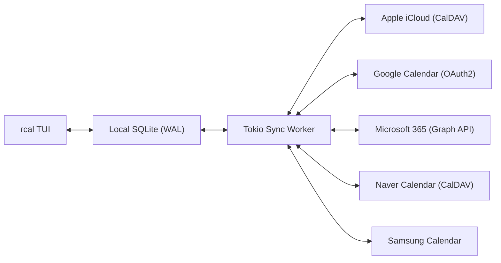
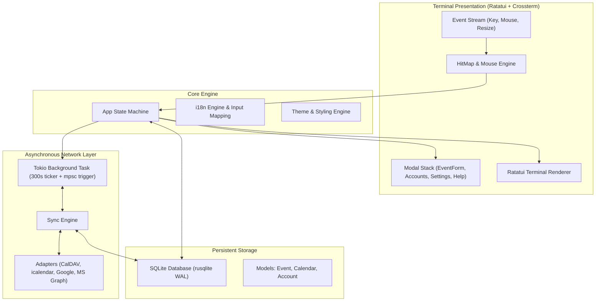

<div align="center">

```
  ██████╗  ██████╗ █████╗ ██╗     
  ██╔══██╗██╔════╝██╔══██╗██║     
  ██████╔╝██║     ███████║██║     
  ██╔══██╗██║     ██╔══██║██║     
  ██║  ██║╚██████╗██║  ██║███████╗
  ╚═╝  ╚═╝ ╚═════╝╚═╝  ╚═╝╚══════╝
```

### **Çoklu Bulut Senkronizasyonlu Hızlı, Modern ve Fare Etkileşimli Rust Terminal Takvimi**

[](https://www.rust-lang.org)
[](../../LICENSE)
[](https://github.com/eeyees/rcal)
[](https://github.com/ratatui/ratatui)
[](https://www.sqlite.org)
[](https://tokio.rs)

<p align="center">
  🌐 <strong>Languages / 다국어 / 语言 / 言語 / Idiomas:</strong><br>
  <a href="../../README.md">English</a> •
  <a href="README.ko.md">한국어</a> •
  <a href="README.zh-CN.md">简体中文</a> •
  <a href="README.zh-TW.md">繁體中文</a> •
  <a href="README.ja.md">日本語</a> •
  <a href="README.es.md">Español</a> •
  <a href="README.fr.md">Français</a> •
  <a href="README.de.md">Deutsch</a> •
  <a href="README.pt-BR.md">Português</a> •
  <a href="README.ru.md">Русский</a> •
  <a href="README.it.md">Italiano</a> •<br>
  <a href="README.id.md">Bahasa Indonesia</a> •
  <a href="README.vi.md">Tiếng Việt</a> •
  <strong>Türkçe</strong> •
  <a href="README.pl.md">Polski</a> •
  <a href="README.nl.md">Nederlands</a> •
  <a href="README.ar.md">العربية</a> •
  <a href="README.hi.md">हिन्दी</a> •
  <a href="README.bn.md">বাংলা</a> •
  <a href="README.sv.md">Svenska</a> •
  <a href="README.uk.md">Українська</a> •
  <a href="README.th.md">ภาษาไทย</a>
</p>

<p align="center">
  <a href="#-key-features">Özellikler</a> •
  <a href="#-ui-views">Görünümler</a> •
  <a href="#-controls">Kontroller</a> •
  <a href="#-cloud-sync">Bulut Senkronizasyonu</a> •
  <a href="#-themes">Temalar</a> •
  <a href="#-installation">Kurulum</a> •
  <a href="#-architecture">Mimari</a>
</p>

---

</div>

`rcal`, geliştiriciler ve terminal meraklıları için Google Takvim'in görsel gücünü gecikmesiz olarak doğrudan terminale getiren **sıfır gecikmeli**, **%100 fare etkileşimli** ve **güçlü çoklu bulut senkronizasyonlu** modern bir TUI takvimidir.

---

## <a id="-key-features"></a>✨ Temel Özellikler

- ⚡ **Gecikmesiz Çevrimdışı Öncelikli Mimari**: WAL modundaki gömülü SQLite veritabanı sayesinde 1 milisaniyenin altında anında açılış.
- 🖱️ **Tam Fare Desteği**: Görünüm sekmelerine ve düğmelere tıklama, gün detayına inmek için tarihe çift tıklama, etkinlik oluşturmak için saat dilimine tıklama ve fare tekerleğiyle kaydırma.
- 📅 **4 Tanıdık Yüksek Yoğunluklu Görünüm**: Ay Görünümü, Hafta Görünümü, Gün Görünümü (çakışan etkinlikleri yan yana akıllı yerleştirme) ve tarihe göre gruplanmış Ajanda Görünümü.
- ☁️ **Çoklu Bulut ve CalDAV Senkronizasyonu**: Apple iCloud, Naver, Google Calendar (OAuth2), Microsoft 365 Graph API ve Samsung Calendar ile arka planda sessiz Tokio senkronizasyon iş parçacığı.
- ⌨️ **Vim Tuşları ve Şeffaf Klavye Desteği**: `h/j/k/l` yön tuşları, anında görünüm değiştirme ve rahat kullanım.
- 🌐 **Yerel Çoklu Dil Desteği (i18n)**: Sistem dilini otomatik algılama ve tek tuşla diller arası geçiş.
- 🎨 **7 Renk Teması ve Özelleştirme**: Modern Dark, Nord, Dracula, Forest, Sunset, Monokai, Solarized ve haftanın ilk gününü seçebilme.

---

## <a id="-ui-views"></a>🖥️ Görünümler

```
┌── rcal v2026.11.01.1 ─────────────────────────────────────────────── [ L: 한/EN ] [ ? Help ] [ ⚙ Settings ] ──┐
│ [ 1:Month ] [ 2:Week ] [ 3:Day ] [ 4:Agenda ]    [ < ] [ Today ] [ > ]  2026-11-01 (Sun)   [ ⟳ Sync ]  │
├────────────────────┬───────────────────────────────────────────────────────────────────────────────────┤
│ Calendars          │                             November 2026                                         │
│ [x] ■ Personal     │  Sun         Mon         Tue         Wed         Thu         Fri         Sat      │
│ [x] ■ Work         │ ┌───────────┬───────────┬───────────┬───────────┬───────────┬───────────┬───────────┐ │
│ [x] ■ Holidays     │ │ 1  TODAY  │ 2         │ 3         │ 4         │ 5         │ 6         │ 7         │ │
│                    │ │■ 10:00 AM │■ 09:00 AM │           │■ 14:00 PM │           │■ 19:00 PM │           │ │
│ Accounts           │ │  Sprint   │  Standup  │           │  Design   │           │  Dinner   │           │ │
│ • iCloud (Syncing) │ ├───────────┼───────────┼───────────┼───────────┼───────────┼───────────┼───────────┤ │
│ • Google (Active)  │ │ 8         │ 9         │ 10        │ 11        │ 12        │ 13        │ 14        │ │
│                    │ │           │           │           │           │           │           │           │ │
├────────────────────┴───────────────────────────────────────────────────────────────────────────────────┤
│ [c] New Event  [m/w/d/a] Switch View  [h/j/k/l] Navigate  [/] Search  [a] Accounts  [s] Settings  [q] Quit │
└────────────────────────────────────────────────────────────────────────────────────────────────────────┘
```

---

## <a id="-controls"></a>⌨️ Klavye ve Fare Kontrolleri

### 🧭 Kontroller 1: Navigation

| Kısayol | Fare Hareketi | Açıklama |
| :--- | :--- | :--- |
| `h` / `j` / `k` / `l` veya Oklar | Hücreye / saat dilimine tıkla | İmleci Sol / Aşağı / Yukarı / Sağ yönlendir |
| `1` veya `m` | `[ 1:Month ]` sekmesine tıkla | **Ay Görünümüne** geç |
| `2` veya `w` | `[ 2:Week ]` sekmesine tıkla | **Hafta Görünümüne** geç |
| `3` veya `d` | `[ 3:Day ]` sekmesine tıkla | **Gün Görünümüne** geç |
| `4` veya `a` | `[ 4:Agenda ]` sekmesine tıkla | **Ajanda Görünümüne** geç |
| `t` | `[ Today ]` düğmesine tıkla | Bugüne atla |
| `[` / `]` | `[ < ]` / `[ > ]` düğmesine tıkla | Önceki / sonraki dönem |
| Fare Tekerleği | Tekerleği çevir | Zaman çizelgesini kaydır veya gün değiştir |
| Çift Tıklama | Tarih kutusuna çift tıkla | Ay görünümünden doğrudan gün detayına git |

### 📝 Kontroller 2: Events & Modals

| Kısayol | Fare Hareketi | Açıklama |
| :--- | :--- | :--- |
| `c` veya `n` | `[ + New ]` veya boş dilime tıkla | Yeni etkinlik formunu aç |
| `Enter` | Etkinlik kutusuna tıkla | Etkinlik detaylarını aç |
| `e` | `[ Edit ]` düğmesine tıkla | Etkinliği düzenle |
| `x` veya `Delete` | `[ Delete ]` düğmesine tıkla | Seçili etkinliği sil |
| `Tab` / `Shift+Tab` | Giriş alanına / düğmeye tıkla | Form alanları arasında geçiş yap |
| `Esc` veya `q` | `[ Close ]` veya dış alana tıkla | Açık pencereyi kapat |

### ⚙️ Kontroller 3: System & Settings

| Kısayol | Fare Hareketi | Açıklama |
| :--- | :--- | :--- |
| `L` | `[ L: 한/EN ]` düğmesine tıkla | Arayüz dilini değiştir |
| `s` | `[ ⚙ Settings ]` düğmesine tıkla | Ayarlar penceresini aç |
| `a` | Kenar çubuğundaki Hesaplara tıkla | Bulut hesap yöneticisini aç |
| `b` | Kenar çubuğu düğmesine tıkla | Kenar çubuğunu aç / kapat |
| `r` | `[ ⟳ Sync ]` düğmesine tıkla | Bulut senkronizasyonunu şimdi çalıştır |
| `?` | `[ ? Help ]` düğmesine tıkla | Kısayol yardımını göster |
| `Ctrl+C` / `q` | - | `rcal` uygulamasından güvenle çık |

---

## <a id="-cloud-sync"></a>☁️ Çoklu Bulut ve CalDAV Senkronizasyonu

`rcal`, takviminizi her zaman güncel tutmak için popüler servislerle entegre çalışır:



### Supported Providers

- **Apple iCloud**: Apple Kimliği ve Uygulamaya Özel Parola ile CalDAV eşitleme.
- **Naver Calendar**: CalDAV protokolü ile otomatik takvim senkronizasyonu.
- **Google Calendar**: Güvenli OAuth2 ile Google Calendar API bağlantısı.
- **Microsoft 365 / Outlook**: Microsoft Graph REST API üzerinden eşitleme.
- **Samsung Calendar**: Samsung Cloud entegrasyonu.

---

## <a id="-themes"></a>🎨 Renk Temaları ve Özelleştirme

`s` tuşuna basarak **Ayarlar Penceresini** açın ve ortamınızı kişiselleştirin:

### Built-in Color Palettes
- 🌙 **Modern Dark**: Varsayılan modern ve sade karanlık tema
- ❄️ **Nord**: İskandinav arktik mavi-gri tonları
- 🧛 **Dracula**: Yüksek kontrastlı popüler karanlık tema
- 🌲 **Forest**: Gözü dinlendiren doğal yeşil ve matcha tonları
- 🌆 **Sunset**: Canlı siberpunk mor ve turuncu
- 🎨 **Monokai**: Klasik kod editörü renk düzeni
- ☀️ **Solarized**: Göz yormayan yumuşak kontrastlı karanlık tema

### Haftanın İlk Günü
Haftanın başlangıç gününü **Pazar**, **Pazartesi** veya **Cumartesi** olarak ayarlayın.

---

## <a id="-architecture"></a>🏗️ Mimari



---

## <a id="-installation"></a>🚀 Kurulum ve Çalıştırma

### Kaynak koddan derleme

```bash
# Clone the repository
git clone https://github.com/eeyees/rcal.git
cd rcal

# Build release
cargo build --release

# Run
./target/release/rcal
```

### Cargo ile küresel kurulum

```bash
cargo install --path .
rcal
```

### Yerel Veritabanı Konumu

- **macOS**: `~/Library/Application Support/rcal/rcal.db`
- **Linux**: `~/.local/share/rcal/rcal.db`
- **Windows**: `%LOCALAPPDATA%\rcal\rcal.db`

---

## 🗺️ 🗺️ Geliştirme Yol Haritası

- [x] **Aşama 1**: Yerel TUI MVP, 4 görünüm, fare motoru, SQLite WAL, etkinlik CRUD.
- [x] **Aşama 2**: CalDAV motoru (Apple iCloud & Naver), Tokio arka plan iş parçacığı, hesap yönetimi.
- [x] **Aşama 3**: Google Calendar, MS Graph, Samsung, 7 tema, hafta başlangıcı ayarı.
- [ ] **Aşama 4**: Ekosistem ve açık protokoller:
    - [ ] Yapay Zeka Ajanları için MCP (Model Context Protocol) sunucusu
    - [ ] WebCal / iCalendar (`.ics`) HTTP takvim sunucusu
    - [ ] Yinelenen etkinlik kuralları (RFC 5545 RRULE)
    - [ ] Doğal dil ile etkinlik ekleme
    - [ ] Masaüstü sistem bildirimleri

---

## 📜 📜 Lisans

**MIT Lisansı** ile dağıtılmaktadır. Daha fazla bilgi için [`LICENSE`](../../LICENSE) dosyasına bakın.
