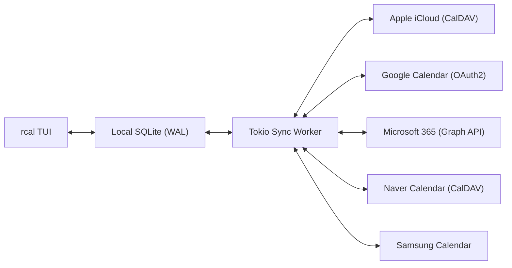
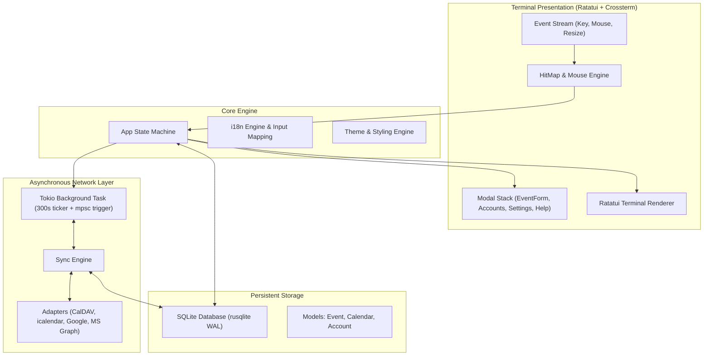

<div align="center">

```
  ██████╗  ██████╗ █████╗ ██╗     
  ██╔══██╗██╔════╝██╔══██╗██║     
  ██████╔╝██║     ███████║██║     
  ██╔══██╗██║     ██╔══██║██║     
  ██║  ██║╚██████╗██║  ██║███████╗
  ╚═╝  ╚═╝ ╚═════╝╚═╝  ╚═╝╚══════╝
```

### **Швидкий, сучасний термінальний календар на Rust з підтримкою миші та мульти-хмарною синхронізацією**

[](https://www.rust-lang.org)
[](../../LICENSE)
[](https://github.com/eeyees/rcal)
[](https://github.com/ratatui/ratatui)
[](https://www.sqlite.org)
[](https://tokio.rs)

<p align="center">
  🌐 <strong>Languages / 다국어 / 语言 / 言語 / Idiomas:</strong><br>
  <a href="../../README.md">English</a> •
  <a href="README.ko.md">한국어</a> •
  <a href="README.zh-CN.md">简体中文</a> •
  <a href="README.zh-TW.md">繁體中文</a> •
  <a href="README.ja.md">日本語</a> •
  <a href="README.es.md">Español</a> •
  <a href="README.fr.md">Français</a> •
  <a href="README.de.md">Deutsch</a> •
  <a href="README.pt-BR.md">Português</a> •
  <a href="README.ru.md">Русский</a> •
  <a href="README.it.md">Italiano</a> •<br>
  <a href="README.id.md">Bahasa Indonesia</a> •
  <a href="README.vi.md">Tiếng Việt</a> •
  <a href="README.tr.md">Türkçe</a> •
  <a href="README.pl.md">Polski</a> •
  <a href="README.nl.md">Nederlands</a> •
  <a href="README.ar.md">العربية</a> •
  <a href="README.hi.md">हिन्दी</a> •
  <a href="README.bn.md">বাংলা</a> •
  <a href="README.sv.md">Svenska</a> •
  <strong>Українська</strong> •
  <a href="README.th.md">ภาษาไทย</a>
</p>

<p align="center">
  <a href="#-key-features">Можливості</a> •
  <a href="#-ui-views">Інтерфейс</a> •
  <a href="#-controls">Керування</a> •
  <a href="#-cloud-sync">Синхронізація</a> •
  <a href="#-themes">Теми</a> •
  <a href="#-installation">Встановлення</a> •
  <a href="#-architecture">Архітектура</a>
</p>

---

</div>

`rcal` — це легкий і швидкий TUI-календар для розробників та ентузіастів термінала. Він поєднує наочність Google Calendar із потужністю термінала: **нульова затримка**, **100% інтерактивність миші** та **надійна двостороння синхронізація із хмарою**.

---

## <a id="-key-features"></a>✨ Основні можливості

- ⚡ **Архітектура Offline-First без затримок**: Миттєвий запуск менш ніж за 1 мс завдяки вбудованій базі SQLite у режимі WAL.
- 🖱️ **Повна підтримка миші**: Перемикання вкладок, навігаційні кнопки, подвійний клік на даті для переходу в режим дня, створення подій кліком по часовому інтервалу та прокрутка коліщатком.
- 📅 **4 Зручні режими відображення**: Місяць, Тиждень, День (інтелектуальне паралельне розміщення подій, що збігаються за часом) та хронологічна стрічка подій (Agenda).
- ☁️ **Синхронізація з мульти-хмарою та CalDAV**: Підтримка Apple iCloud, Naver, Google Calendar (OAuth2), Microsoft 365 Graph API та Samsung Calendar з фоновим потоком Tokio.
- ⌨️ **Vim-навігація та зручне керування**: Зручні клавіші `h/j/k/l`, швидке перемикання екранів та комфортне введення без збоїв.
- 🌐 **Нативна підтримка багатьох мов (i18n)**: Автоматичне визначення мови системи та перемикання однією клавішею.
- 🎨 **7 Стильних тем і налаштування**: Modern Dark, Nord, Dracula, Forest, Sunset, Monokai, Solarized та вибір першого дня тижня (неділя, понеділок чи субота).

---

## <a id="-ui-views"></a>🖥️ Інтерфейс

```
┌── rcal v2026.11.02.1 ─────────────────────────────────────────────── [ L: 한/EN ] [ ? Help ] [ ⚙ Settings ] ──┐
│ [ 1:Month ] [ 2:Week ] [ 3:Day ] [ 4:Agenda ]    [ < ] [ Today ] [ > ]  2026-11-01 (Sun)   [ ⟳ Sync ]  │
├────────────────────┬───────────────────────────────────────────────────────────────────────────────────┤
│ Calendars          │                             November 2026                                         │
│ [x] ■ Personal     │  Sun         Mon         Tue         Wed         Thu         Fri         Sat      │
│ [x] ■ Work         │ ┌───────────┬───────────┬───────────┬───────────┬───────────┬───────────┬───────────┐ │
│ [x] ■ Holidays     │ │ 1  TODAY  │ 2         │ 3         │ 4         │ 5         │ 6         │ 7         │ │
│                    │ │■ 10:00 AM │■ 09:00 AM │           │■ 14:00 PM │           │■ 19:00 PM │           │ │
│ Accounts           │ │  Sprint   │  Standup  │           │  Design   │           │  Dinner   │           │ │
│ • iCloud (Syncing) │ ├───────────┼───────────┼───────────┼───────────┼───────────┼───────────┼───────────┤ │
│ • Google (Active)  │ │ 8         │ 9         │ 10        │ 11        │ 12        │ 13        │ 14        │ │
│                    │ │           │           │           │           │           │           │           │ │
├────────────────────┴───────────────────────────────────────────────────────────────────────────────────┤
│ [c] New Event  [m/w/d/a] Switch View  [h/j/k/l] Navigate  [/] Search  [a] Accounts  [s] Settings  [q] Quit │
└────────────────────────────────────────────────────────────────────────────────────────────────────────┘
```

---

## <a id="-controls"></a>⌨️ Керування з клавіатури та миші

### 🧭 Керування 1: Navigation

| Клавіша | Дія миші | Опис |
| :--- | :--- | :--- |
| `h` / `j` / `k` / `l` або Стрілки | Клік по даті / інтервалу | Переміщення курсора Вліво / Вниз / Вгору / Вправо |
| `1` або `m` | Клік по вкладці `[ 1:Month ]` | Перейти в **Режим місяця** |
| `2` або `w` | Клік по вкладці `[ 2:Week ]` | Перейти в **Режим тижня** |
| `3` або `d` | Клік по вкладці `[ 3:Day ]` | Перейти в **Режим дня** |
| `4` або `a` | Клік по вкладці `[ 4:Agenda ]` | Перейти в **Режим розкладу (Agenda)** |
| `t` | Клік по кнопці `[ Today ]` | Перейти до Сьогодні |
| `[` / `]` | Клік по `[ < ]` / `[ > ]` | Попередній / наступний період |
| Коліщатко миші | Прокрутка коліщатка | Прокрутка шкали часу або зміна дати |
| Подвійний клік | Подвійний клік по комірці дати | Перехід до деталей дня з режиму місяця |

### 📝 Керування 2: Events & Modals

| Клавіша | Дія миші | Опис |
| :--- | :--- | :--- |
| `c` або `n` | Клік по `[ + New ]` або інтервалу | Відкрити форму нової події |
| `Enter` | Клік по блоку події | Відкрити подробиці події |
| `e` | Клік по кнопці `[ Edit ]` | Редагувати подію |
| `x` або `Delete` | Клік по кнопці `[ Delete ]` | Видалити вибрану подію |
| `Tab` / `Shift+Tab` | Клік по полю / кнопці | Перемикання між полями введення |
| `Esc` або `q` | Клік по `[ Close ]` або фону | Закрити активне вікно |

### ⚙️ Керування 3: System & Settings

| Клавіша | Дія миші | Опис |
| :--- | :--- | :--- |
| `L` | Клік по `[ L: 한/EN ]` | Змінити мову інтерфейсу |
| `s` | Клік по `[ ⚙ Settings ]` | Відкрити налаштування |
| `a` | Клік по Accounts на бічній панелі | Менеджер хмарних акаунтів |
| `b` | Клік по кнопці бічної панелі | Показати / приховати бічну панель |
| `r` | Клік по `[ ⟳ Sync ]` | Запустити фонову синхронізацію зараз |
| `?` | Клік по `[ ? Help ]` | Показати довідку гарячих клавіш |
| `Ctrl+C` / `q` | - | Безпечно вийти з `rcal` |

---

## <a id="-cloud-sync"></a>☁️ Синхронізація з мульти-хмарою та CalDAV

`rcal` забезпечує надійне з'єднання з провідними хмарними сервісами:



### Supported Providers

- **Apple iCloud**: Двостороння синхронізація CalDAV з Apple ID та паролем програми.
- **Naver Calendar**: Автоматичне підключення та синхронізація через CalDAV.
- **Google Calendar**: Інтеграція з Google Calendar API через безпечний OAuth2.
- **Microsoft 365 / Outlook**: З'єднання через Microsoft Graph REST API.
- **Samsung Calendar**: Інтеграція із сервісами Samsung Cloud.

---

## <a id="-themes"></a>🎨 Кольорові теми та налаштування

Натисніть `s`, щоб відкрити **Налаштування** та обрати бажану тему:

### Built-in Color Palettes
- 🌙 **Modern Dark**: Сучасна темна тема за замовчуванням
- ❄️ **Nord**: Спокійні арктичні синьо-сірі тони
- 🧛 **Dracula**: Популярна висококонтрастна тема
- 🌲 **Forest**: Приємні зелені та природні відтінки
- 🌆 **Sunset**: Кіберпанк у фіолетових та помаранчевих кольорах
- 🎨 **Monokai**: Класичний контраст редакторів коду
- ☀️ **Solarized**: М'яка низькоконтрастна темна тема для комфорту очей

### Перший день тижня
Оберіть день початку тижня: **неділя**, **понеділок** або **субота**.

---

## <a id="-architecture"></a>🏗️ Архітектура



---

## <a id="-installation"></a>🚀 Встановлення та запуск

### Збірка з вихідного коду

```bash
# Clone the repository
git clone https://github.com/eeyees/rcal.git
cd rcal

# Build release
cargo build --release

# Run
./target/release/rcal
```

### Глобальне встановлення через Cargo

```bash
cargo install --path .
rcal
```

### Розташування локальної бази даних

- **macOS**: `~/Library/Application Support/rcal/rcal.db`
- **Linux**: `~/.local/share/rcal/rcal.db`
- **Windows**: `%LOCALAPPDATA%\rcal\rcal.db`

---

## 🗺️ 🗺️ План розвитку

- [x] **Етап 1**: Локальний TUI MVP, 4 режими, механізм миші, SQLite WAL, CRUD.
- [x] **Етап 2**: CalDAV (Apple iCloud та Naver), фоновий потік Tokio, інтерфейс акаунтів.
- [x] **Етап 3**: Google Calendar, MS Graph, Samsung, 7 тем, перший день тижня.
- [ ] **Етап 4**: Екосистема та відкриті протоколи:
    - [x] Сервер MCP (Model Context Protocol) для підключення AI-агентів
    - [ ] HTTP-сервер підписки WebCal / iCalendar (`.ics`)
    - [ ] Повторювані події (RFC 5545 RRULE)
    - [ ] Додавання подій природною мовою
    - [ ] Сповіщення операційної системи

---

## 📜 📜 Ліцензія

Розповсюджується під ліцензією **MIT**. Подробиці у файлі [`LICENSE`](../../LICENSE).
