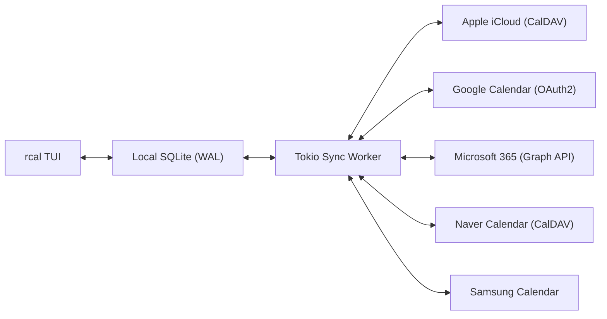
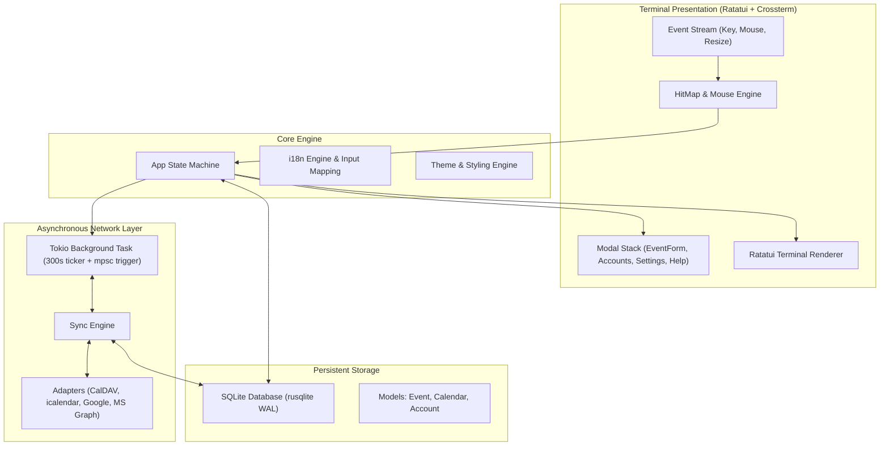

<div align="center">

```
  ██████╗  ██████╗ █████╗ ██╗     
  ██╔══██╗██╔════╝██╔══██╗██║     
  ██████╔╝██║     ███████║██║     
  ██╔══██╗██║     ██╔══██║██║     
  ██║  ██║╚██████╗██║  ██║███████╗
  ╚═╝  ╚═╝ ╚═════╝╚═╝  ╚═╝╚══════╝
```

### **Lịch dòng lệnh Rust nhanh, hiện đại, tương tác chuột với đồng bộ đa đám mây**

[](https://www.rust-lang.org)
[](../../LICENSE)
[](https://github.com/eeyees/rcal)
[](https://github.com/ratatui/ratatui)
[](https://www.sqlite.org)
[](https://tokio.rs)

<p align="center">
  🌐 <strong>Languages / 다국어 / 语言 / 言語 / Idiomas:</strong><br>
  <a href="../../README.md">English</a> •
  <a href="README.ko.md">한국어</a> •
  <a href="README.zh-CN.md">简体中文</a> •
  <a href="README.zh-TW.md">繁體中文</a> •
  <a href="README.ja.md">日本語</a> •
  <a href="README.es.md">Español</a> •
  <a href="README.fr.md">Français</a> •
  <a href="README.de.md">Deutsch</a> •
  <a href="README.pt-BR.md">Português</a> •
  <a href="README.ru.md">Русский</a> •
  <a href="README.it.md">Italiano</a> •<br>
  <a href="README.id.md">Bahasa Indonesia</a> •
  <strong>Tiếng Việt</strong> •
  <a href="README.tr.md">Türkçe</a> •
  <a href="README.pl.md">Polski</a> •
  <a href="README.nl.md">Nederlands</a> •
  <a href="README.ar.md">العربية</a> •
  <a href="README.hi.md">हिन्दी</a> •
  <a href="README.bn.md">বাংলা</a> •
  <a href="README.sv.md">Svenska</a> •
  <a href="README.uk.md">Українська</a> •
  <a href="README.th.md">ภาษาไทย</a>
</p>

<p align="center">
  <a href="#-key-features">Tính năng</a> •
  <a href="#-ui-views">Giao diện</a> •
  <a href="#-controls">Điều khiển</a> •
  <a href="#-cloud-sync">Đồng bộ</a> •
  <a href="#-themes">Chủ đề</a> •
  <a href="#-installation">Cài đặt</a> •
  <a href="#-architecture">Kiến trúc</a>
</p>

---

</div>

`rcal` là ứng dụng lịch TUI gọn nhẹ và siêu mượt, mang trải nghiệm trực quan của Google Calendar vào thẳng terminal của bạn với **độ trễ bằng không**, **tương tác chuột 100%**, và **đồng bộ đa đám mây hai chiều ổn định**.

---

## <a id="-key-features"></a>✨ Tính năng nổi bật

- ⚡ **Kiến trúc Offline-First không độ trễ**: Khởi động tức thì dưới 1ms nhờ SQLite nhúng chế độ WAL.
- 🖱️ **Tương tác chuột toàn diện**: Nhấp tab chế độ xem, nút điều hướng, nhấp đúp ngày để xem chi tiết, nhấp khe giờ để tạo sự kiện, lăn chuột để cuộn.
- 📅 **4 Chế độ xem lịch quen thuộc**: Xem Tháng, Tuần, Ngày (tự động căn chỉnh sự kiện trùng giờ), và Lịch trình theo ngày.
- ☁️ **Đồng bộ Đa Đám mây & CalDAV**: Hỗ trợ Apple iCloud, Naver, Google Calendar (OAuth2), Microsoft 365 Graph API và Samsung Calendar qua tiến trình chạy nền Tokio.
- ⌨️ **Phím tắt Vim & Điều hướng mượt mà**: Các phím `h/j/k/l`, chuyển đổi nhanh và hỗ trợ gõ không bị xung đột phím.
- 🌐 **Hỗ trợ Đa ngôn ngữ (i18n)**: Tự nhận diện ngôn ngữ hệ thống và chuyển đổi nhanh chỉ bằng 1 phím.
- 🎨 **7 Bảng màu chủ đề & Tùy biến**: Modern Dark, Nord, Dracula, Forest, Sunset, Monokai, Solarized cùng tùy chọn ngày bắt đầu tuần.

---

## <a id="-ui-views"></a>🖥️ Giao diện

```
┌── rcal v0.1.0 ─────────────────────────────────────────────── [ L: 한/EN ] [ ? Help ] [ ⚙ Settings ] ──┐
│ [ 1:Month ] [ 2:Week ] [ 3:Day ] [ 4:Agenda ]    [ < ] [ Today ] [ > ]  2026-11-01 (Sun)   [ ⟳ Sync ]  │
├────────────────────┬───────────────────────────────────────────────────────────────────────────────────┤
│ Calendars          │                             November 2026                                         │
│ [x] ■ Personal     │  Sun         Mon         Tue         Wed         Thu         Fri         Sat      │
│ [x] ■ Work         │ ┌───────────┬───────────┬───────────┬───────────┬───────────┬───────────┬───────────┐ │
│ [x] ■ Holidays     │ │ 1  TODAY  │ 2         │ 3         │ 4         │ 5         │ 6         │ 7         │ │
│                    │ │■ 10:00 AM │■ 09:00 AM │           │■ 14:00 PM │           │■ 19:00 PM │           │ │
│ Accounts           │ │  Sprint   │  Standup  │           │  Design   │           │  Dinner   │           │ │
│ • iCloud (Syncing) │ ├───────────┼───────────┼───────────┼───────────┼───────────┼───────────┼───────────┤ │
│ • Google (Active)  │ │ 8         │ 9         │ 10        │ 11        │ 12        │ 13        │ 14        │ │
│                    │ │           │           │           │           │           │           │           │ │
├────────────────────┴───────────────────────────────────────────────────────────────────────────────────┤
│ [c] New Event  [m/w/d/a] Switch View  [h/j/k/l] Navigate  [/] Search  [a] Accounts  [s] Settings  [q] Quit │
└────────────────────────────────────────────────────────────────────────────────────────────────────────┘
```

---

## <a id="-controls"></a>⌨️ Bảng phím tắt & Thao tác chuột

### 🧭 Điều khiển 1: Navigation

| Phím tắt | Thao tác chuột | Mô tả |
| :--- | :--- | :--- |
| `h` / `j` / `k` / `l` hoặc Phím mũi tên | Nhấp ô ngày / khe giờ | Di chuyển con trỏ Trái / Xuống / Lên / Phải |
| `1` hoặc `m` | Nhấp tab `[ 1:Month ]` | Chuyển sang **Xem Tháng** |
| `2` hoặc `w` | Nhấp tab `[ 2:Week ]` | Chuyển sang **Xem Tuần** |
| `3` hoặc `d` | Nhấp tab `[ 3:Day ]` | Chuyển sang **Xem Ngày** |
| `4` hoặc `a` | Nhấp tab `[ 4:Agenda ]` | Chuyển sang **Xem Lịch trình** |
| `t` | Nhấp nút `[ Today ]` | Chuyển nhanh về Hôm nay |
| `[` / `]` | Nhấp `[ < ]` / `[ > ]` | Chuyển kỳ trước / kỳ sau |
| Cuộn chuột | Lăn chuột lên/xuống | Cuộn dòng thời gian hoặc chuyển ngày |
| Nhấp đúp | Nhấp đúp vào ô ngày | Xem chi tiết ngày từ chế độ xem tháng |

### 📝 Điều khiển 2: Events & Modals

| Phím tắt | Thao tác chuột | Mô tả |
| :--- | :--- | :--- |
| `c` hoặc `n` | Nhấp `[ + New ]` hoặc khe giờ trống | Mở biểu mẫu tạo sự kiện mới |
| `Enter` | Nhấp khối sự kiện | Xem chi tiết sự kiện |
| `e` | Nhấp nút `[ Edit ]` | Chỉnh sửa sự kiện |
| `x` hoặc `Delete` | Nhấp nút `[ Delete ]` | Xóa sự kiện đã chọn |
| `Tab` / `Shift+Tab` | Nhấp ô nhập / nút | Chuyển đổi tiêu điểm nhập liệu |
| `Esc` hoặc `q` | Nhấp `[ Close ]` hoặc vùng ngoài | Đóng cửa sổ hiện tại |

### ⚙️ Điều khiển 3: System & Settings

| Phím tắt | Thao tác chuột | Mô tả |
| :--- | :--- | :--- |
| `L` | Nhấp `[ L: 한/EN ]` | Chuyển đổi ngôn ngữ hiển thị |
| `s` | Nhấp `[ ⚙ Settings ]` | Mở Cài đặt hệ thống |
| `a` | Nhấp Tài khoản ở thanh bên | Quản lý tài khoản đám mây |
| `b` | Nhấp nút thanh bên | Bật / tắt thanh bên |
| `r` | Nhấp `[ ⟳ Sync ]` | Kích hoạt đồng bộ đám mây ngay lập tức |
| `?` | Nhấp `[ ? Help ]` | Xem trợ giúp phím tắt |
| `Ctrl+C` / `q` | - | Thoát ứng dụng an toàn |

---

## <a id="-cloud-sync"></a>☁️ Đồng bộ Đa Đám mây & CalDAV

`rcal` tích hợp sẵn bộ chuyển đổi đồng bộ đáng tin cậy với các nhà cung cấp:



### Supported Providers

- **Apple iCloud**: Kết nối CalDAV bằng Apple ID và Mật khẩu dành riêng cho ứng dụng.
- **Naver Calendar**: Tự động phát hiện và đồng bộ lịch Naver.
- **Google Calendar**: Tích hợp Google Calendar API với OAuth2 an toàn.
- **Microsoft 365 / Outlook**: Kết nối lịch Outlook qua Microsoft Graph REST API.
- **Samsung Calendar**: Tích hợp dịch vụ đám mây Samsung.

---

## <a id="-themes"></a>🎨 Bảng màu & Tùy biến

Nhấn `s` để mở **Cài đặt** và chọn giao diện phù hợp với bạn:

### Built-in Color Palettes
- 🌙 **Modern Dark**: Giao diện tối hiện đại mặc định
- ❄️ **Nord**: Sắc xanh băng giá Bắc Âu
- 🧛 **Dracula**: Tông màu tương phản cao kinh điển
- 🌲 **Forest**: Sắc xanh matcha nhẹ dịu mắt
- 🌆 **Sunset**: Phong cách cyberpunk rực rỡ tím cam
- 🎨 **Monokai**: Giao diện trình soạn thảo code quen thuộc
- ☀️ **Solarized**: Độ tương phản dịu nhẹ bảo vệ mắt

### Ngày bắt đầu tuần
Tùy chọn ngày đầu tuần giữa **Chủ nhật**, **Thứ hai**, hoặc **Thứ bảy**.

---

## <a id="-architecture"></a>🏗️ Kiến trúc



---

## <a id="-installation"></a>🚀 Cài đặt & Sử dụng

### Biên dịch từ mã nguồn

```bash
# Clone the repository
git clone https://github.com/eeyees/rcal.git
cd rcal

# Build release
cargo build --release

# Run
./target/release/rcal
```

### Cài đặt toàn hệ thống qua Cargo

```bash
cargo install --path .
rcal
```

### Vị trí lưu trữ dữ liệu cục bộ

- **macOS**: `~/Library/Application Support/rcal/rcal.db`
- **Linux**: `~/.local/share/rcal/rcal.db`
- **Windows**: `%LOCALAPPDATA%\rcal\rcal.db`

---

## 🗺️ 🗺️ Lộ trình phát triển

- [x] **Giai đoạn 1**: TUI MVP nội bộ, 4 chế độ xem, động cơ chuột, SQLite WAL, CRUD sự kiện.
- [x] **Giai đoạn 2**: Đồng bộ CalDAV (Apple iCloud & Naver), tiến trình nền Tokio, UI tài khoản.
- [x] **Giai đoạn 3**: Google Calendar, Microsoft Graph, Samsung, xử lý phím tắt, 7 chủ đề.
- [ ] **Giai đoạn 4**: Hỗ trợ giao thức mở:
    - [ ] Máy chủ MCP (Model Context Protocol) cho AI Agent
    - [ ] Máy chủ HTTP xuất lịch WebCal (`.ics`)
    - [ ] Sự kiện lặp lại (RFC 5545 RRULE)
    - [ ] Thêm sự kiện bằng ngôn ngữ tự nhiên
    - [ ] Thông báo hệ điều hành

---

## 📜 📜 Giấy phép

Phát hành theo **Giấy phép MIT**. Xem tệp [`LICENSE`](../../LICENSE) để biết chi tiết.
