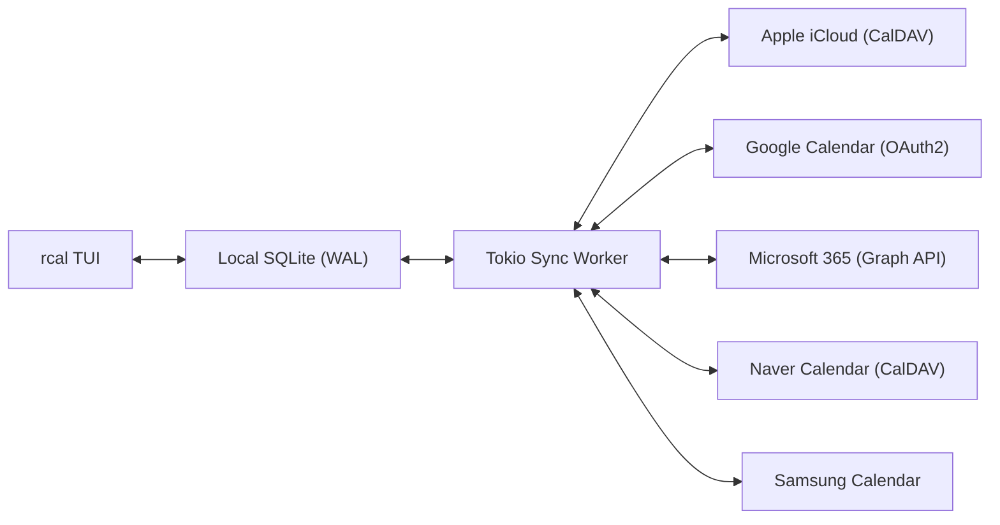
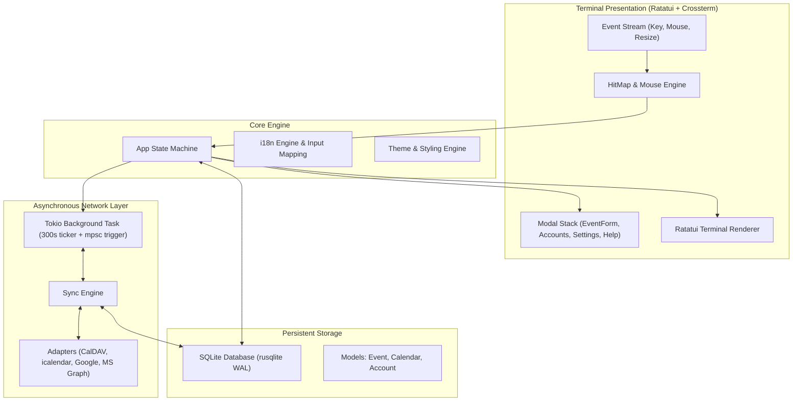

<div align="center">

```
  ██████╗  ██████╗ █████╗ ██╗     
  ██╔══██╗██╔════╝██╔══██╗██║     
  ██████╔╝██║     ███████║██║     
  ██╔══██╗██║     ██╔══██║██║     
  ██║  ██║╚██████╗██║  ██║███████╗
  ╚═╝  ╚═╝ ╚═════╝╚═╝  ╚═╝╚══════╝
```

### **支持多云同步的高性能、现代化鼠标交互 Rust 终端日历**

[](https://www.rust-lang.org)
[](../../LICENSE)
[](https://github.com/eeyees/rcal)
[](https://github.com/ratatui/ratatui)
[](https://www.sqlite.org)
[](https://tokio.rs)

<p align="center">
  🌐 <strong>Languages / 다국어 / 语言 / 言語 / Idiomas:</strong><br>
  <a href="../../README.md">English</a> •
  <a href="README.ko.md">한국어</a> •
  <strong>简体中文</strong> •
  <a href="README.zh-TW.md">繁體中文</a> •
  <a href="README.ja.md">日本語</a> •
  <a href="README.es.md">Español</a> •
  <a href="README.fr.md">Français</a> •
  <a href="README.de.md">Deutsch</a> •
  <a href="README.pt-BR.md">Português</a> •
  <a href="README.ru.md">Русский</a> •
  <a href="README.it.md">Italiano</a> •<br>
  <a href="README.id.md">Bahasa Indonesia</a> •
  <a href="README.vi.md">Tiếng Việt</a> •
  <a href="README.tr.md">Türkçe</a> •
  <a href="README.pl.md">Polski</a> •
  <a href="README.nl.md">Nederlands</a> •
  <a href="README.ar.md">العربية</a> •
  <a href="README.hi.md">हिन्दी</a> •
  <a href="README.bn.md">বাংলা</a> •
  <a href="README.sv.md">Svenska</a> •
  <a href="README.uk.md">Українська</a> •
  <a href="README.th.md">ภาษาไทย</a>
</p>

<p align="center">
  <a href="#-key-features">主要特性</a> •
  <a href="#-ui-views">界面预览</a> •
  <a href="#-controls">操作指南</a> •
  <a href="#-cloud-sync">云端同步</a> •
  <a href="#-themes">主题定制</a> •
  <a href="#-installation">安装运行</a> •
  <a href="#-architecture">系统架构</a>
</p>

---

</div>

`rcal` 是一款专为开发者、终端爱好者和极客打造的轻量级、超低延迟 TUI 日历应用。它将 Google 日历的直观视觉体验与终端的高效融为一体，拥有**零延迟**、**全鼠标交互**以及**强大的多云双向同步**能力。

---

## <a id="-key-features"></a>✨ 主要特性

- ⚡ **零延迟离线优先架构**：基于内置 SQLite WAL（预写日志）模式，毫秒级快速启动与离线读取。
- 🖱️ **全功能鼠标交互**：支持点击视图标签（月、周、日、日程）、导航按钮（前进/后退/今天/同步）、双击日期下钻到日视图、点击时间槽创建事件、滚轮滚动浏览时间线。
- 📅 **4 种高密度日历视图**：
  - **月视图**：7 列网格布局，带事件角标与今日高亮。
  - **周视图**：全周时间线，各时间段彩色日程块。
  - **日视图**：同时间重叠日程智能并排分配的高精时间表。
  - **日程视图**：按日期分组的按时间顺序排列的事件流。
- ☁️ **多云与 CalDAV 同步引擎**：
  - **Apple iCloud**：原生双向 CalDAV 同步。
  - **Naver 智能日历**：CalDAV 自动发现与同步。
  - **Google Calendar**：基于 OAuth2 令牌交换的 Google 日历 API。
  - **Microsoft 365 / Outlook**：Microsoft Graph REST API 适配器。
  - **Samsung Calendar**：三星云日历适配。
  - **后台静默工作线程**：独立的 Tokio 异步线程每 5 分钟或按需同步，不阻塞 UI 渲染。
- ⌨️ **Vim 键位与透明输入法导航**：经典 `h/j/k/l` 移动、视图直切；输入法激活时自动映射按键，避免终端异常嘟嘟声或快捷键丢失。
- 🌐 **原生多语言 (i18n)**：自动检测系统语言，支持使用 `L` 键或鼠标在运行时一键切换中/英/日等语言。
- 🎨 **精美主题与高度定制**：内置 7 种配色（Modern Dark, Nord, Dracula, Forest, Sunset, Monokai, Solarized），可配置周起始日（周日/周一/周六），自定义日历分类与颜色标签。

---

## <a id="-ui-views"></a>🖥️ 界面预览

```
┌── rcal v2026.11.02.1 ─────────────────────────────────────────────── [ L: 한/EN ] [ ? Help ] [ ⚙ Settings ] ──┐
│ [ 1:Month ] [ 2:Week ] [ 3:Day ] [ 4:Agenda ]    [ < ] [ Today ] [ > ]  2026-11-01 (Sun)   [ ⟳ Sync ]  │
├────────────────────┬───────────────────────────────────────────────────────────────────────────────────┤
│ Calendars          │                             November 2026                                         │
│ [x] ■ Personal     │  Sun         Mon         Tue         Wed         Thu         Fri         Sat      │
│ [x] ■ Work         │ ┌───────────┬───────────┬───────────┬───────────┬───────────┬───────────┬───────────┐ │
│ [x] ■ Holidays     │ │ 1  TODAY  │ 2         │ 3         │ 4         │ 5         │ 6         │ 7         │ │
│                    │ │■ 10:00 AM │■ 09:00 AM │           │■ 14:00 PM │           │■ 19:00 PM │           │ │
│ Accounts           │ │  Sprint   │  Standup  │           │  Design   │           │  Dinner   │           │ │
│ • iCloud (Syncing) │ ├───────────┼───────────┼───────────┼───────────┼───────────┼───────────┼───────────┤ │
│ • Google (Active)  │ │ 8         │ 9         │ 10        │ 11        │ 12        │ 13        │ 14        │ │
│                    │ │           │           │           │           │           │           │           │ │
├────────────────────┴───────────────────────────────────────────────────────────────────────────────────┤
│ [c] New Event  [m/w/d/a] Switch View  [h/j/k/l] Navigate  [/] Search  [a] Accounts  [s] Settings  [q] Quit │
└────────────────────────────────────────────────────────────────────────────────────────────────────────┘
```

---

## <a id="-controls"></a>⌨️ 键盘与鼠标操作指南

### 🧭 操作指南 1: Navigation

| 快捷键 | 鼠标动作 | 说明 |
| :--- | :--- | :--- |
| `h` / `j` / `k` / `l` 或 方向键 | 点击日期单元格 / 时间槽 | 光标左 / 下 / 上 / 右移动 |
| `1` 或 `m` | 点击 `[ 1:Month ]` 标签 | 切换至 **月视图** |
| `2` 或 `w` | 点击 `[ 2:Week ]` 标签 | 切换至 **周视图** |
| `3` 或 `d` | 点击 `[ 3:Day ]` 标签 | 切换至 **日视图** |
| `4` 或 `a` | 点击 `[ 4:Agenda ]` 标签 | 切换至 **日程(Agenda)视图** |
| `t` | 点击 `[ Today ]` 按钮 | 光标跳转至今天 |
| `[` / `]` | 点击 `[ < ]` / `[ > ]` 按钮 | 上一个 / 下一个周期（按月/周/日） |
| 滚轮上下滚动 | 滚轮滚动 | 滚动时间轴或翻动日期 |
| 双击 | 双击日期格子 | 从月视图直接下钻进入日视图 |

### 📝 操作指南 2: Events & Modals

| 快捷键 | 鼠标动作 | 说明 |
| :--- | :--- | :--- |
| `c` 或 `n` | 点击 `[ + New ]` 或空白时间槽 | 打开新建日程模态框 |
| `Enter` | 点击日程块 | 打开所选日程详情模态框 |
| `e` | 点击 `[ Edit ]` 按钮 | 编辑日程 |
| `x` 或 `Delete` | 点击 `[ Delete ]` 按钮 | 删除所选日程 |
| `Tab` / `Shift+Tab` | 点击输入框或按钮 | 在表单输入框和按钮间切换焦点 |
| `Esc` 或 `q` | 点击 `[ Close ]` 或遮罩背景 | 关闭当前打开的弹窗 |

### ⚙️ 操作指南 3: System & Settings

| 快捷键 | 鼠标动作 | 说明 |
| :--- | :--- | :--- |
| `L` | 点击 `[ L: 한/EN ]` 按钮 | 切换界面语言 |
| `s` | 点击 `[ ⚙ Settings ]` 按钮 | 打开系统设置（周起始日、主题、语言） |
| `a` | 点击侧边栏账户菜单 | 打开云账户管理器模态框 |
| `b` | 点击侧边栏收起按钮 | 显示 / 隐藏侧边栏 |
| `r` | 点击 `[ ⟳ Sync ]` 按钮 | 立即触发后台云端同步 |
| `?` | 点击 `[ ? Help ]` 按钮 | 打开快捷键帮助说明 |
| `Ctrl+C` / `q` | - | 安全退出 `rcal` |

---

## <a id="-cloud-sync"></a>☁️ 多云与 CalDAV 协议同步

`rcal` 内置高效同步适配器，支持与各类主流云端日历服务无缝对接：



### Supported Providers

- **Apple iCloud**：支持使用 Apple ID 与 App 专用密码建立 CalDAV 双向同步。
- **Naver 智能日历**：通过 CalDAV 协议自动发现并同步 Naver 日历。
- **Google Calendar**：通过 Google Cloud OAuth2 凭据实现日历同步。
- **Microsoft 365 / Outlook**：通过 Microsoft Graph API 连接企业与个人 Outlook 日历。
- **Samsung Calendar**：支持与三星云端日历服务适配。

---

## <a id="-themes"></a>🎨 主题与个性化配置

按 `s` 键进入**设置弹窗**，随心定制您的专属日历终端：

### Built-in Color Palettes
- 🌙 **Modern Dark**：默认清爽极简暗色终端风格
- ❄️ **Nord**：沉稳典雅的北欧极地蓝灰色调
- 🧛 **Dracula**：经典高对比度吸血鬼配色
- 🌲 **Forest**：柔和护眼的自然抹茶与大地绿
- 🌆 **Sunset**：炫彩赛博朋克紫橙渐变
- 🎨 **Monokai**：经典代码编辑器高亮配色
- ☀️ **Solarized**：精准调校的低对比度暗调

### 周起始日自定义
可根据您的日常工作习惯将每周首日设定为**星期日**、**星期一**或**星期六**。

---

## <a id="-architecture"></a>🏗️ 系统架构



---

## <a id="-installation"></a>🚀 安装与运行

### 从源码编译运行

```bash
# Clone the repository
git clone https://github.com/eeyees/rcal.git
cd rcal

# Build release
cargo build --release

# Run
./target/release/rcal
```

### 通过 Cargo 全局安装

```bash
cargo install --path .
rcal
```

### 本地数据库存储路径

- **macOS**: `~/Library/Application Support/rcal/rcal.db`
- **Linux**: `~/.local/share/rcal/rcal.db`
- **Windows**: `%LOCALAPPDATA%\rcal\rcal.db`

---

## 🗺️ 🗺️ 开发路线图

- [x] **第 1 阶段：本地 TUI MVP**：月/周/日(重叠检测)/日程视图、100% 鼠标点击引擎、SQLite WAL 存储、事件 CRUD。
- [x] **第 2 阶段：CalDAV 同步引擎**：Apple iCloud 与 Naver 캘린더 双向同步、Tokio 后台工作线程、账户管理 UI。
- [x] **第 3 阶段：多云适配器与交互完善**：Google Calendar API、Microsoft Graph 适配器、输入法透明映射、7 种主题与周起始日配置。
- [ ] **第 4 阶段：东亚区域特化多云同步适配**：
    - **日本 (🇯🇵)**:
      - [ ] **LINE WORKS**: CalDAV 双向同步 (`caldav.worksmobile.com`) 预设
      - [ ] **Cybozu Garoon / Office**: REST API 与 iCal 日程桥接
      - [ ] **TimeTree**: 社区协同集成评估（iCal 订阅与生态关注）
    - **中国 (🇨🇳)**:
      - [ ] **腾讯 QQ 邮箱日历 (QQ邮箱)**: CalDAV 双向同步 (`dav.qq.com`) 授权码预设
      - [ ] **字节跳动 飞书 / Lark (Feishu)**: 开放平台 REST API v4 适配器
      - [ ] **阿里巴巴 钉钉 (DingTalk)**: OpenAPI v2.0 日程同步
      - [ ] **网易 163 企业邮箱**: CalDAV 同步 (`caldav.qiye.163.com`)
- [ ] **第 5 阶段：生态扩展与开放协议**：
    - [x] 支持 AI Agent 接入的 MCP (Model Context Protocol) 服务端
    - [ ] 外部订阅用 WebCal / iCalendar (`.ics`) HTTP 导出服务
    - [ ] 重复日程规则（RFC 5545 RRULE）
    - [ ] 自然语言快捷添加事件（如 `rcal add "明早 10 点团队周会"`）
    - [ ] 系统原生桌面日程提醒通知

---

## 📜 📜 开源许可

本项目采用 **MIT 许可证** 授权开源。详情请参阅 [`LICENSE`](../../LICENSE) 文件。
