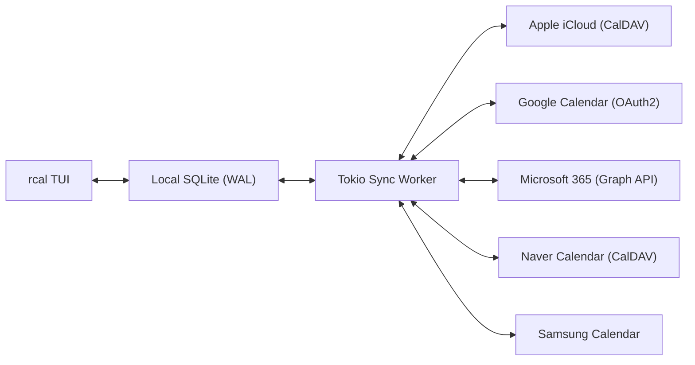
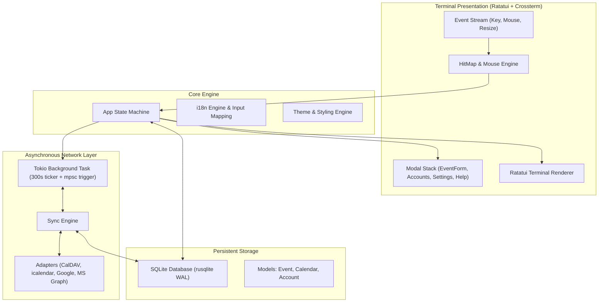

<div align="center">

```
  ██████╗  ██████╗ █████╗ ██╗     
  ██╔══██╗██╔════╝██╔══██╗██║     
  ██████╔╝██║     ███████║██║     
  ██╔══██╗██║     ██╔══██║██║     
  ██║  ██║╚██████╗██║  ██║███████╗
  ╚═╝  ╚═╝ ╚═════╝╚═╝  ╚═╝╚══════╝
```

### **支援多雲端同步的高效能、現代化滑鼠互動 Rust 終端機行事曆**

[](https://www.rust-lang.org)
[](../../LICENSE)
[](https://github.com/eeyees/rcal)
[](https://github.com/ratatui/ratatui)
[](https://www.sqlite.org)
[](https://tokio.rs)

<p align="center">
  🌐 <strong>Languages / 다국어 / 语言 / 言語 / Idiomas:</strong><br>
  <a href="../../README.md">English</a> •
  <a href="README.ko.md">한국어</a> •
  <a href="README.zh-CN.md">简体中文</a> •
  <strong>繁體中文</strong> •
  <a href="README.ja.md">日本語</a> •
  <a href="README.es.md">Español</a> •
  <a href="README.fr.md">Français</a> •
  <a href="README.de.md">Deutsch</a> •
  <a href="README.pt-BR.md">Português</a> •
  <a href="README.ru.md">Русский</a> •
  <a href="README.it.md">Italiano</a> •<br>
  <a href="README.id.md">Bahasa Indonesia</a> •
  <a href="README.vi.md">Tiếng Việt</a> •
  <a href="README.tr.md">Türkçe</a> •
  <a href="README.pl.md">Polski</a> •
  <a href="README.nl.md">Nederlands</a> •
  <a href="README.ar.md">العربية</a> •
  <a href="README.hi.md">हिन्दी</a> •
  <a href="README.bn.md">বাংলা</a> •
  <a href="README.sv.md">Svenska</a> •
  <a href="README.uk.md">Українська</a> •
  <a href="README.th.md">ภาษาไทย</a>
</p>

<p align="center">
  <a href="#-key-features">核心功能</a> •
  <a href="#-ui-views">畫面預覽</a> •
  <a href="#-controls">操作指南</a> •
  <a href="#-cloud-sync">雲端同步</a> •
  <a href="#-themes">主題風格</a> •
  <a href="#-installation">安裝執行</a> •
  <a href="#-architecture">系統架構</a>
</p>

---

</div>

`rcal` 是一款專為開發者、終端機愛好者與極客打造的輕量級、超低延遲 TUI 行事曆。它將 Google 行事曆的直覺視覺體驗融入終端機中，擁有**零延遲**、**全滑鼠互動**以及**穩健的多雲端雙向同步**能力。

---

## <a id="-key-features"></a>✨ 核心功能

- ⚡ **零延遲離線優先架構**：採用內嵌 SQLite WAL（預寫日誌）模式，毫秒級快速啟動與離線讀取。
- 🖱️ **全方位滑鼠互動支援**：支援點擊視圖分頁（月、週、日、待辦）、導航按鈕、雙擊日期進入日視圖、點擊時間軸建立活動、滾輪滾動瀏覽日期與時間線。
- 📅 **4 種直覺高密度行事曆視圖**：
  - **月視圖**：7 欄經典網格，含活動徽章與今日高亮。
  - **週視圖**：全週時間軸，搭配分段彩色活動方塊。
  - **日視圖**：同時段重疊活動智慧並列排版的高精時間表。
  - **待辦視圖 (Agenda)**：按日期分組的時間序活動串流。
- ☁️ **多雲端與 CalDAV 同步引擎**：
  - **Apple iCloud**：原生雙向 CalDAV 同步。
  - **Naver 行事曆**：CalDAV 自動探索與雙向同步。
  - **Google Calendar**：基於 OAuth2 憑證的 Google 行事曆 API。
  - **Microsoft 365 / Outlook**：Microsoft Graph REST API 配接器。
  - **Samsung Calendar**：三星雲端行事曆配接。
  - **背景非同步工作執行緒**：獨立 Tokio 執行緒每 5 分鐘或手動觸發同步，不卡頓 UI 介面。
- ⌨️ **Vim 鍵位與輸入法透明導航**：經典 `h/j/k/l` 游標移動；切換中文輸入法時自動對應，防止終端機嗶嗶聲或快捷鍵失效。
- 🌐 **原生多國語言 (i18n)**：自動偵測作業系統語系，支援按 `L` 鍵即時在多種語言間切換。
- 🎨 **豐富主題與深度自訂**：內建 7 款色彩風格（Modern Dark, Nord, Dracula, Forest, Sunset, Monokai, Solarized），可自訂週起始日（週日/週一/週六），管理分類與色彩標籤。

---

## <a id="-ui-views"></a>🖥️ 畫面預覽

```
┌── rcal v2026.11.02.1 ─────────────────────────────────────────────── [ L: 한/EN ] [ ? Help ] [ ⚙ Settings ] ──┐
│ [ 1:Month ] [ 2:Week ] [ 3:Day ] [ 4:Agenda ]    [ < ] [ Today ] [ > ]  2026-11-01 (Sun)   [ ⟳ Sync ]  │
├────────────────────┬───────────────────────────────────────────────────────────────────────────────────┤
│ Calendars          │                             November 2026                                         │
│ [x] ■ Personal     │  Sun         Mon         Tue         Wed         Thu         Fri         Sat      │
│ [x] ■ Work         │ ┌───────────┬───────────┬───────────┬───────────┬───────────┬───────────┬───────────┐ │
│ [x] ■ Holidays     │ │ 1  TODAY  │ 2         │ 3         │ 4         │ 5         │ 6         │ 7         │ │
│                    │ │■ 10:00 AM │■ 09:00 AM │           │■ 14:00 PM │           │■ 19:00 PM │           │ │
│ Accounts           │ │  Sprint   │  Standup  │           │  Design   │           │  Dinner   │           │ │
│ • iCloud (Syncing) │ ├───────────┼───────────┼───────────┼───────────┼───────────┼───────────┼───────────┤ │
│ • Google (Active)  │ │ 8         │ 9         │ 10        │ 11        │ 12        │ 13        │ 14        │ │
│                    │ │           │           │           │           │           │           │           │ │
├────────────────────┴───────────────────────────────────────────────────────────────────────────────────┤
│ [c] New Event  [m/w/d/a] Switch View  [h/j/k/l] Navigate  [/] Search  [a] Accounts  [s] Settings  [q] Quit │
└────────────────────────────────────────────────────────────────────────────────────────────────────────┘
```

---

## <a id="-controls"></a>⌨️ 鍵盤與滑鼠操作指南

### 🧭 操作指南 1: Navigation

| 快速鍵 | 滑鼠動作 | 功能說明 |
| :--- | :--- | :--- |
| `h` / `j` / `k` / `l` 或 方向鍵 | 點擊日期格 / 時間槽 | 游標向 左 / 下 / 上 / 右 移動 |
| `1` 或 `m` | 點擊 `[ 1:Month ]` 標籤 | 切換至 **月視圖** |
| `2` 或 `w` | 點擊 `[ 2:Week ]` 標籤 | 切換至 **週視圖** |
| `3` 或 `d` | 點擊 `[ 3:Day ]` 標籤 | 切換至 **日視圖** |
| `4` 或 `a` | 點擊 `[ 4:Agenda ]` 標籤 | 切換至 **待辦 (Agenda) 視圖** |
| `t` | 點擊 `[ Today ]` 按鈕 | 游標跳轉至今天 |
| `[` / `]` | 點擊 `[ < ]` / `[ > ]` 按鈕 | 上一個 / 下一個週期（月份/週/日） |
| 滾輪上下滾動 | 滾輪滾動 | 捲動時間軸或翻動日期 |
| 按兩下 | 按兩下日期格 | 從月視圖直接切換進入日視圖詳細畫面 |

### 📝 操作指南 2: Events & Modals

| 快速鍵 | 滑鼠動作 | 功能說明 |
| :--- | :--- | :--- |
| `c` 或 `n` | 點擊 `[ + New ]` 或空白時間槽 | 開啟新增活動表單視窗 |
| `Enter` | 點擊活動區塊 | 開啟所選活動詳情彈窗 |
| `e` | 點擊 `[ Edit ]` 按鈕 | 編輯活動內容 |
| `x` 或 `Delete` | 點擊 `[ Delete ]` 按鈕 | 刪除所選活動 |
| `Tab` / `Shift+Tab` | 點擊輸入欄位或按鈕 | 在表單欄位與按鈕間切換焦點 |
| `Esc` 或 `q` | 點擊 `[ Close ]` 或彈窗外背景 | 關閉目前彈窗 |

### ⚙️ 操作指南 3: System & Settings

| 快速鍵 | 滑鼠動作 | 功能說明 |
| :--- | :--- | :--- |
| `L` | 點擊 `[ L: 한/EN ]` 按鈕 | 切換介面顯示語言 |
| `s` | 點擊 `[ ⚙ Settings ]` 按鈕 | 開啟偏好設定（週首日、主題、語系） |
| `a` | 點擊側邊欄帳號選單 | 開啟雲端帳號管理員 |
| `b` | 點擊側邊欄收合按鈕 | 展開 / 收合側邊欄 |
| `r` | 點擊 `[ ⟳ Sync ]` 按鈕 | 立即執行背景雲端同步 |
| `?` | 點擊 `[ ? Help ]` 按鈕 | 顯示快速鍵說明文件 |
| `Ctrl+C` / `q` | - | 安全結束 `rcal` |

---

## <a id="-cloud-sync"></a>☁️ 多雲端與 CalDAV 協定同步

`rcal` 內建可靠的同步配接器，支援與各大雲端行事曆服務即時連線：



### Supported Providers

- **Apple iCloud**：透過 Apple ID 與 App 專用密碼建立 CalDAV 雙向同步。
- **Naver 行事曆**：透過 CalDAV 協定自動搜尋並同步 Naver 雲端日程。
- **Google Calendar**：透過 Google Cloud OAuth2 授權進行安全排程同步。
- **Microsoft 365 / Outlook**：透過 Microsoft Graph API 整合企業與個人行事曆。
- **Samsung Calendar**：支援三星雲端行事曆服務。

---

## <a id="-themes"></a>🎨 主題與外觀設定

按下 `s` 鍵進入**設定視窗**，打造符合個人風格的終端機環境：

### Built-in Color Palettes
- 🌙 **Modern Dark**：預設純淨俐落的深色介面
- ❄️ **Nord**：極具質感的北歐極光藍灰色系
- 🧛 **Dracula**：吸睛高對比的經典吸血鬼深色主題
- 🌲 **Forest**：柔和放鬆的森林抹茶大地綠調
- 🌆 **Sunset**：賽博龐克風格的紫橘漸層
- 🎨 **Monokai**：經典高亮程式碼編輯風格
- ☀️ **Solarized**：舒適護眼的低對比暗色主題

### 每週首日設定
可配合您的生活節奏將一週的起始日自訂為**星期日**、**星期一**或**星期六**。

---

## <a id="-architecture"></a>🏗️ 系統架構



---

## <a id="-installation"></a>🚀 安裝與執行

### 從原始碼建置

```bash
# Clone the repository
git clone https://github.com/eeyees/rcal.git
cd rcal

# Build release
cargo build --release

# Run
./target/release/rcal
```

### 透過 Cargo 全域安裝

```bash
cargo install --path .
rcal
```

### 本機資料庫存放位置

- **macOS**: `~/Library/Application Support/rcal/rcal.db`
- **Linux**: `~/.local/share/rcal/rcal.db`
- **Windows**: `%LOCALAPPDATA%\rcal\rcal.db`

---

## 🗺️ 🗺️ 開發藍圖

- [x] **階段 1：本機 TUI MVP**：月/週/日(重疊活動智慧分槽)/待辦視圖、100% 滑鼠點擊偵測、SQLite WAL 儲存、CRUD 彈窗。
- [x] **階段 2：CalDAV 同步引擎**：Apple iCloud 與 Naver 行事曆雙向同步、Tokio 背景工作執行緒、帳號管理介面。
- [x] **階段 3：多雲端整合與體驗優化**：Google Calendar API、Microsoft Graph 模組、輸入法透明對應、7 款主題與週首日設定。
- [ ] **階段 4：生態系擴充與開放協定**：
    - [x] 支援 AI Agent 串接的 MCP (Model Context Protocol) 伺服器
    - [ ] 外部訂閱用 WebCal / iCalendar (`.ics`) HTTP 匯出服務
    - [ ] 週期性循環活動規則（RFC 5545 RRULE）
    - [ ] 自然語言快速建立行程（例如 `rcal add "明天上午 10 點團隊週會"`）
    - [ ] 作業系統桌面原生通知推播

---

## 📜 📜 開源授權

本專案採用 **MIT 授權條款** 開源釋出。完整授權內容請參閱 [`LICENSE`](../../LICENSE) 檔案。
